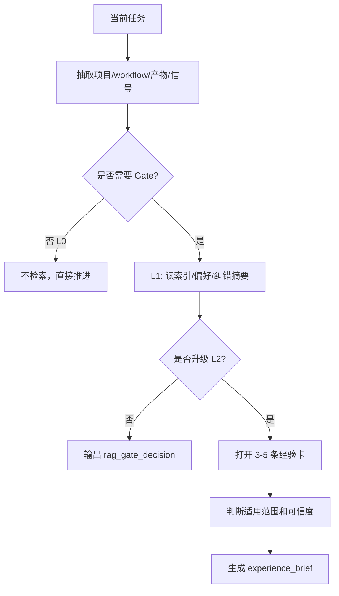

# Experience RAG Rules

> 用途：规定产品管理 person 如何检索、阅读、应用和沉淀经验。

## 1. 什么时候必须经过 RAG Gate

出现以下任一情况，必须先经过 RAG Gate；通过 Gate 后再决定是否读取经验卡：

- 用户要求产品判断、PRD、项目汇报、需求分析、范围取舍。
- 用户要做决策，尤其涉及技术选项、架构、后台、Agent、数据。
- 用户说“听不懂、不对、不是我要的、下次要这样”。
- 要生成正式开发输入、需求卡、下游文件或协作复核记录。
- 同一项目继续推进，且可能受历史偏好、纠错或决策影响。

轻量问答可以不进入 Gate；只要准备追问、结论会影响后续项目文件，或任务会产出正式报告/文档，就要进入 Gate。

## 1.1 两个强制嵌入点

| 位置 | 什么时候必须过 Gate | 默认层级 | 目的 | 禁止 |
| --- | --- | --- | --- | --- |
| 提问前 | 准备向用户追问、质问、grill、确认方向前 | L1 | 看索引、用户偏好和项目纠错摘要，再决定问不问、问什么 | 禁止直接抽象出大而全的问题库 |
| 重任务入口 | 准备产出汇报、需求文档、PRD、竞品分析、技术翻译报告、指标/验收文档、正式需求包等报告或文档前 | L2 | 召回少量高相关经验，形成 `experience_brief` 和重思考约束 | 禁止先套模板写报告，再补经验 |

重任务内部如果还需要追问，默认复用入口的 `experience_brief`。只有项目、workflow、产物或决策点发生变化，才重新进入 Gate。提问和质问本身不是重任务，只有当它服务于正式报告或文档产出时，才继承重任务门禁。

## 1.2 轻重边界

| 类型 | 例子 | RAG 要求 |
| --- | --- | --- |
| 轻任务 | 解释、下一步建议、单轮判断、仅提问/质问 | 只有准备提问或影响后续项目文件时过 Gate；默认 L0/L1 |
| 中任务 | 非正式草稿、局部审阅、单个框架梳理 | 影响结论时过 Gate；默认 L1，命中强信号才 L2 |
| 重任务 | PRD、需求分析报告、竞品分析报告、项目汇报、技术翻译报告、指标框架报告、验收文档、正式需求包 | 入口 L2，形成 `experience_brief`；内部追问默认复用 brief |

## 1.3 RAG 层级

| 层级 | 读取范围 | 适用场景 | 输出 | 上限 |
| --- | --- | --- | --- | --- |
| L0 无检索 | 不读经验库 | 轻量解释、不会追问、不会影响项目文件 | 无 | 0 |
| L1 索引级 Gate | `EXPERIENCE_INDEX.md`、当前项目经验索引、用户偏好/纠错摘要 | 提问前、轻量判断、持续项目的方向校准 | `rag_gate_decision`、发问约束 | 不打开经验卡 |
| L2 经验卡检索 | L1 命中后再打开经验卡 | 重任务入口、强纠错、关键决策、高风险文档 | `experience_brief`、applied_rules | 3-5 条 |

升级到 L2 的条件：

- 本轮要产出正式报告、文档或需求包。
- L1 命中高置信纠错、用户偏好或项目规则，且会影响结论。
- 当前决策代价高，错误会导致返工、误导用户或错误进入开发。

不要因为“有经验库”就自动打开经验卡。

## 2. 检索 query 怎么生成

从用户输入和当前任务中抽取 6 类词：

| 类别 | 示例 |
| --- | --- |
| 项目 | 示例项目、某后台、某 agent |
| workflow | project-briefing、prd-report、demand-management |
| 产物 | 汇报、PRD、需求卡、测试场景、UI brief |
| 信号 | 听不懂、如何决策、兜底、需求进开发 |
| 产品区域 | 首页、核心工作台、详情页、后台运营 |
| 决策维度 | 范围、优先级、技术选项、数据、体验、权限 |

先用精确词，再用同义词。不要只搜一个宽泛词。

## 3. Gate 顺序

## 4. 召回数量

默认先做 L1，不打开经验卡。只有进入 L2 时才读经验卡：

| 类型 | 默认上限 |
| --- | --- |
| pre-question L1 | 0 条经验卡 |
| normal L1 | 0 条经验卡 |
| normal L2 | 1-3 条经验卡 |
| heavy-task L2 | 3-5 条经验卡 |

超过 5 条说明 query 太宽，要收缩到具体项目、workflow、产物或决策点。

## 4.1 experience_brief 复用

重任务入口生成一次 `experience_brief`，后续报告写作和内部追问优先复用它。

只有以下任一变化发生，才重新检索：

- 项目变化。
- workflow 变化。
- 产物类型变化。
- 决策点变化。
- 用户明确纠正之前的方向。

如果只是同一份报告内部补字段、补表达、补格式，不重新检索。

## 5. 应用规则

经验应用前必须判断：

| 检查 | 通过标准 |
| --- | --- |
| 范围 | 当前项目、产物、workflow 与经验范围匹配 |
| 可信度 | `validated` 可作为默认规则；`observed` 只做提醒 |
| 时效 | 没有被新文件或新用户要求覆盖 |
| 证据 | 能回到来源文件或用户原话 |
| 边界 | 不适用条件没有命中 |

冲突优先级：

1. 用户当前明确要求。
2. 当前项目已验证经验。
3. 当前用户跨项目偏好。
4. 全局 PM 经验。
5. 旧记忆或未验证候选。

## 6. 经验如何进入输出

不要在最终回答里堆“我检索了经验库”。只在判断里自然体现：

- 汇报要先讲用户如何决策。
- 技术选项要写差异、代价、风险、兜底。
- 正式开发输入要有需求编号和审核状态。
- 用户说听不懂时，先人话解释，再技术细节。

如果经验直接影响结论，要写一句“这里沿用之前项目经验：...”并给出文件路径。

## 7. 什么时候写入新经验

任务结束后做一次轻量判断：

| 问题 | 是则写入 |
| --- | --- |
| 用户是否明确表达了偏好或纠错？ | 写入 `user/` 或项目经验 |
| 是否出现同类错误第二次？ | 写入纠错经验 |
| 是否形成了可复用的产品判断规则？ | 写入经验卡 |
| 是否影响后续文件管理或协作审核？ | 写入经验卡 |
| 是否只是一次性项目事实？ | 不写入经验库，写项目正式文档 |

## 8. 写入状态

- 未确认但可能复用：先写 `experience/inbox/`，状态 `candidate`。
- 用户明确确认：写到项目目录或 `global/`，状态 `validated`。
- 单次任务观察：状态 `observed`。
- 被新规则覆盖：把旧经验状态改为 `superseded`，不要删除。
