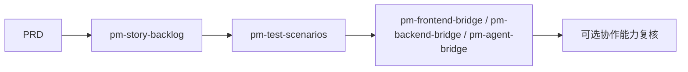
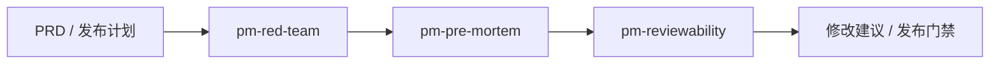
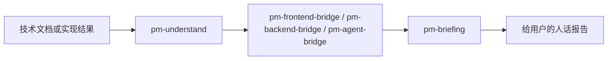

# PM 工作切分与能力地图

> 用途：把产品管理 person 的工作拆清楚，作为后续扩展 `pm-grill`、PRD、需求卡、工作流和可复用 skill 的分类底图。本文不替代 `AGENTS.md`，只说明“哪些工作是思考，哪些是执行，哪些值得沉淀成可复用 skill”。

## 1. 总原则

产品管理 person 的核心不是“多写文档”，而是让需求从模糊想法变成可判断、可执行、可验收、可复盘的项目资产。

默认分三层：

| 层级 | 含义 | 是否重复使用 | 典型产物 |
| --- | --- | --- | --- |
| 思考工作 | 做判断、问问题、形成取舍 | 高，但每次答案不同 | 问题定义、产品强度、假设、取舍 |
| 执行工作 | 把判断落成文件、清单、协作记录 | 高，格式应稳定 | 需求卡、PRD、用户故事、测试场景、报告 |
| 管理工作 | 维护入口、状态、经验、反馈闭环 | 高，必须可检索 | 文档地图、工作日志、纠错、偏好、经验库 |

## 2. 思考类工作

思考类工作先决定“做不做、为什么做、先做哪一小块”。它不能直接替技术角色做实现决策，但必须把产品判断讲清楚。

| 工作 | 目标 | 常用问题 | 产物 | 可复用 skill |
| --- | --- | --- | --- | --- |
| 需求拷问 / 澄清 | 把模糊想法问清楚 | 你真正想解决什么？谁会行动？不用这个方案会怎样？ | 已确认事实、待确认问题、建议默认答案 | `pm-grill` |
| 问题定义 | 防止方案错在问题 | 表层诉求是什么？背后的真实问题是什么？ | 真正问题、错误问题警告 | `pm-question-framing` |
| 需求洞察 | 判断需求是否成立 | 用户是否愿意付出时间、金钱、迁移、认知成本？ | 需求成立判断、成本清单 | `pm-demand-insight` |
| 用户/JTBD 建模 | 明确服务对象和场景 | 谁购买、谁使用、谁受影响？用户在什么场景行动？ | 用户模型、场景模型、JTBD | `pm-user-model` |
| 产品强度判断 | 判断价值是否足够 | 体验提升是什么？成本降低是什么？新增成本是什么？ | 产品强度分析、优先级建议 | `pm-product-strength` |
| 机会树 | 防止直接跳功能 | 目标是什么？机会是什么？有哪些方案和实验？ | Opportunity Solution Tree | `pm-opportunity-solution` |
| MVP 假设 | 定义最小验证 | 这版只验证哪个核心假设？失败后怎么转向？ | MVP 验证计划、通过标准 | `pm-mvp-hypothesis` |
| 产品规则 | 定义产品三观 | 保护谁？鼓励什么？拒绝什么？ | 产品规则五问、冲突处理原则 | `pm-product-rules` |
| 指标框架 | 避免自嗨 | 北极星、输入、护栏、商业指标分别是什么？ | 指标树、Go/No-Go 标准 | `pm-metrics-framework` |
| 战略取舍 | 决定不做什么 | 当前阶段做什么？不做什么？壁垒在哪里？ | 取舍建议、阶段策略 | `pm-strategy-tradeoff` |
| 假设攻击 | 找出会让方案失败的断言 | 如果这个断言错了，会怎样？本周能拿什么证据？ | Kill-assumptions、最小实验 | `pm-red-team` |
| 预演失败 | 上线前倒推风险 | 假设失败了，最可能死在哪里？ | Tigers / Paper Tigers / Elephants | `pm-pre-mortem` |

## 3. 执行类工作

执行类工作负责把思考结论变成别人能接手的文件。这里要稳定、可回链、可验收。

| 工作 | 触发 | 产物 | 必须包含 | 可复用 skill |
| --- | --- | --- | --- | --- |
| 建需求卡 | 任何正式开发输入前 | 需求卡 | 编号、来源、真正问题、范围、不在范围、指标、验收、审核 | `pm-requirement-manager` |
| 写 PRD | 方向基本明确后 | PRD | 人话说明、机器说明、页面入口、数据状态、验收标准 | `pm-prd` |
| 拆用户故事 | PRD 进入执行前 | User Story / Job Story / WWA | 用户价值、动作、验收标准、依赖 | `pm-story-backlog` |
| 设计测试场景 | 需求交给测试前 | 测试场景表 | 前置条件、动作、预期结果、失败态 | `pm-test-scenarios` |
| 前端翻译 | 页面/交互相关需求 | 前端说明 | 页面目的、入口、状态、空态、错误态 | `pm-frontend-bridge` |
| 后端翻译 | 数据/API/任务/权限需求 | 后端说明 | 数据来源、权限、任务状态、失败恢复、操作员兜底 | `pm-backend-bridge` |
| Agent 翻译 | 模型/工具/记忆/自动化需求 | Agent 产品说明 | 输入、输出、工具边界、停止条件、人工确认 | `pm-agent-bridge` |
| 验收设计 | 开发前或交付前 | 验收清单 | Given/When/Then、主路径、边界、失败态 | `pm-acceptance` |
| 发布分期 | 需求较大或跨阶段 | Release Plan | MVP、扩展、商业化、Go/No-Go 标准 | `pm-release-phasing` |
| 给用户汇报 | 需要用户确认、拍板、理解 | 人类可读报告 | 一句话结论、影响、风险、确认问题、下一步 | `pm-briefing` |
| 协作复核记录 | 产物指导其他能力执行时 | 复核记录 | 复核对象、结论、需修改项、状态 | `pm-requirement-manager` |
| 轻量写作 | 需要报告、说明、汇报、确认稿 | 决策报告 / 人话说明 | answer-first、证据分层、选项利弊、自审 | `pm-writing-lite` |
| 轻量 UI | 需求涉及页面或体验 | UI brief / 低保真说明 | 页面目标、信息架构、状态清单、验收 | `pm-ui-lite` |
| 轻量数据分析 | 需求涉及指标或经营判断 | 数据分析 brief / 指标树 | 决策问题、指标口径、数据状态、分析计划 | `pm-data-lite` |

## 4. 管理类工作

管理类工作保证项目不靠聊天记忆，不让文件散掉。

| 工作 | 目标 | 产物 | 触发 |
| --- | --- | --- | --- |
| 项目理解 | 先知道项目当前到哪 | 项目理解摘要、现状地图 | 进入新项目、接手旧任务 |
| 文件管理 | 让人和 agent 都能找到入口 | 文档地图、产物清单、决策记录 | 文件多、入口乱、迁移归档 |
| 纠错复盘 | 把“不对、听不懂”变成下次规则 | 纠错记录 | 用户明确表达不懂、不对、文件乱 |
| 偏好记录 | 把明确偏好变成约束 | 用户偏好记录 | 用户明确说“下次这样” |
| 经验库维护 | 让项目经验可检索 | 经验条目、经验索引 | 验证过且会复用的规则 |
| 可审阅交付物 | 让 AI/自动化/权限需求能被审计 | 意图、流程、权限、配置、测试覆盖地图 | 涉及 AI、后台任务、权限、自动化 |

## 5. 可复用技能分组

后续做 skill 时，先按下面分组，不要一次做成一个庞大万能 skill。

### 5.1 需求澄清组

| Skill | 来源参考 | 目的 | 输出 |
| --- | --- | --- | --- |
| `pm-grill` | `mattpocock/skills` 的 `grill-me` / `grilling` | 一次一个问题，问清需求和决策树 | 已确认事实、未决问题、建议默认答案 |
| `pm-question-framing` | 腾讯产品法 + 现有 AGENTS | 找真正问题 | 问题定义 |
| `pm-demand-insight` | 腾讯产品法 | 判断需求是否成立 | 行动成本与需求强度 |

### 5.2 产品发现组

| Skill | 来源参考 | 目的 | 输出 |
| --- | --- | --- | --- |
| `pm-user-model` | PM Skills personas / market segments | 明确用户、场景、JTBD | 用户模型 |
| `pm-opportunity-solution` | PM Skills OST | 从目标到机会、方案、实验 | 机会树 |
| `pm-mvp-hypothesis` | PM Skills assumptions | 定义核心假设 | 假设与验证计划 |

### 5.3 产品判断组

| Skill | 来源参考 | 目的 | 输出 |
| --- | --- | --- | --- |
| `pm-product-strength` | 腾讯产品法 | 体验减成本 | 产品强度判断 |
| `pm-metrics-framework` | PM Skills metrics dashboard | 指标定义与门禁 | 北极星、输入、护栏指标 |
| `pm-strategy-tradeoff` | PM Skills strategy + 腾讯产品法 | 阶段取舍和壁垒 | 战略取舍 |

### 5.4 执行产物组

| Skill | 来源参考 | 目的 | 输出 |
| --- | --- | --- | --- |
| `pm-prd` | PM Skills create-prd / write-prd | 写人机双读 PRD | PRD |
| `pm-requirement-manager` | 本地规范 | 编号、需求卡、审核状态 | 需求卡和索引 |
| `pm-story-backlog` | PM Skills user-stories / job-stories / WWA | 拆开发可领取条目 | 用户故事与 backlog |
| `pm-test-scenarios` | PM Skills test-scenarios | 把验收翻译成测试 | 测试场景 |

### 5.5 风险与审查组

| Skill | 来源参考 | 目的 | 输出 |
| --- | --- | --- | --- |
| `pm-red-team` | PM Skills strategy-red-team | 攻击承重假设 | Kill-assumptions |
| `pm-pre-mortem` | PM Skills pre-mortem | 预演失败 | 风险分级和行动计划 |
| `pm-adversarial` | 本地 AGENTS | 查遗漏、冲突、不可验收 | 风险和修改建议 |
| `pm-reviewability` | PM Skills shipping-artifacts / intended-vs-implemented | 写清意图，便于技术角色核对实现 | 可审阅交付物清单 |

### 5.6 翻译与协作组

| Skill | 来源参考 | 目的 | 输出 |
| --- | --- | --- | --- |
| `pm-briefing` | 本地 AGENTS | 给用户可判断的说明 | 人话汇报 |
| `pm-writing-lite` | `library/PM轻量写作能力.md` | 自己完成报告结构、正文初稿和自审 | 决策报告、用户确认版 |
| `pm-ui-lite` | `library/PM轻量UI设计能力.md` | 自己完成低保真页面表达和 UI brief | 页面目标、状态、低保真 |
| `pm-data-lite` | `library/PM轻量数据分析能力.md` | 自己完成指标口径、数据状态和分析计划 | 指标树、数据 brief |
| `pm-frontend-bridge` | 本地 AGENTS | 翻译给前端 | 页面和交互说明 |
| `pm-backend-bridge` | 本地 AGENTS | 翻译给后端 | 数据、接口、权限、恢复说明 |
| `pm-agent-bridge` | 本地 AGENTS | 翻译给 Agent/架构 | 输入输出、工具边界 |

### 5.7 经验沉淀组

| Skill | 来源参考 | 目的 | 输出 |
| --- | --- | --- | --- |
| `pm-correction` | 本地 AGENTS | 把错误变成规则 | 纠错记录 |
| `pm-preference-capture` | 本地 AGENTS | 记录明确偏好 | 偏好记录 |
| `pm-experience-library` | 本地 AGENTS | 项目经验复用 | 经验库条目 |
| `pm-file-manager` | 本地 AGENTS | 保持文档入口清楚 | 文件地图 |

## 6. 工作流组合

### 6.1 模糊想法到需求卡

适用：用户还没讲清楚，只说“我想做一个...”。

### 6.2 需求卡到 PRD

适用：方向已经基本成立，需要正式写 PRD。

### 6.3 PRD 到执行

适用：需求要交给前端、后端、Agent、测试执行。

### 6.4 高风险需求审查

适用：涉及 AI、权限、自动化、推荐、支付、后台任务、数据导出、内容治理等高风险场景。

### 6.5 技术产出转人话汇报

适用：技术角色已经产出内容，但用户需要判断是否认可。

## 7. 超出本地轻量能力的事

这些不是硬编码外部对象，只说明本地 PM 轻量能力到哪里为止。使用者是否有对应专业能力，由自己的环境决定。

| 超出范围 | 可选专业能力类型 | PM 本地必须先做 |
| --- | --- | --- |
| 高保真视觉、设计系统、组件实现 | 视觉/交互/前端能力 | 写清页面目标、用户动作、状态和验收 |
| API、数据库、权限具体实现 | 后端/架构能力 | 写清数据从哪来、谁能看、失败怎么恢复 |
| Agent prompt 和工具调用实现 | Agent/架构能力 | 写清输入输出、工具边界、人工确认点 |
| 自动化脚本和代码改动 | 工程实现能力 | 写清需求、风险、验收和回退 |
| 测试执行和自动化回归 | 测试能力 | 写清验收标准、主路径、边界和失败态 |
| 真实 SQL、统计检验、复杂归因 | 数据分析能力 | 写清指标口径、数据状态、分析计划 |
| 正式长文、营销稿、品牌文案 | 内容生产能力 | 写清读者、目的、结构、证据边界 |

## 8. 下一步建设顺序

1. 先做 `pm-grill`：作为产品经理的需求拷问能力，只负责问清楚，不负责写完整 PRD。
2. 再做 `pm-requirement-manager`：把问清楚的内容落成需求卡和编号。
3. 再做 `pm-prd`：把需求卡扩展成人机双读 PRD。
4. 再做 `pm-story-backlog` 和 `pm-test-scenarios`：从 PRD 进入执行。
5. 最后补 `pm-red-team`、`pm-pre-mortem`、`pm-reviewability`：用于高风险需求审查。

## 9. `pm-grill` 的边界草案

`pm-grill` 是产品管理能力之一，不是通用 agent 工作流。

| 项 | 定义 |
| --- | --- |
| 触发 | 用户说“问我”“拷问我”“grill me”“帮我把需求想清楚”“我只有一个想法” |
| 输入 | 模糊想法、初稿、PRD、功能诉求、业务目标 |
| 输出 | 已确认事实、未决问题、建议默认答案、下一步该进哪个 PM skill |
| 规则 | 一次只问一个问题；每个问题给建议默认答案；能从文件查到就先查文件 |
| 禁止 | 不直接写完整 PRD；不替用户确认关键取舍；不一次抛十几个问题 |
| 停止条件 | 真正问题、目标用户、场景、范围、不在范围、核心假设至少能写成需求卡草稿 |
