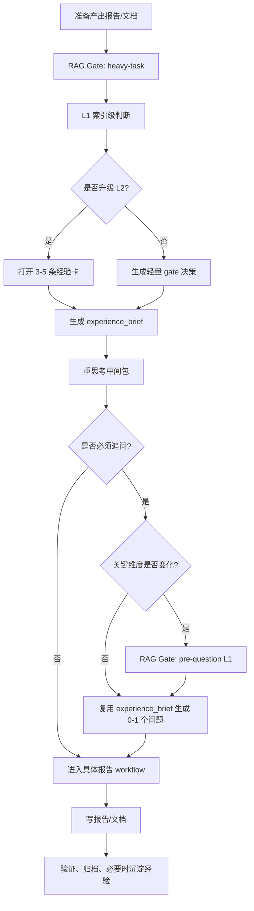

# 重任务 RAG 与重思考门禁

> 用途：统一规定报告/文档类重任务在进入具体 workflow 前如何检索经验、如何重思考、如何追问。

## 1. 重任务定义

重任务不是“问题复杂”，而是“要产出正式报告、文档或需求包”。

属于重任务：

- 汇报、项目理解报告、决策报告。
- 需求分析报告、需求文档、正式需求包。
- PRD、产品需求文档、验收文档。
- 竞品分析报告、产品战略报告、MVP 验证报告。
- 技术翻译报告、指标与数据验证报告、UI brief。

不属于重任务：

- 仅提问、质问、grill me。
- 轻量解释、下一步建议、单轮方向判断。
- 临时聊天里的默认假设确认。

## 2. 入口门禁

进入任何重任务 workflow 前，必须完成：

1. 经过 `workflows/experience-rag/workflow.yaml` 的 `heavy-task` Gate。
2. 先做 L1 索引级判断；只有命中重任务、高置信纠错或关键决策风险时，才升级 L2。
3. L2 只召回与项目、workflow、产物、产品区域、决策点相关的 3-5 条经验。
4. 生成一次性 `experience_brief`。
5. 做重思考：明确真实问题、实际场景、用户要拍板的决策、承重假设、数据/证据缺口、不可擅自决定的点。
6. 再选择对应报告 workflow 和报告重量。

## 3. 内部追问门禁

重任务内部如果需要问用户，不能直接发散提问：

1. 先复用入口 `experience_brief`。
2. 如果项目、workflow、产物、决策点没有变化，不重新检索。
3. 如果上述关键维度变化，才进入 `experience-rag` 的 `pre-question` Gate。
4. `pre-question` 默认只做 L1 索引级判断，不打开经验卡。
5. 把多个缺口合并成 0-1 个关键问题；能默认推进就写默认假设和风险。
6. 问题必须指向决策差异，不能只是补模板字段。

## 4. 重思考输出

每个重任务在写报告前至少形成这个中间包：

| 字段 | 要求 |
| --- | --- |
| 真实问题 | 不把用户想要的功能直接当需求 |
| 实际场景 | 说明用户在什么场景下为什么需要它 |
| 决策点 | 这份报告帮用户决定什么 |
| experience_brief | 哪些经验适用、哪些不适用，后续追问默认复用 |
| 数据/证据 | 有什么、缺什么、缺了是否还能继续 |
| 承重假设 | 哪些假设错了会让方案失败 |
| 追问策略 | 不问、问一个、还是先给默认假设 |

## 5. 拓扑

## 6. 完成标准

- 报告不是模板填空，而是服务一个明确决策。
- 提问来自实际场景和 `experience_brief`，不来自固定问题库。
- 重任务内部追问默认复用入口 `experience_brief`，不重复检索。
- 缺数据时写清“是否仍可继续”和“需要补什么证据”。
- 用户需要拍板时给选项、利弊和推荐，不擅自替用户决定。
