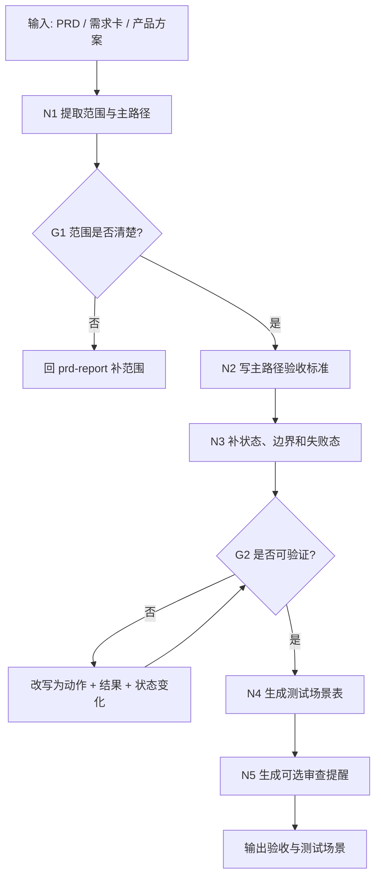

# 验收与测试场景工作流拓扑

## 1. 目标

把 PRD 或需求卡转成能检查、能复现、能交接给测试和开发的验收标准。

这个 workflow 不执行测试，只定义测试应该验证什么。

## 2. 拓扑图

## 3. 节点备注

| 节点 | 责任 | 输入 | 输出 | 注意 |
| --- | --- | --- | --- | --- |
| N1 提取范围与主路径 | 明确本次验收覆盖什么 | PRD、需求卡 | 范围和主路径 | 不在范围也要写 |
| N2 写主路径验收 | 用 Given/When/Then 写可检查标准 | 主路径 | 验收标准 | 不用“优化、支持” |
| N3 补边界失败态 | 补空态、加载、错误、权限、异常 | 验收标准 | 边界清单 | 先覆盖高风险 |
| G2 可验证门禁 | 检查每条是否能执行 | 验收标准 | 通过/回写 | 必须有观察结果 |
| N4 生成测试场景表 | 转成测试可用表格 | 验收标准 | 场景表 | 测试执行另走测试角色 |

## 4. 输出包

| 产物 | 作用 | 默认状态 |
| --- | --- | --- |
| 验收标准 | 判断需求是否完成 | 草稿/待确认 |
| 测试场景表 | 给测试或开发自测使用 | 草稿 |
| 边界与失败态 | 防止只测主路径 | 草稿 |
| 回归范围提示 | 告诉后续哪些旧能力可能受影响 | 可选 |
