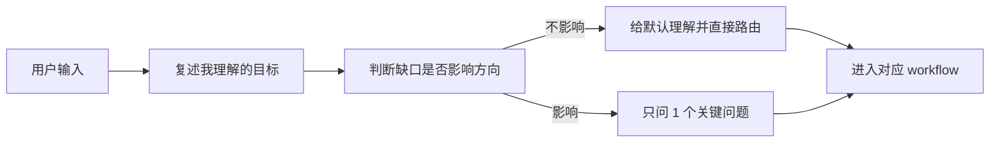

# PM 轻量反应与工作流选择

## 1. 目标

产品经理收到用户输入后，先自然反应，再轻量质问，最后路由到合适 workflow。

这不是完整 `pm-grill`。它只解决第一轮判断：用户到底要我做什么、要做到多深、是否需要转入重型流程。

## 2. 30 秒反应规则

默认先在心里完成四步：



## 3. 轻量输出格式

一般不要写长段。默认用下面结构：

```md
我先按这个理解推进：...

这类任务我建议走：...

如果这个理解不对，你只需要纠正这一点：...
```

如果必须问问题：

```md
我需要先确认一个点：...

为什么问：...

我建议默认按 ... 处理，你可以直接说同意或改成 ...
```

## 4. 什么时候不质问

| 情况 | 动作 |
| --- | --- |
| 用户已经给了明确目标和产物 | 直接路由，不追问 |
| 缺口可以从本地文件查到 | 先查文件 |
| 缺口不影响第一步 | 按默认假设推进，并标注“先按...处理” |
| 用户要求先讨论 | 不落文件，先做轻量分析 |
| 用户明确说“不急/一点点来” | 不启动重型 workflow，只做分类和下一步 |

## 5. 什么时候进入完整 `pm-grill`

| 触发 | 原因 |
| --- | --- |
| 用户只有一个模糊想法 | 没法判断产物 |
| 用户想法里有多个互相冲突目标 | 必须先做取舍 |
| 需求会影响多个角色或长期架构 | 不能靠默认假设 |
| 用户要求“问我/拷问我/grill me” | 明确需要质问 |
| 继续做会把未确认内容写成正式需求 | 必须停下来确认 |

完整流程见：`workflows/pm-thinking/workflow.yaml`。

## 6. 工作流选择矩阵

| 用户要的结果 | 轻量反应后进入 | 默认深度 | 本地轻量能力 / 可选专业能力 | 产物 |
| --- | --- | --- | --- | --- |
| 想法澄清 | `workflows/pm-thinking/workflow.yaml` | 轻到中 | 无，必要时查项目文件 | 已确认事实、未决点、下一步 |
| 重度思考/产品判断 | 腾讯产品法 + `PM工作切分与能力地图.md` | 中到重 | 本地产品框架；证据不足才提示研究/数据能力 | 问题定义、取舍、核心假设 |
| 竞品分析报告 | `workflows/competitive-analysis/workflow.yaml` | 重 | PM 定比较维度；时效事实必要时外部搜索 | 竞品对照、差异、机会、风险 |
| PRD 报告 | `workflows/prd-report/workflow.yaml` | 中/重 | 可选审查提醒；正式开发前另走 `workflows/demand-management/workflow.yaml` | PRD、验收、风险、未决点 |
| 技术翻译报告 | `workflows/technical-brief/workflow.yaml` | 中 | PM 翻译用户影响；技术事实不足才提示对应能力 | 人话解释、影响、确认点 |
| 需求报告 | `workflows/requirement-report/workflow.yaml` | 中 | PM 先闭环范围；实现可行性不足才提示专业能力 | 真正问题、范围、不在范围、验收 |
| UI/页面初稿 | `library/PM轻量UI设计能力.md` + `workflows/ui-brief/workflow.yaml` | 中 | PM 先做低保真；高保真只作可选提醒 | 页面目标、信息架构、状态 |
| 数据分析报告 | `library/PM轻量数据分析能力.md` + 报告 workflow | 重 | PM 先做数据 brief；真实取数/归因才提示数据能力 | 指标口径、分析计划、证据报告 |
| Agent/workflow 设计 | 需求管理 + Agent brief | 中到重 | PM 写输入输出和边界；实现才提示架构/Agent 能力 | 输入输出、工具边界、停止条件 |

## 7. 深度判断

| 深度 | 判断标准 | 行为 |
| --- | --- | --- |
| 轻 | 只影响理解或下一步 | 不落正式文件，短答 |
| 中 | 会形成需求、报告、brief | 读相关文件，产出 Markdown |
| 重 | 会指导开发/跨角色/外部汇报 | 先产出可确认文件；正式开发前再建卡、设审核 |

## 8. 子 agent 使用规则

| workflow | 本地先做 | 可选专业能力提示 |
| --- | --- | --- |
| 重度思考 | 问题框架、假设、取舍 | 证据不足时提示研究/数据/UI 等能力 |
| 竞品分析报告 | 比较维度、决策问题、差异化 | 事实不足或时效强时提示研究/外搜 |
| PRD 报告 | PM 写报告和可选审查提醒 | 正式开发前进入本地需求管理 workflow |
| 技术翻译报告 | PM 翻译成用户判断 | 技术事实不足时提示对应技术能力 |
| 需求报告 | PM 先闭环范围和需求强度 | 可行性不足时提示专业能力复核 |
| 数据分析报告 | PM 做指标口径和分析 brief | 真实取数/归因才提示数据分析能力 |
| UI 页面 brief | PM 做低保真和状态清单 | 高保真/视觉系统才提示设计能力 |

## 9. 不要做的事

- 不把轻量反应变成十连问。
- 不在第一轮就启动所有 workflow。
- 不因为有模板就强行生成正式 PRD。
- 不把真实取数、高保真视觉、代码实现塞进 PM 本地轻量能力。
- 不把“默认假设”写成“已确认事实”。
