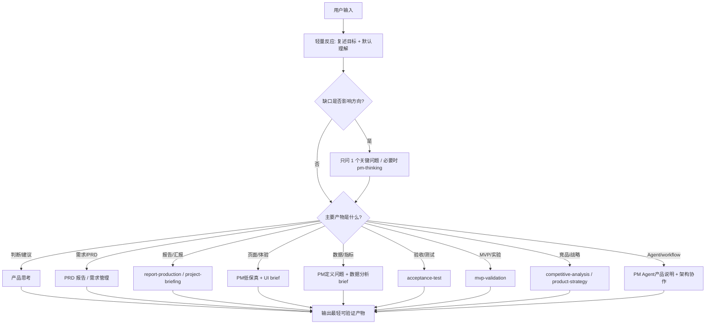

# PM 总控路由流程

## 1. 目标

让产品管理 person 先判断“这次该做什么”，再选择能力，而不是默认写长文档。

第一步永远先走轻量反应层：`workflows/controller/workflow.yaml`。只有缺口会影响方向，才进入完整质问。

## 2. 路由步骤

## 3. 路由表

| 信号 | 先走 | 输出 | 外部能力只作可选提醒 |
| --- | --- | --- | --- |
| “我有个想法” | `workflows/pm-thinking/workflow.yaml` | 已确认事实、未决点、建议默认答案 | 通常不需要 |
| “该不该做” | 腾讯产品法判断 | 问题定义、产品强度、取舍 | 通常不需要 |
| “分析需求/判断想法/整理反馈” | `workflows/requirement-report/workflow.yaml` | 需求成立判断、优先级、最低成本验证 | 确认继续后再转 PRD |
| “写PRD/生成产品需求文档” | `workflows/prd-report/workflow.yaml` | PRD 报告、验收、风险、未决点 | 正式开发前再转 `workflows/demand-management/workflow.yaml` |
| “指标怎么定/怎么验证成功” | `library/PM轻量数据分析能力.md` + `workflows/metrics-framework/workflow.yaml` | 指标树、口径、数据缺口、Go/No-Go | 真实取数才提示数据分析能力 |
| “怎么验收/拆测试场景” | `workflows/acceptance-test/workflow.yaml` | 验收标准、测试场景、边界失败态 | 执行测试才提示测试能力 |
| “MVP怎么验证/先验证什么” | `workflows/mvp-validation/workflow.yaml` | 承重假设、最低成本实验、Kill 标准 | 指标不清先转 metrics-framework |
| “竞品分析/对比竞品” | `workflows/competitive-analysis/workflow.yaml` | 对照矩阵、启发、差异化、取舍 | 时效事实必须现查 |
| “产品战略/机会树/阶段取舍” | `workflows/product-strategy/workflow.yaml` | 机会树、战略画布、取舍 | 单个需求转 requirement-report |
| “页面怎么设计/UI brief” | `library/PM轻量UI设计能力.md` + `workflows/ui-brief/workflow.yaml` | 页面目标、信息架构、用户动作、状态 | 高保真才提示视觉能力 |
| “技术方案讲成人话” | `workflows/technical-brief/workflow.yaml` | 用户影响、技术影响、数据权限、兜底 | 架构争议才提示架构能力 |
| “做报告/汇报” | `library/PM轻量写作能力.md` + 报告 workflow | 报告大纲或报告文件 | 正式长文/真实数据/高保真才提示专业能力 |
| “页面怎么设计” | PM 轻量 UI brief | 页面目的、信息架构、状态 | 高保真才提示视觉能力 |
| “分析数据” | PM 轻量数据 brief | 指标口径、分析计划 | 真实分析才提示数据能力 |
| “Agent 怎么设计” | PM Agent brief | 输入输出、工具边界、失败边界 | 实现或架构定稿才提示专业能力 |

## 4. 工作流与辅助 agent 配置

| 工作流 | 适用任务 | 默认深度 | PM 先做 | 可选专业能力提醒 |
| --- | --- | --- | --- | --- |
| 轻量质问 | 模糊想法、方向不清 | 轻 | 1 个关键问题 + 默认答案 | 无 |
| 重度思考 | 方向会影响战略、阶段、取舍 | 中/重 | 问题定义、产品强度、核心假设 | 研究/数据/UI 只作为证据缺口提醒 |
| 竞品分析报告 | 需要比较竞品、市场做法、机会 | 重 | 定义比较维度和决策问题 | 必要时外部搜索或研究能力 |
| 需求分析报告 | 判断想法/反馈是否构成需求 | 中 | 真正问题、需求强度、优先级、最低成本验证 | 只给可选审查提醒；确认后转 PRD |
| PRD 报告 | 把需求写成可确认报告 | 中/重 | PRD、验收标准、风险、未决点 | 只给可选审查提醒；正式开发前转 `workflows/demand-management/workflow.yaml` |
| 指标与数据验证 | 定义需求如何被证明 | 中 | 指标树、口径、数据缺口、Go/No-Go | 真实分析才提示数据能力 |
| 验收与测试场景 | 把 PRD 变成可检查标准 | 中 | Given/When/Then、测试场景、失败态 | 执行测试才提示测试能力 |
| MVP 与实验验证 | 先验证承重假设 | 中 | 假设地图、最低成本实验、Kill 标准 | 数据/UI/技术按缺口提示 |
| 竞品分析报告 | 比较竞品、市场做法、机会 | 重 | 决策问题、对照矩阵、差异化 | 研究/数据/UI 视证据缺口提示 |
| 产品战略 | 阶段目标、机会树、取舍 | 重 | 战略画布、机会树、做/不做 | 数据/研究/技术视取舍提示 |
| 技术翻译报告 | 技术方案需要给用户拍板 | 中 | 用户影响、运营影响、风险、确认点 | 技术事实不足时提示对应能力 |
| UI brief | 页面体验、低保真、信息架构 | 中 | 页面目的、用户动作、状态 | 高保真才提示设计能力 |

## 5. 最小产物原则

| 不确定性 | 最小产物 |
| --- | --- |
| 问题不清楚 | 1 个问题 + 建议默认答案 |
| 方向不清楚 | “我理解为”摘要 + 1-3 个确认点 |
| 需求未判断 | 需求分析报告 |
| 需求成立但未落地 | PRD 报告或需求卡草稿 |
| 需求要开发 | 先 PRD + 验收标准；用户确认后进入 `workflows/demand-management/workflow.yaml` |
| 要正式汇报 | 报告结构 + 证据 + 视觉/图表计划 |
