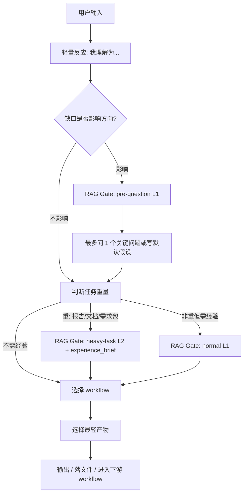

# PM 总控与轻量反应拓扑

## 1. 目标

把用户输入先收敛成“我理解的问题、是否需要追问、该走哪条 workflow、最小产物是什么”。

## 2. 拓扑图

## 3. 节点备注

| 节点 | 作用 | 输入 | 输出 | 门禁 |
| --- | --- | --- | --- | --- |
| 轻量反应 | 先复述真实问题 | 用户输入 | 一句话理解 | 不急着问长问题 |
| 缺口判断 | 判断是否影响方向 | 已知事实、默认假设 | 追问或默认推进 | 准备追问前先过 pre-question L1 Gate |
| 重量判断 | 区分轻量讨论和正式报告/文档 | 用户意图、产物类型 | 重任务或非重 | 提问/质问本身不算重任务 |
| 重任务门禁 | 给报告/文档配重思考 | 项目、workflow、产物、决策点 | `experience_brief` + 重思考中间包 | 入口 L2，内部追问默认复用 brief |
| 路由 | 匹配 workflow | 用户意图、任务强度 | workflow id | 不把 skill 当 agent 主体 |
| RAG Gate | 轻量判断是否需要经验 | 项目、workflow、产物、信号 | rag_gate_decision / applied_rules | 轻任务不打开大量经验卡 |
| 最小产物 | 控制任务重量 | 任务强度 | 短答、报告、需求包 | 不为轻任务跑重流程 |

## 4. 输出包

| 产物 | 用途 | 生命周期 |
| --- | --- | --- |
| 路由结论 | 告诉用户当前该走什么能力 | 本轮任务 |
| 关键追问 | 只补方向性缺口 | 本轮任务 |
| 下游 workflow | 进入正式工作流入口 | 任务推进 |
