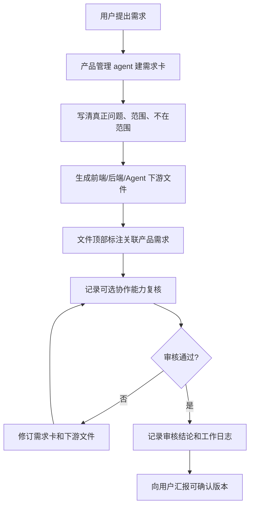

# 需求管理与协作审核流程

## 一句话规则

产品管理 agent 生成任何正式开发输入前，必须先有需求编号；生成后必须记录对应协作能力的复核状态。这里的协作能力不是固定 agent 契约，是否存在由使用者环境决定。

---

## 触发条件

只要出现以下任一情况，就进入本流程：

- 用户提出新产品需求。
- 需要给前端、后端、Agent 生成开发说明。
- 需要修改 PRD、页面树、数据模型、API、Agent 工作流。
- 用户指出“这个文件不知道对应什么需求”。
- 用户提供外部 PM 框架、样例 PRD 或开源 PM skill，并希望融合到当前 agent。

---

## 固定流程

如果输入来自外部 PM 框架或样例 PRD，先走 `workflows/prd-report/references/external-framework-fusion-guide.md` 生成融合对照表，再回到本流程建卡和组织协作复核。

---

## 文件生成规范

| 文件类型 | 位置 | 必填内容 |
| --- | --- | --- |
| 需求卡 | `项目管理/需求管理/` | 需求编号、来源、参考材料、真正问题、核心假设、成功指标、范围、不在范围、下游文件、协作复核 |
| PRD | 项目约定目录 | 关联需求、真正问题、用户/JTBD、价值主张、指标门禁、发布分期、风险和未决点 |
| 前端开发说明 | `前端设计/` | 关联需求、页面/路由/组件/状态、前后端边界、前端复核状态 |
| 后端开发说明 | `后端设计/` | 关联需求、数据对象/API/任务/权限、后台操作员检查、调整、恢复和人工兜底方式、后端复核状态 |
| Agent 开发说明 | `Agent设计/` | 关联需求、输入输出、工具边界、失败边界、审批门禁、审计记录、Agent/架构复核状态 |
| 给用户报告 | `产品经理工作报告/对用户的报告/` | 人话结论、依据、风险、下一步、协作复核状态 |
| 工作日志 | `产品经理工作报告/工作日志/` | 做了什么、改了哪些文件、复核结果、未决点 |

---

## 撰写规范

每份正式开发输入必须包含：

1. `关联产品需求`。
2. `真正问题`。
3. `范围`。
4. `不在范围`。
5. `核心假设和验证方式`。
6. `成功指标或 Go/No-Go 标准`。
7. `给对应角色的执行语言`。
8. `验收或通过标准`。
9. `协作能力复核记录`。
10. 若引用外部 PM 框架或样例 PRD，写清参考来源、融合字段、舍弃字段。
11. 若涉及 AI、自动化或后台运营，写清操作员可检查、调整、恢复、人工处理的兜底动作。

---

## 需求提交规范

需求提交给开发前必须满足：

- 有需求编号。
- 有需求卡。
- 下游文件顶部写明关联需求。
- 需求范围和不在范围清楚。
- 至少一个对应协作能力已有复核状态；没有对应能力时，明确写“环境未配置，待人工/专业能力复核”。
- 若协作复核提出“需修改”，必须修完再提交。
- 若未复核，只能标注为“草稿”，不能称为正式开发输入。
