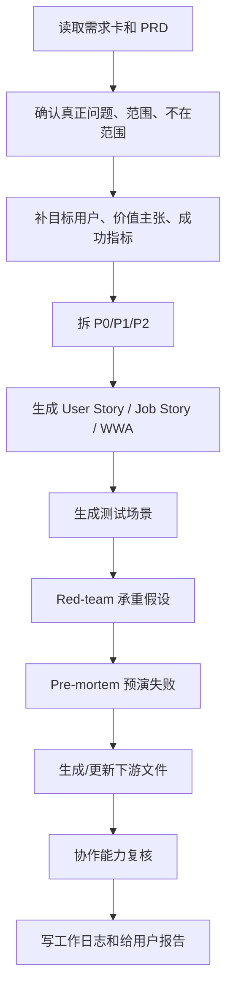

# PRD 到执行需求融合流程

## 一句话规则

PRD 不是终点。正式进入开发前，产品管理 person 必须把 PRD 继续拆成故事/backlog、测试场景、风险审查和协作能力复核记录。

---

## 触发条件

- 用户要求“整理需求”“写 PRD”“拆开发任务”“生成用户故事”“补验收标准”。
- PRD 已经有方向，但前端、后端、Agent 或测试还不知道怎么执行。
- PRD 准备提交给开发、协作能力复核或阶段发布。
- 外部 PRD 或 PM 框架已经融合完，需要落成本地开发输入。

---

## 固定流程

---

## 每步输入输出

| 步骤 | 输入 | 输出 | 通过标准 |
| --- | --- | --- | --- |
| 读需求卡和 PRD | 需求编号、需求卡、PRD | 当前事实摘要 | 不靠聊天记忆，能回链文件 |
| 确认范围 | 用户原话、项目文件 | 范围/不在范围 | 没有“支持/优化”式空话 |
| 补指标 | 目标、数据来源 | 成功指标与门禁 | 有基线、目标、数据来源或明确待补 |
| 拆优先级 | PRD 功能块 | P0/P1/P2 | P0 能验证核心假设 |
| 拆故事/backlog | PRD、设计入口 | User Story / Job Story / WWA | 每条可独立讨论、可验收 |
| 生成测试场景 | 验收标准 | 主路径、边界、失败态 | 测试 agent 能直接审 |
| Red-team | PRD 断言 | 承重假设、证据、停止标准 | 只列关键假设，不列泛泛风险 |
| Pre-mortem | 发布计划 | 风险分级、行动计划 | 上线阻塞项明确 |
| 下游文件 | PRD、故事、测试 | 前端/后端/Agent/测试文件 | 顶部有 `关联产品需求` |
| 协作复核 | 下游文件 | 复核记录 | 通过/需修改/未复核状态清楚 |

---

## 输出产物

| 产物 | 默认落点 | 模板 |
| --- | --- | --- |
| 需求卡 | `项目管理/需求管理/` | `workflows/demand-management/templates/product-requirement-submit-template.md` |
| PRD | 项目内对应产品文档目录 | `workflows/prd-report/templates/prd-human-machine-template.md` |
| 故事/backlog | 项目管理或开发说明目录 | `workflows/acceptance-test/templates/user-story-test-scenario-template.md` |
| 测试场景 | 测试或项目管理目录 | `workflows/acceptance-test/templates/user-story-test-scenario-template.md` |
| 红队/预演失败 | 产品经理工作报告或审查目录 | `workflows/prd-report/templates/prd-red-team-premortem-template.md` |
| 工作日志 | `产品经理工作报告/工作日志/` | 项目既有日志格式 |

---

## 人话汇报要求

给用户汇报时，先讲：

1. 这个需求现在能不能进入开发。
2. 最大的不确定点是什么。
3. 前端、后端、Agent、测试分别还缺什么。
4. 下一步最小动作是什么。

不要先给完整技术清单。技术清单放在后面作为证据。

---

## 验证点

1. 每个正式下游文件都能回链同一个需求编号。
2. P0 能验证核心假设，不是“缩小版完整产品”。
3. 测试场景覆盖主路径、边界和失败态。
4. 红队审查给出本周能拿到的证据或最小实验。
5. 未审核内容只能标为草稿。

---

## 回退方式

- 如果拆解过重：保留 PRD、需求卡和 P0，延后 P1/P2、Red-team 和 Pre-mortem。
- 如果发现方向未确认：回到问题定义和产品强度判断，不继续拆开发任务。
- 如果协作能力复核不通过：先改需求卡，再改 PRD 和下游文件。
