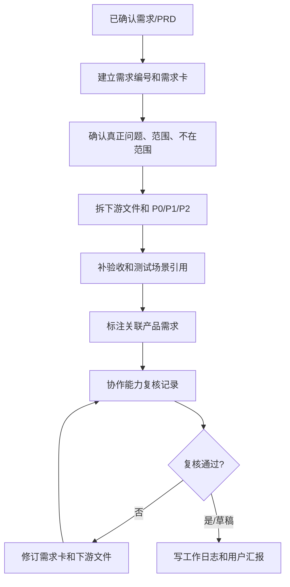

# 需求管理与协作复核拓扑

## 1. 目标

把已确认的 PRD 或需求转成可执行、可验收、可追溯的开发输入。

## 2. 拓扑图

## 3. 输出包

| 产物 | 用途 | 生命周期 |
| --- | --- | --- |
| 需求卡 | 正式需求入口 | 长期 |
| 下游文件 | 给前端、后端、Agent、测试接手 | 开发周期 |
| 复核记录 | 标记通过/需修改/未复核 | 开发周期 |
| 工作日志 | 后续追溯 | 长期 |
