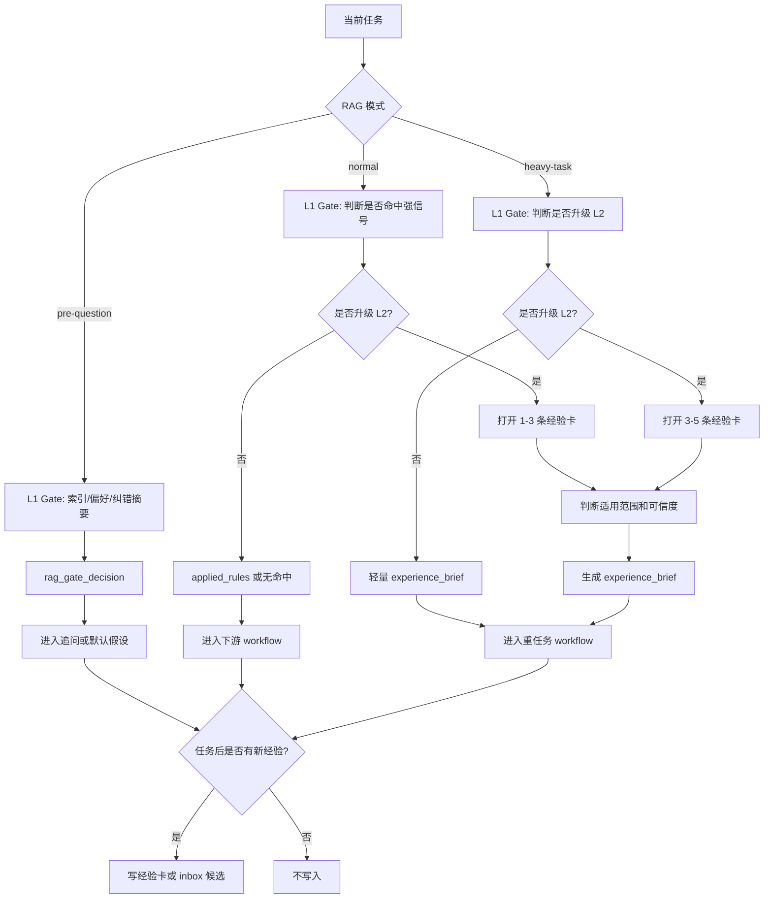

# 经验 RAG 与沉淀拓扑

## 1. 目标

让产品经理先经过轻量 RAG Gate，再决定是否打开经验卡；重任务入口生成可复用 `experience_brief`，任务后沉淀高复用经验。

## 2. 拓扑图

## 3. 节点备注

| 节点 | 作用 | 门禁 |
| --- | --- | --- |
| L1 Gate | 只读索引、偏好、纠错摘要 | 不打开经验卡 |
| 升级判断 | 决定是否进入 L2 | 不因“有经验库”自动检索 |
| 打开经验 | 重任务读 3-5 条；normal L2 读 1-3 条 | 超过上限要收缩 query |
| 适用判断 | 看范围、可信度、时效、边界 | 不匹配不能套用 |
| pre-question 输出 | 把经验转成发问依据 | 不生成固定问题库 |
| heavy-task 输出 | 生成 `experience_brief` 和重思考约束 | 后续追问默认复用 |
| 经验写入 | 任务后沉淀高复用规则 | 未验证事实不入经验库 |

## 4. 输出包

| 产物 | 用途 | 生命周期 |
| --- | --- | --- |
| rag_gate_decision | 说明是否命中经验、是否升级 L2 | 本轮任务 |
| 经验适用判断 | 防止误套旧经验 | 本轮任务 |
| 应用规则 | 进入下游 workflow | 本轮任务 |
| 发问依据 | 决定是否问、问什么 | 本轮追问前 |
| experience_brief | 进入报告/文档类 workflow，并供内部追问复用 | 本轮重任务 |
| 新经验候选 | 后续复用 | 长期或候选 |
