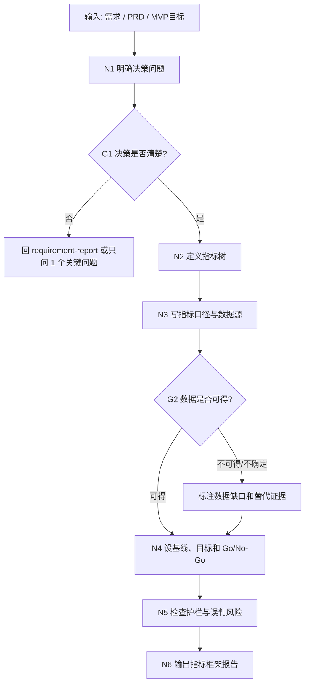

# 指标与数据验证工作流拓扑

## 1. 目标

把需求或 PRD 里的“成功”翻译成可以验证的指标体系，回答：

- 这件事到底用什么指标证明有效？
- 哪些指标是结果，哪些是输入，哪些是护栏？
- 当前有没有数据，缺什么数据？
- 什么时候继续、调整、停止或补证据？

这个 workflow 不跑真实数据，只定义指标框架和数据验证计划。

## 2. 拓扑图

## 3. 节点备注

| 节点 | 责任 | 输入 | 输出 | 注意 |
| --- | --- | --- | --- | --- |
| N1 明确决策问题 | 说明指标服务做/不做、继续/停止、上线/回滚 | 需求、PRD、目标 | 决策问题 | 指标不能脱离决策 |
| N2 定义指标树 | 北极星、输入、护栏、商业指标分层 | 决策问题 | 指标树 | 不只写一个转化率 |
| N3 写指标口径与数据源 | 定义单位、时间窗、粒度、排除项、来源 | 指标树 | 指标字典 | 不编造数据源 |
| G2 数据可得性 | 判断现有数据、待补数据和替代证据 | 指标字典 | 数据状态 | 无数据时可给计划，不能给确定结论 |
| N4 设 Go/No-Go | 写继续、调整、停止标准 | 数据状态 | 门禁标准 | 标明基线待补也可以 |
| N5 检查护栏 | 防止优化主指标伤害体验、成本、质量 | 指标树 | 风险清单 | 包含反作弊和误判风险 |

## 4. 输出包

| 产物 | 作用 | 默认状态 |
| --- | --- | --- |
| 指标框架报告 | 让用户确认怎么验证需求 | 草稿/待确认 |
| 指标树 | 说明结果、输入、护栏关系 | 草稿 |
| 指标字典 | 让数据口径可复核 | 草稿 |
| 数据缺口清单 | 说明要补什么证据 | 待确认 |
| Go/No-Go 标准 | 决定继续、调整、停止 | 待确认 |
