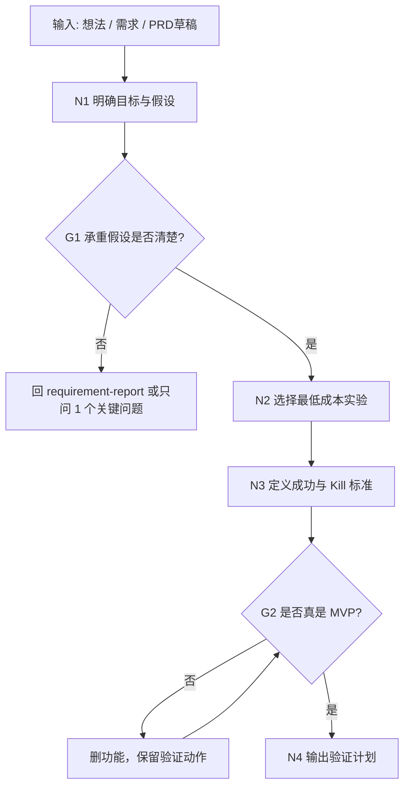

# MVP 与实验验证工作流拓扑

## 1. 目标

把想法或需求转成最低成本验证计划，回答：

- 最容易让方案失败的假设是什么？
- 这次 MVP 到底验证什么？
- 不开发完整功能，怎样最快学到结果？
- 成功、失败、停止、转向标准是什么？

## 2. 拓扑图

## 3. 节点备注

| 节点 | 责任 | 输出 |
| --- | --- | --- |
| N1 明确目标与假设 | 找价值、可用性、可行性、商业性假设 | 假设地图 |
| N2 选择最低成本实验 | 在访谈、假门、原型、手工服务、小流量实验中取舍 | 实验方案 |
| N3 定义标准 | 写成功、失败、停止、转向 | 判定标准 |
| N4 输出计划 | 让用户能决定是否先验证 | MVP 验证报告 |
