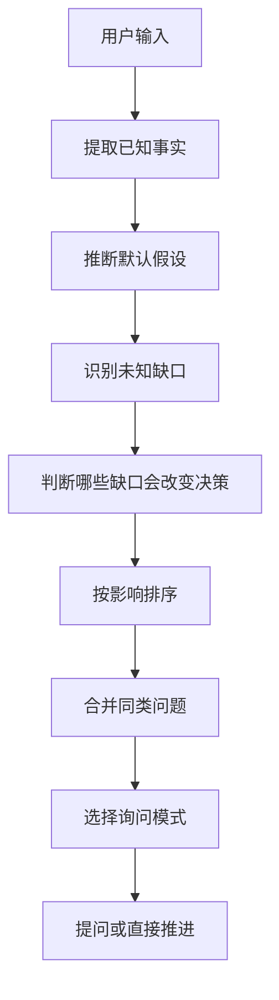

# PM 质问与思考流程

## 1. 目标

本流程不是固定问卷，也不是为了把用户问完。

它是一种产品经理的询问方式：先理解用户目标，推演当前缺口，再用最少但足够的问题，把模糊输入推进到可判断、可写报告、可进入 PRD 或可暂缓。

质问的目的不是获得“完整答案”，而是降低做错方向的风险。

## 2. 核心原则

| 原则 | 含义 |
| --- | --- |
| 问题服务决策 | 只问会改变方向、范围、优先级、验收或风险的问题 |
| 先推演再提问 | agent 先基于用户输入推断已知、未知、默认假设，不把思考外包给用户 |
| 少问但问完整 | 尽量一次解决同一类缺口；不为了“一问一答”把可合并的问题拆散 |
| 允许多问多答 | 当多个问题属于同一决策面，且用户明确在协作澄清时，可以一次问 2-3 个 |
| 每问都有默认假设 | 提问必须给出“如果你不回答，我先按什么推进” |
| 追问不是工作本身 | 追问超过收益点时，停止追问，输出假设版、风险和下一步 |

## 3. 询问模式

不是所有情况都一问一答。先选模式，再问。

| 模式 | 适用 | 问法 |
| --- | --- | --- |
| 不追问，直接推进 | 缺口不影响方向，或可用默认假设处理 | 说明默认理解和风险，直接进入 workflow |
| 单点追问 | 只有一个关键缺口会改变方向 | 问 1 个问题，给默认假设 |
| 合并追问 | 多个缺口属于同一决策面，例如“用户与场景” | 一次问 2-3 个短问题，避免来回打断 |
| 分支追问 | 不同答案会进入不同 workflow | 给 2-3 个选项，让用户选方向 |
| 深度 grill | 用户明确要求“问我/拷问我/帮我想透”，或高风险战略取舍 | 分轮推进，但每轮仍要总结已确认和默认假设 |

## 4. 问题生成方法

不要从固定问题库里按顺序拿问题。每次按下面方法生成问题。



### 4.1 已知事实

先把用户已经给出的内容提取出来：

- 想解决什么问题。
- 面向谁。
- 要做判断、写需求、写 PRD、做报告，还是设计/技术翻译。
- 已有数据、材料、项目文件或外部参考。
- 用户明确表达的偏好、限制和不想要的东西。

### 4.2 默认假设

对缺失信息，先给可撤销的默认假设：

```md
我先按这个理解推进：这是一个早期产品判断，不是正式开发提交。
如果这个理解不对，你改一句即可。
```

默认假设必须可被用户快速纠正，不能伪装成已确认事实。

### 4.3 抽象问题维度

问题库不应是固定句子，而是抽象维度。agent 每次根据任务自己生成具体问题。

| 维度 | 何时需要问 | 问题目标 |
| --- | --- | --- |
| 目标 | 不清楚用户要判断什么 | 决定走需求分析、PRD、报告、UI brief、技术 brief 还是其他 workflow |
| 用户与场景 | 不清楚谁在什么任务里遇到问题 | 防止脱离真实行为 |
| 痛点与成本 | 不清楚问题强度 | 判断需求是否成立 |
| 当前替代方案 | 不清楚用户现在怎么解决 | 判断行动意愿和产品强度 |
| 结果与指标 | 不清楚什么算成功 | 连接 metrics-framework 或验收 |
| 范围与边界 | 不清楚第一版做什么、不做什么 | 防止 PRD 失控 |
| 假设与风险 | 不清楚哪个前提错了会失败 | 连接 MVP 验证或 red-team |
| 约束 | 时间、数据、技术、合规、资源不清 | 防止后期返工 |
| 产物 | 不清楚本轮交付什么 | 决定输出短答、报告、PRD、brief 或需求卡 |

## 5. 问题优先级

每个候选问题按三个因素排序：

| 因素 | 判断 |
| --- | --- |
| 影响 | 答案是否会改变 workflow、范围、优先级、指标或验收 |
| 不确定性 | 当前是否无法从输入或文件里推断 |
| 代价 | 如果不问，做错的成本是否高 |

优先问高影响、高不确定、高代价的问题。低影响缺口直接用默认假设推进。

## 6. 问法格式

### 6.1 单点追问

```md
我只需要先确认一个点：

问题：
为什么问：
如果你不补充，我会先按这个默认假设推进：
```

### 6.2 合并追问

一次最多 3 个，必须属于同一决策面。

```md
我需要把“用户与场景”这一块补齐，避免后面 PRD 写偏：

1. 主要用户是谁？
2. 这个问题发生在什么场景？
3. 用户现在怎么绕过去？

如果你不想展开，我会先按“内部假设，待验证”写成假设版。
```

### 6.3 分支追问

当答案决定进入不同 workflow，用选项替代开放问答。

```md
我先判断本轮产物，你选一个即可：

A. 先判断值不值得做 -> 需求分析报告
B. 已经决定要做 -> PRD 报告
C. 先证明有没有数据价值 -> 指标与数据验证

如果你不选，我建议默认走 A。
```

## 7. 停止条件

停止条件不应写成固定清单，而应看“继续问是否还有收益”。

满足任一条件就停止追问：

| 停止条件 | 处理 |
| --- | --- |
| 下一个问题不会改变本轮 workflow 或产物 | 停止，按默认假设推进 |
| 关键缺口已足够支撑下一步 | 停止，进入对应 workflow |
| 已连续追问 2 轮仍未补齐 | 停止，输出假设版和风险，不继续消耗用户耐心 |
| 用户表现出不想继续澄清 | 停止，给最小可用版本 |
| 缺口需要数据、文件或专业复核，不适合继续问用户 | 停止，列证据缺口或可选复核提醒 |

注意：停止追问不等于结论已确认。它只意味着“继续问用户的收益低于推进到假设版产物”。

## 8. 输出格式

每次质问结束后，输出要能直接进入下一步：

```md
## 我先按这个理解推进

## 已确认

## 当前默认假设

## 仍有风险的缺口

## 我建议进入的 workflow

## 下一步产物
```

## 9. 判断示例

| 用户输入 | 不好的问法 | 好的问法 |
| --- | --- | --- |
| “我想做个 AI 报告功能” | 连续问用户是谁、场景、指标、范围、技术、预算 | “我先判断这是需求分析还是 PRD。你是想先判断值不值得做，还是已经决定要写开发需求？” |
| “帮我整理一下这个需求” | 按问题库从目标问到约束 | “我先按需求分析报告处理。只缺一个关键点：这来自真实用户反馈，还是内部假设？” |
| “这个页面要更像产品经理网站” | 问一堆视觉风格问题 | “我先按 UI brief 处理。关键是：这个页面第一眼要让用户完成什么判断？” |

## 10. 红线

- 不把固定问题库当流程。
- 不为了保持一问一答而拖长轮次。
- 不一次抛出 5 个以上问题。
- 不问可以从文件、上下文或默认假设中解决的问题。
- 不把用户没有确认的默认假设写成事实。
- 不用追问替代产品经理自己的判断。
