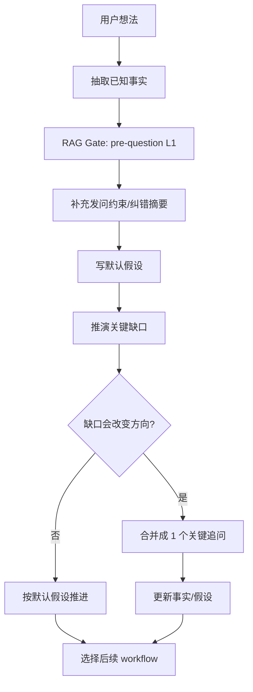

# PM 质问与思考拓扑

## 1. 目标

用最少问题把需求方向想清楚，而不是让用户陷入一问一答。

## 2. 拓扑图

## 3. 输出包

| 产物 | 用途 | 生命周期 |
| --- | --- | --- |
| 已确认事实 | 避免误解用户 | 当前需求 |
| 发问依据 | 说明问题来自真实场景和 L1 Gate | 本轮追问前 |
| 默认假设 | 支撑继续推进 | 确认前为临时 |
| 风险缺口 | 告诉用户哪里会影响方向 | 当前需求 |
| 推荐 workflow | 接到需求分析、PRD、MVP 等 | 下一步 |
