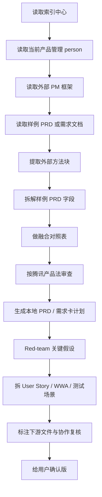

# 外部 PM 框架融合流程

## 一句话规则

外部 PM 框架只能作为方法参考；正式开发输入必须本地化为需求编号、需求卡、PRD、下游文件标注和协作能力复核。

## 触发条件

- 用户提供外部 PM agent、PM skill、样例 PRD、竞品 PRD 或开源 PM 仓库。
- 用户要求“优化产品管理 agent”“融合外部框架”“参考某个 PRD 产物”。
- 现有 PRD 缺少产品发现、指标、阶段门禁、假设验证或下游审核。

## 固定输入

| 输入 | 读取规则 |
| --- | --- |
| 索引中心 | 先读任务路由、触发矩阵、注册表、runner、管理协议、外部搜索、模型调度、验证回退、记忆入口 |
| 当前 person | 读 `AGENTS.md`、`README.md`、相关模板和 workflow |
| 外部框架 | 只提取方法块，不安装、不替代本地 agent |
| 样例 PRD | 拆成问题、用户、价值、方案、指标、风险、发布阶段、未决点 |
| 项目事实 | 以当前项目文件为准；没有证据只标假设 |

## 流程拓扑

## 方法块取舍

| 外部方法块 | 默认动作 | 本地化要求 |
| --- | --- | --- |
| 8 段 PRD | 保留 | 合并到 `PRD-人机翻译模板.md`，补人话说明和机器说明 |
| Opportunity Solution Tree | 复杂需求保留 | 只围绕一个期望成果，机会不是功能 |
| Metrics / North Star | 保留 | 写清定义、基线、目标、数据来源、护栏和门禁 |
| Product Strategy Canvas | 视阶段保留 | 只用于战略判断，不替代需求卡 |
| User Story / Job Story / WWA | PRD 方向确认后保留 | 只拆已确认范围，每条必须有验收条件 |
| Test Scenarios | 需要测试或验收时保留 | 覆盖主路径、边界、失败态，不替代测试能力复核 |
| Red-team / Pre-mortem | 保留 | 输出 3-5 个 kill-assumptions，不写泛泛风险 |
| Shipping Artifacts | AI/权限/自动化需求保留 | 转成本地架构、权限、变量、流程、测试、自动化文档清单 |
| Slash command 工作流 | 不照搬 | Codex 中改成自然语言 workflow 和模板 |
| 外部保存路径 | 舍弃 | 使用本地项目目录和需求管理路径 |

## 样例 PRD 审查清单

| 审查项 | 通过标准 |
| --- | --- |
| 真正问题 | 不是功能愿望，而是用户在场景中的问题 |
| 用户/JTBD | 按任务和痛点分群，不只写年龄职业 |
| 价值主张 | 写清 Before / How / After / Alternatives |
| 方案拆解 | 前端入口、后端数据流、Agent/AI 工作流、测试都能接手 |
| 指标 | 有北极星、输入指标、护栏指标、Go/No-Go 标准 |
| MVP | 验证核心假设，不是缩小版完整产品 |
| 风险 | 有缓解动作、负责人或最低成本验证 |
| 发布分期 | 每阶段有目标、范围、门禁和回退方式 |
| 未决点 | 真正 unresolved，不能列已能从材料判断的问题 |

## 输出产物

| 产物 | 路径 | 说明 |
| --- | --- | --- |
| 融合对照表 | 使用 `workflows/prd-report/templates/product-discovery-to-prd-template.md` | 说明保留、舍弃、改写 |
| 需求卡 | `项目管理/需求管理/` | 正式需求入口 |
| PRD | 项目约定目录 | 人能判断、机器能执行 |
| 故事/backlog | 使用 `workflows/acceptance-test/templates/user-story-test-scenario-template.md` | 把 PRD 拆成开发可领取的工作项 |
| 测试场景 | 使用 `workflows/acceptance-test/templates/user-story-test-scenario-template.md` | 把验收标准变成测试可执行步骤 |
| 红队/预演失败 | 使用 `workflows/prd-report/templates/prd-red-team-premortem-template.md` | 检查承重假设和发布风险 |
| 下游说明 | `前端设计/`、`后端设计/`、`Agent设计/`、测试目录 | 必须有 `关联产品需求` |
| 工作日志 | `产品经理工作报告/工作日志/` | 记录参考来源、改动、审核状态 |
| 给用户报告 | `产品经理工作报告/对用户的报告/` | 先讲结论和用户影响，再讲下游影响 |

## 验证门禁

- `AGENTS.md` 推荐的模板和 workflow 必须真实存在。
- 每个正式开发输入必须能回链到需求卡。
- 外部框架引用必须说明来源、适用范围和舍弃项。
- PRD 至少包含：真正问题、目标用户、范围、不在范围、验收标准、指标门禁、关键风险、未决点。
- story/backlog/test 场景必须从已确认 PRD 派生，不能提前替用户定方案。
- 涉及后台、AI、自动化或推荐时，必须写操作员可检查、调整、恢复、人工兜底的方式。
- 未完成协作能力复核的产物只能标为草稿。

## 回退方式

- 若融合后文档变长但不可执行，回退到本地 `PRD-人机翻译模板.md` 的最小字段。
- 若外部框架与本地 AGENTS 冲突，以本地索引中心和 `AGENTS.md` 为准。
- 若样例 PRD 的结论缺证据，保留结构，结论改标“假设待验证”。
