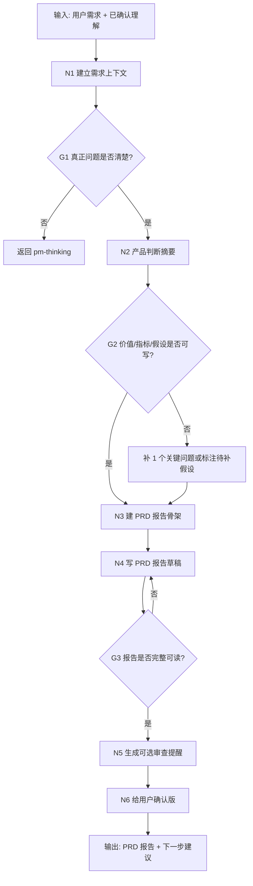

# PRD 报告工作流拓扑

## 1. 目标

把“已基本澄清的需求”变成一份可确认、可阅读、可继续流转的 PRD 报告。

这个工作流不负责早期漫长质问；如果需求还不清楚，先回到 `workflows/pm-thinking/workflow.yaml`。

这个工作流也不负责自动调度其他 agent。其他角色只作为“后续审查提醒”出现，真正进入开发前再走 `workflows/demand-management/workflow.yaml`。

## 2. 拓扑图

## 3. 节点备注

| 节点 | 责任 | 输入 | 输出 | 注意 |
| --- | --- | --- | --- | --- |
| N1 建立需求上下文 | 读取用户原话、项目文件、外部参考 | 用户输入、项目入口 | 上下文摘要 | 不靠聊天记忆猜项目事实 |
| G1 真正问题门禁 | 判断是否能进入 PRD | 上下文摘要 | 通过/返回质问 | 不清楚就回问，不硬写 PRD |
| N2 产品判断摘要 | 先判断为什么要做、给谁做、验证什么 | 上下文摘要、`references/prd-writing-guide.md` | 产品判断摘要 | 融合腾讯产品法、pm-skills、样例 PRD |
| G2 价值/指标/假设门禁 | 判断是否足以写成 PRD | 产品判断摘要 | 通过/标注待补 | 不清楚的指标写“待补”，不能伪造成事实 |
| N3 建 PRD 报告骨架 | 决定报告结构 | 产品判断摘要、来源、范围 | 报告目录 | 可按轻量/标准/重型裁剪 |
| N4 写 PRD 报告草稿 | 形成用户和后续执行者都能读的 PRD | 报告目录 | PRD 草稿 | 使用 `workflows/prd-report/templates/prd-human-machine-template.md` |
| G3 报告完整性门禁 | 检查报告是否可读、可确认 | PRD 草稿 | 通过/回写 | 重点看问题、范围、验收、风险、未决点 |
| N5 生成可选审查提醒 | 提醒后续可能需要谁复核 | PRD 草稿、`review_hints.yaml` | 审查提醒 | 不写成本地路径，不自动触发 |
| N6 给用户确认版 | 翻译成可拍板语言 | PRD 草稿、审查提醒 | 人话报告 | 先讲用户影响，再讲下一步 |

## 4. 门禁

| 门禁 | 必须满足 | 不满足时 |
| --- | --- | --- |
| G1 真正问题 | 问题、用户、场景、范围初步明确 | 回 `workflows/pm-thinking/workflow.yaml` |
| G2 价值/指标/假设 | 说明体验提升、成本降低、指标用途、MVP 假设和最低成本验证 | 补 1 个关键问题，或标为待补假设 |
| G3 报告完整性 | PRD 报告包含真正问题、用户场景、方案、范围、不在范围、验收、风险、未决点 | 回到 PRD 草稿修订 |
| 可选审查提醒 | 若报告要进入正式开发，只提示需要进入 `workflows/demand-management/workflow.yaml` | 不在本 workflow 内触发其他 agent |

## 5. 输出包

| 产物 | 作用 | 默认状态 |
| --- | --- | --- |
| 需求卡草稿 | 回链需求来源和编号；项目需要时生成 | 草稿/可选 |
| PRD 报告 | 用户和后续执行者共读 | 草稿/待确认 |
| 验收标准 | 让需求变得可检查 | 草稿/待确认 |
| 可选审查提醒 | 告诉用户后续可能需要哪些角色复核 | 提醒，不是触发 |
| 给用户确认版 | 用人话让用户拍板 | 待确认 |
