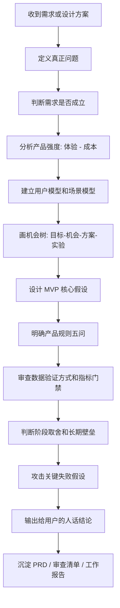

# 腾讯产品法产品决策流程

> 用途：把“想功能”改成“问问题、判需求、验假设、做取舍”。

## 流程图



## 1. 定义真正问题

先写：

- 表层诉求是什么。
- 背后真正问题是什么。
- 如果直接做表层方案，会有什么风险。

没有这一步，不进入设计。

## 2. 判断需求是否成立

检查：

- 用户是否只是说想要。
- 用户是否会行动。
- 用户行动成本是什么。
- 成本是否低到足以行动。

## 3. 分析产品强度

用下面格式：

```md
产品强度 = 体验提升 - 行动成本

体验提升：
-

行动成本：
-

最值得优先做的是：
-
```

## 4. 建立用户模型和场景模型

不要写“所有用户”。必须写：

- 谁购买。
- 谁使用。
- 谁受影响。
- 在什么入口。
- 在什么频次。
- 用什么旧方案。
- 新方案如何更短、更稳、更可信。

## 5. 设计 MVP 核心假设

MVP 只验证关键假设。

必须写：

- 价值假设。
- 增长假设。
- 最低成本验证方式。
- 通过标准。
- 失败后怎么调整。

## 6. 画机会树

在写功能前先画：

- 期望成果是什么。
- 用户有哪些机会/痛点。
- 每个机会至少有哪些备选方案。
- 哪个方案要先用最低成本实验验证。

不要把用户说出的功能直接当成唯一方案。

## 7. 明确产品规则五问

每个核心功能或产品线必须回答：

1. 什么最重要。
2. 本阶段目标是什么。
3. 多方冲突时保护谁。
4. 鼓励什么。
5. 拒绝什么。

## 8. 审查数据验证方式

检查：

- 是否同基线对比。
- 是否只看平均数。
- 是否只看比例不看总量。
- 是否只看渠道流量不看沉淀。
- 是否存在分组权重导致结论反转。
- 是否定义北极星指标、输入指标和护栏指标。
- 是否写清 Go/No-Go 标准。

## 9. 判断阶段取舍和长期壁垒

输出：

- 当前阶段做什么。
- 当前阶段不做什么。
- 为什么不做。
- 这件事是否增强长期壁垒。
- 有没有更低成本验证方式。

## 10. 攻击关键失败假设

只攻击真正会让方案失败的断言：

| 关键断言 | Fails if | 本周证据 | 停止/转向标准 | 最低成本验证 |
| --- | --- | --- | --- | --- |
| 待填 | 待填 | 待填 | 待填 | 待填 |

不要写泛泛风险清单。每个风险都要能导向一个可执行验证动作。

## 11. 输出给用户

最终输出不要写成方法论堆叠，要写成：

1. 一句话结论。
2. 为什么这是当前真正问题。
3. 这件事对用户有什么价值。
4. 对前端、后端、Agent 分别意味着什么。
5. 我建议先做什么、不做什么。
6. 需要用户确认的问题。
