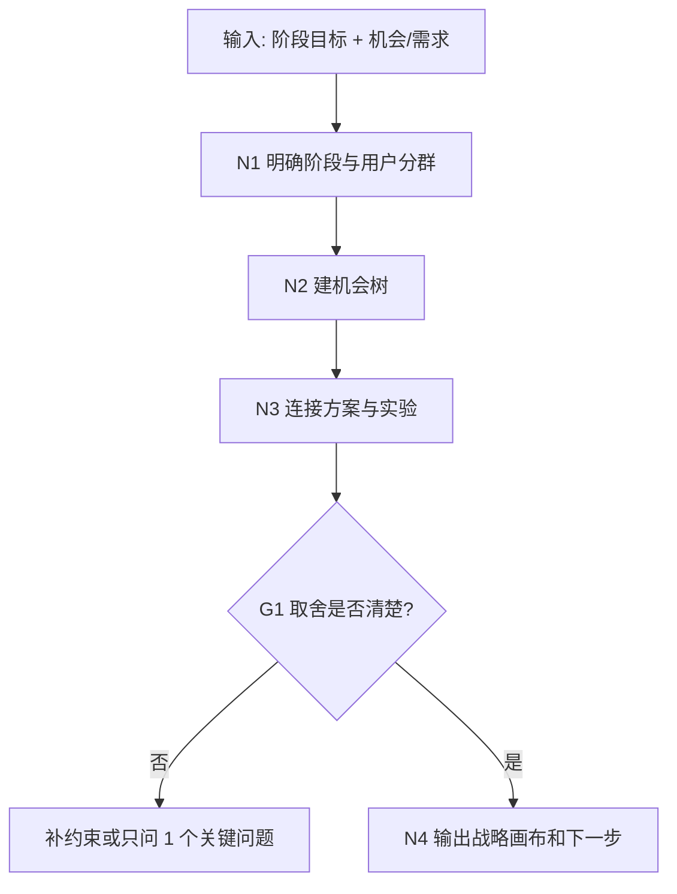

# 产品战略与机会树工作流拓扑

## 1. 目标

把多个机会和需求放回阶段目标里做取舍，回答：

- 当前阶段最重要的产品任务是什么？
- 哪些用户和场景优先？
- 哪些机会值得推进？
- 做什么、不做什么，为什么？

## 2. 拓扑图

## 3. 输出包

| 产物 | 作用 |
| --- | --- |
| 产品战略报告 | 说明阶段判断和取舍 |
| 机会树 | 连接目标、机会、方案、实验 |
| 战略画布 | 汇总用户、价值、能力、壁垒 |
| 下一步路径 | 转需求分析、MVP、PRD 或暂缓 |
