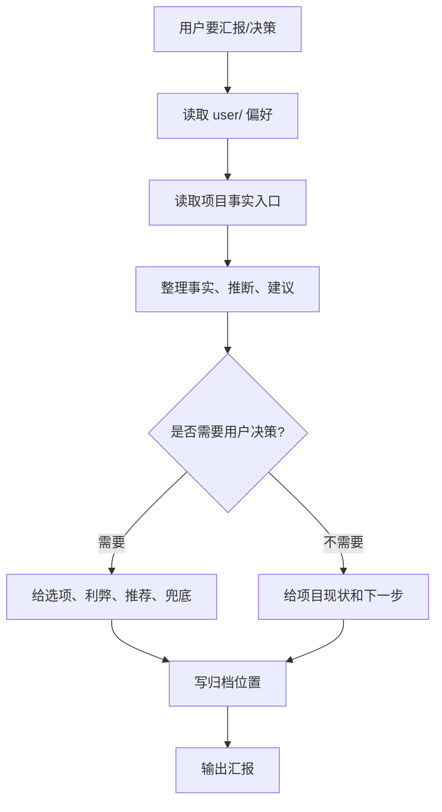

# 项目理解与汇报拓扑

## 1. 目标

先读用户，再读项目事实，最后输出能加快用户决策的汇报。

## 2. 拓扑图

## 3. 输出包

| 产物 | 用途 | 生命周期 |
| --- | --- | --- |
| 项目理解摘要 | 让用户快速进入上下文 | 当前项目 |
| 选项对照 | 支持用户拍板 | 决策期 |
| 推荐与兜底 | 加快决策但不代决策 | 决策期 |
| 归档位置 | 避免汇报丢失 | 长期 |
