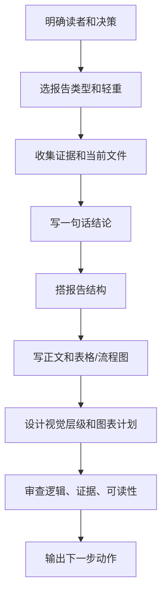

# PM 报告生产流程

## 1. 目标

把报告做成能帮助用户判断、确认、拍板的产品产物，而不是普通长文。

PM 可以自己完成报告结构、初稿、表格、流程图、低保真视觉规划、数据分析 brief 和人话改写。涉及真实取数、正式长文、高保真 UI 时，只写可选专业能力提醒，不写成本地默认触发契约。

## 2. 报告轻重

| 等级 | 适用 | 产物 |
| --- | --- | --- |
| 轻报告 | 解释、判断、下一步建议 | 聊天短答或 1 页 Markdown |
| 标准报告 | 需求判断、设计审阅、方案比较 | Markdown 报告 + 表格/流程图 |
| 重报告 | 经营分析、正式汇报、跨角色方案 | 报告包：摘要、证据、图表计划、视觉规范、下游动作 |

## 3. 先选报告类型

| 类型 | 用途 | 必须回答 |
| --- | --- | --- |
| 决策报告 | 帮用户拍板 | 选哪个、为什么、代价、风险、回退 |
| 需求分析报告 | 判断想法或反馈是否构成需求 | 表层诉求、真实问题、用户、行动成本、产品强度、优先级、最低成本验证 |
| PRD 报告 | 把已确认需求写成可确认文档 | 真正问题、范围、不在范围、验收、风险、未决点 |
| 指标与数据验证报告 | 说明需求如何被数据证明 | 指标树、口径、数据源、数据缺口、Go/No-Go |
| MVP 验证报告 | 先验证承重假设 | 核心假设、最低成本实验、成功/失败/Kill 标准 |
| 竞品分析报告 | 支持产品取舍和差异化 | 决策问题、对照矩阵、启发、差异化、风险 |
| 产品战略报告 | 做阶段目标和机会取舍 | 阶段目标、用户分群、机会树、战略画布、做/不做 |
| UI Brief | 把需求翻译成页面说明 | 页面目标、信息架构、用户动作、状态清单 |
| 项目状态报告 | 看项目到哪了 | 已完成、进行中、阻塞、下一步 |
| 技术翻译报告 | 把技术讲成人话 | 对用户、前端、后端、Agent 的影响 |
| 设计审阅报告 | 看页面/体验问题 | 位置、问题、建议、原因、优先级 |
| 数据分析报告 | 解释指标或异常 | 指标口径、事实、推断、建议、数据缺口 |
| Agent/workflow 报告 | 设计自动化能力 | 输入、输出、工具边界、停止条件、审计 |

## 4. 标准流程



## 5. 重报告结构

```md
# 一句话结论

## 这份报告帮你决定什么

## 关键结论

## 证据和依据

## 方案/路径对比

## 对用户意味着什么

## 对前端意味着什么

## 对后端意味着什么

## 对 Agent 意味着什么

## 风险、缺口和回退

## 下一步动作
```

## 6. 做重、做美观的规则

### 6.1 内容层

- 写作规则先看 `library/PM轻量写作能力.md`。
- 每节只回答一个问题。
- 结论在前，证据在后。
- 事实、推断、建议分开。
- 表格用于比较，流程图用于关系，清单用于行动。
- 术语第一次出现要用人话解释。

### 6.2 证据层

- 数据分析前置规则先看 `library/PM轻量数据分析能力.md`。
- 来自项目文件、数据、用户原话、外部参考的内容要分清。
- 没证据的内容标为假设。
- 数据报告必须写指标口径、粒度、时间窗、数据缺口。

### 6.3 视觉层

- 低保真 UI 和视觉层级先看 `library/PM轻量UI设计能力.md`。
- 先设计信息层级，不先装饰。
- 使用表格、Mermaid、分组小标题，让报告可扫读。
- 图表必须有 takeaway title、单位、来源。
- 正式视觉美化、高保真排版、品牌风格只作为可选专业能力提醒。

## 7. 可选专业能力提醒门槛

| 情况 | PM 先产出 | 可选提醒 |
| --- | --- |
| 需要真实数据分析、归因或图表渲染 | 数据分析 brief、指标口径、图表计划 | 真实数据分析能力 |
| 需要正式长文、发布稿、强文风 | 读者、目标、结构、证据边界 | 内容生产能力 |
| 需要高保真报告页、设计系统、图表视觉校准 | 信息层级、低保真、视觉目标 | 视觉设计能力 |
| 需要执行测试、提交 bug 或回归验证 | 验收标准、主路径、失败态 | 测试执行能力 |
| 需要架构决策、接口契约或跨系统方案 | 业务边界、上下游、不可变规则 | 架构能力 |

## 8. 交付前自检

| 检查项 | 通过标准 |
| --- | --- |
| 结论 | 第一屏能看到答案 |
| 读者 | 知道这份报告给谁看、帮他决定什么 |
| 证据 | 关键结论有依据或标假设 |
| 行动 | 有下一步，不只是说明 |
| 视觉 | 表格、图、层级服务结论 |
| 可选提醒 | 超出 PM 本地轻量能力的部分已说明需要哪类专业能力 |
