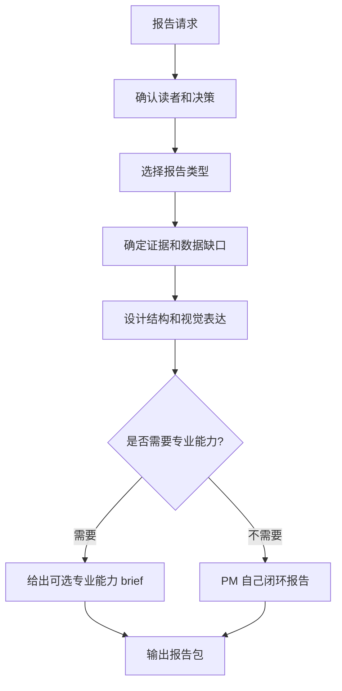

# PM 报告生产拓扑

## 1. 目标

先判断报告要帮用户做什么决定，再决定报告轻重、证据和视觉表达。

## 2. 拓扑图

## 3. 输出包

| 产物 | 用途 | 生命周期 |
| --- | --- | --- |
| 报告目标 | 明确帮用户决定什么 | 报告周期 |
| 证据计划 | 避免空报告 | 报告周期 |
| 视觉计划 | 决定表格、图、流程图等 | 报告周期 |
| 可选专业能力 brief | 说明哪些部分超出 PM 本地轻量能力 | 需要时 |
