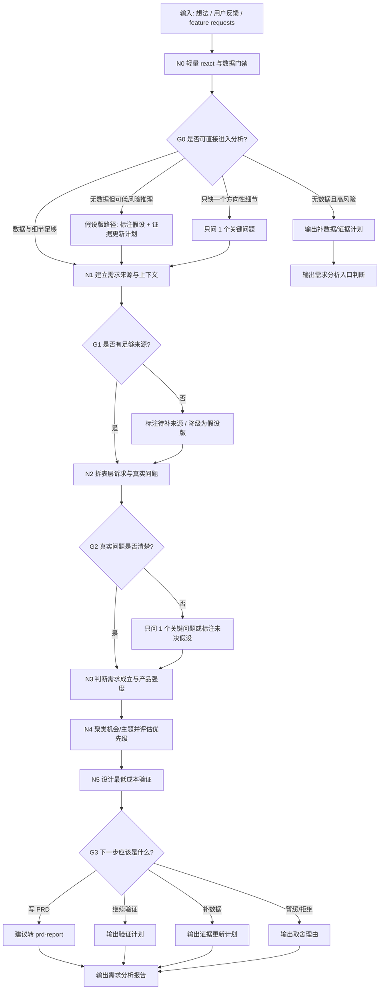

# 需求分析报告工作流拓扑

## 1. 目标

把原始想法、用户反馈或功能请求变成一份可确认的需求分析报告，回答：

- 这是不是一个真实需求？
- 真实问题是什么？
- 哪类用户在什么场景下受影响？
- 需求强度和优先级如何？
- 下一步应该验证、暂缓、拒绝，还是进入 PRD？

这个工作流不写正式 PRD，不自动分派其他 agent。需要正式开发输入时，下一步转 `workflows/prd-report/workflow.yaml` 或 `workflows/demand-management/workflow.yaml`。

进入完整报告前，先做轻量 react 与数据门禁：判断当前能不能直接分析、是否只能做假设版、是否需要先补数据，或是否只差一个关键问题。

## 2. 拓扑图

## 3. 节点备注

| 节点 | 责任 | 输入 | 输出 | 注意 |
| --- | --- | --- | --- | --- |
| N0 轻量 react 与数据门禁 | 判断当前理解、数据状态、细节状态和本轮路径 | 用户输入、可用上下文 | intake decision | 不做重度追问，不伪造数据 |
| G0 入口门禁 | 决定完整报告、假设版、补数据或只问 1 个问题 | intake decision | 路由结果 | 无数据不一定阻塞，但会阻塞确定结论 |
| N1 建立需求来源与上下文 | 记录用户原话、来源、数量、场景、已有证据 | 用户输入、项目文件、反馈列表 | 来源摘要 | 不靠聊天记忆补事实 |
| G1 来源门禁 | 判断证据是否足够 | 来源摘要 | 通过/待补 | 来源不足也能给假设版，但必须标注 |
| N2 拆表层诉求与真实问题 | 把“想要功能”翻译成“问题/机会” | 来源摘要 | 问题定义 | 不允许客户直接设计解决方案 |
| G2 问题门禁 | 判断是否需要追问 | 问题定义 | 通过/追问 | 只问影响方向的 1 个关键问题 |
| N3 判断需求成立与产品强度 | 用腾讯产品法判断需要、行动、成本、体验、取舍 | 问题定义 | 需求强度判断 | 不把“想要”当“需求成立” |
| N4 聚类机会/主题并评估优先级 | 对单个或批量需求做主题、机会、优先级判断 | 需求强度判断、反馈列表 | 机会/主题图、优先级 | 优先问题，不优先功能 |
| N5 设计最低成本验证 | 给出访谈、假门、原型、数据查询等验证动作 | 优先级结果 | 验证计划 | 先验证承重假设，不先写完整方案 |

## 4. 输出包

| 产物 | 作用 | 默认状态 |
| --- | --- | --- |
| 入口判断 | 判断数据状态、细节状态和本轮路径 | 草稿/待确认 |
| 需求分析报告 | 帮用户判断是否值得继续 | 草稿/待确认 |
| 真实问题陈述 | 把功能诉求还原成用户问题 | 草稿 |
| 需求强度判断 | 判断需要、行动、成本、产品强度 | 草稿 |
| 机会/主题地图 | 批量反馈时聚类和排序 | 可选 |
| 最低成本验证计划 | 决定下一步做什么 | 待确认 |
| 证据更新计划 | 数据不足时说明补什么、从哪补、补到什么标准 | 可选 |
| 下一步建议 | 转 PRD、继续验证、暂缓或拒绝 | 待确认 |
