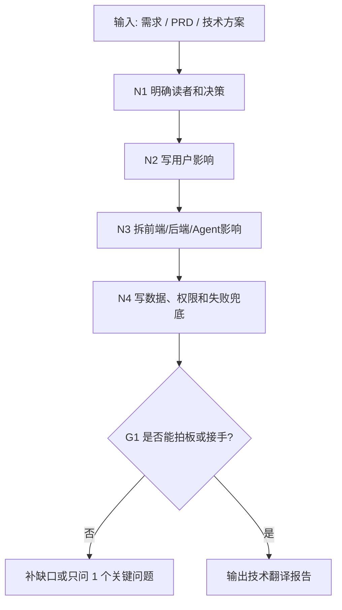

# 技术翻译报告工作流拓扑

## 1. 目标

把技术内容翻译成用户能判断、技术角色能接手的说明。

## 2. 拓扑图

## 3. 输出包

| 产物 | 作用 |
| --- | --- |
| 技术翻译报告 | 给用户和技术角色共读 |
| 影响矩阵 | 拆用户、前端、后端、Agent、运营影响 |
| 数据权限失败图 | 说明数据来源、权限和失败处理 |
| 兜底方案 | 自动化失败时怎么处理 |
