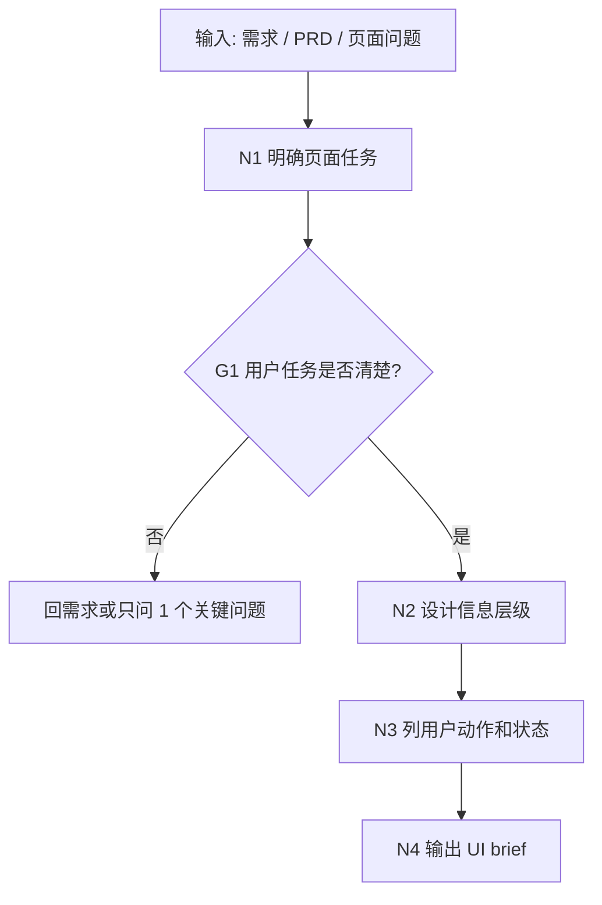

# UI Brief 与页面产品说明工作流拓扑

## 1. 目标

把需求翻译成设计和前端能理解的页面说明。

## 2. 拓扑图

## 3. 输出包

| 产物 | 作用 |
| --- | --- |
| UI brief | 给 UI/前端的产品说明 |
| 页面目标 | 说明用户来这里做什么 |
| 信息架构 | 排列内容优先级 |
| 状态清单 | 覆盖空态、加载、成功、失败、权限 |
