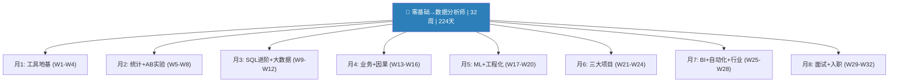

# 数据分析师 8 个月自学计划（32周强化版）

> 📐 **配套文档**：
> - [工程化学习方案（主材料）](D:\python_xuexi\工程化学习方案\README.md) — **27 个文件、25,000+ 行**，每天 20-30 分钟深度工程化训练
> - 每周 7 天：认知冲突→核心原理→鲜果多案例→动手练习→自检反馈——全流程覆盖
> - 📂 [W1-W32 周文件](D:\python_xuexi\工程化学习方案\) + [补充模块](D:\python_xuexi\工程化学习方案\补充模块_上.md) + [32 周总表](D:\python_xuexi\工程化学习方案\README.md)
> - 📋 [《工程化专项计划》](D:\python_xuexi\工程化专项计划.md) — 代码模板速查（CI/CD配置/logging模板/验证模式）
> - 📋 [《工程化每日任务清单》](D:\python_xuexi\工程化每日任务清单.md) — 旧版操作手册（保留作为速查）

> **母目标**：零基础 → 覆盖90%大厂JD，薪资20k-40k
> **起点**：2026-07-28（周一）| **终点**：2027-03-07
> **每日用时**：2-4 小时 | **总时长**：32 周 / 224 天
> **核心升级**：工程化第1周前置 + Hive/Spark/dbt/埋点实战 + 每月末验证节点

---

## 一、32周架构 vs 旧版24周

| 维度 | 旧版24周 | 新版32周 |
|------|---------|---------|
| Python工程化 | W17才学 | **W1起每周GitHub push + W19专项周** |
| Hive/Spark | 仅概念 | **W10-W11实战周：真写HQL+PySpark** |
| dbt/Airflow | 浏览1天 | **W20 3天实战：搭dbt模型+Airflow DAG** |
| 埋点设计 | 1天 | **W11专项：从PRD到埋点文档到验证** |
| 统计 | 1周 | **2周：概率+分布+推断分离（W5-W6）** |
| AB实验 | 2周 | **3周：基础+进阶+工业级实战分离（W6-W8）** |
| 因果推断 | 1周 | **2周：DID/PSM+工业案例分离（W14-W15）** |
| 综合项目 | 3周 | **4周：每个项目多2-3天深挖时间（W21-W24）** |
| 验证机制 | 无 | **每月末：闭卷自测+项目评分+盲区清单** |
| 面试冲刺 | 2周 | **4周：SQL+AB+因果+Case+模拟各分离（W29-W32）** |
| JD覆盖率 | ~75% | **~90%**（补了Spark/Hive/dbt/埋点实战） |
| **工程化训练** | **旧版：每日操作清单** | **🆕 新版：27个深度文件、25,000+行——每天20-30分钟深度训练** |

---

## 一、工程化学习方案如何使用

> ⚠️ **重要更新**：工程化训练材料已从旧版"操作清单"升级为**27个深度文件**（`D:\python_xuexi\工程化学习方案\`），每个文件含完整的 D1-D7 训练流程。

### 每天的标准流程

在学习主课之后——打开对应周的工程化文件，找到今天的日期：

1. **🔴 认知冲突**（2分钟）——先感受"现有知识不够用"的瞬间
2. **📖 核心原理**（10分钟）——理解这个概念为什么存在、怎么工作的
3. **🏢 鲜果多案例**（5分钟）——在真实场景中验证理解
4. **✍️ 动手练习**（10分钟）——自己写代码、git commit、push
5. **✅ 自检反馈**（3分钟）——对照答案，检查常见偏差

### 每天只需 20-30 分钟

工程化文件是深度材料——不是"每天照着打勾"的操作清单——而是**让你理解"为什么这样做"**的学习方案。旧版《工程化每日任务清单》保留作为速查——但学习工程化的主材料是这套新文件。

| 用途 | 旧版文件 | 新版文件（🆕） |
|------|---------|-------------|
| 理解"为什么" | ❌ 只告诉你做什么 | ✅ 认知冲突→核心原理→案例→练习 |
| 鲜果多连贯案例 | ❌ 无 | ✅ 32周在同一个场景中工作 |
| 面试准备 | ❌ 无 | ✅ 每周末闭卷自测+面试追问 |
| 代码模板速查 | ✅ 有 | ✅ 新版文件中含完整代码实现 |
| 每日操作清单 | ✅ 有 | 旧版保留——但主材料已切换 |

### 本周对应哪个工程化文件？

| 周 | 工程化文件 | 工程化重点 |
|----|----------|----------|
| W1-W4 | [W1](工程化学习方案/W1_掌控工具链.md) / [W2](工程化学习方案/W2_代码的可读与可信.md) / [W3](工程化学习方案/W3_数据的可靠管线.md) / [W4](工程化学习方案/W4_从脚本到项目.md) | Shell/Git/项目结构→Type Hints/logging→ETL/验证→图表/CI |
| W5-W8 | [W5](工程化学习方案/W5_统计计算的严谨性.md) / [W6](工程化学习方案/W6_AB实验基础工程.md) / [W7](工程化学习方案/W7_AB实验进阶工程.md) / [W8](工程化学习方案/W8_工业级AB与数据工程.md) | 浮点/p值→AB格式/SRM→CUPED→L2终验 |
| W9-W12 | [W9](工程化学习方案/W9_SQL高级与工程规范.md) / [W10](工程化学习方案/W10_Hive与大数据工程.md) / [W11](工程化学习方案/W11_埋点与数仓工程.md) / [W12](工程化学习方案/W12_指标体系与归因工程.md) | CTE分层→Hive分区→埋点契约→指标口径 |
| W13-W16 | [W13](工程化学习方案/W13_用户增长与项目架构.md) / [W14](工程化学习方案/W14_因果推断工程规范.md) / [W15](工程化学习方案/W15_准实验方法工程化.md) / [W16](工程化学习方案/W16_L3终验与综合项目.md) | 项目架构→DID→PSM/RDD→L3终验 |
| W17-W20 | [W17](工程化学习方案/W17_测试体系上篇.md) / [W18](工程化学习方案/W18_测试体系下篇.md) / [W19](工程化学习方案/W19_静态分析工具链.md) / [W20](工程化学习方案/W20_代码质量门禁与L4终验.md) | pytest→ML测试→ruff/mypy→L4终验 |
| W21-W24 | [W21](工程化学习方案/W21_项目1_架构设计与启动.md) / [W22](工程化学习方案/W22_项目2_数据质量体系.md) / [W23](工程化学习方案/W23_项目3_性能工程入门.md) / [W24](工程化学习方案/W24_作品集打磨与L5起步.md) | 三大项目+作品集+L5起步 |
| W25-W28 | [W25](工程化学习方案/W25_BI与工程接口.md) / [W26](工程化学习方案/W26_自动化报表与任务调度.md) / [W27](工程化学习方案/W27_Docker与容器化.md) / [W28](工程化学习方案/W28_端到端自动化与月7终验.md) | BI→cron→Docker→月7终验 |
| W29-W32 | [W29](工程化学习方案/W29_SQL面试冲刺.md) / [W30](工程化学习方案/W30_AB因果面试冲刺.md) / [W31](工程化学习方案/W31_Case面试与故障演练.md) / [W32](工程化学习方案/W32_L5终验与8月回顾.md) | SQL面试→AB/因果面试→Case→L5毕业 |

| 补充 | [补充模块_上](工程化学习方案/补充模块_上.md) / [补充模块_下](工程化学习方案/补充模块_下.md) | SQLAlchemy/openpyxl/Makefile/正则/FastAPI/S3/DVC/Sphinx |

---

## 二、知识地图

---

## 三、每月末验证节点

| 月末 | 验证内容 | 通过标准 |
|------|---------|---------|
| **月1 (W4末)** | Python+pandas+SQL闭卷(10题) + 第1个项目 | 8/10正确 + 项目含README/清洗/分析/可视化/GitHub Actions |
| **月2 (W8末)** | 统计+AB实验闭卷(10题) + 完整AB实验报告 | p值/CI/效应量/MDE全正确 + 报告含SRM/护栏/决策 |
| **月3 (W12末)** | SQL高级+Hive/Spark闭卷(8题) + 埋点文档 | 窗口函数/CTE/Gap闭卷手写 + 埋点文档含5事件+参数 |
| **月4 (W16末)** | 业务框架+因果推断闭卷(8题) + 增长诊断报告 | OSM/AARRR/RFM/DID/PSM框架默写 + 报告含四模块 |
| **月5 (W20末)** | ML+XGBoost+工程化闭卷(6题) + dbt项目 | sklearn流水线闭卷 + dbt含3层模型+测试 |
| **月6 (W24末)** | 三项目作品集评审 | 每个含README/数据/分析/报告/GitHub/STAR |
| **月7 (W28末)** | BI Dashboard + 自动化日报 + 行业报告 | Dashboard可交互 + 日报含完整自动化脚本 |
| **月8 (W32末)** | 全流程模拟面试 | 6环节各≥3/5分 + 最终JD覆盖率≥90% |

---

## 四、15本核心书单

| # | 书名 | 生态位 | 适用阶段 |
|---|------|--------|---------|
| 1 | 《Python编程：从入门到实践》 | 地基型 | W1-W2 |
| 2 | 《利用Python进行数据分析（第2版）》 | 手术刀型 | W2-W4 |
| 3 | 《Python广告数据挖掘与分析实战》 | 地图型 | W4,W19 |
| 4 | 《SQL必知必会（第5版）》 | 地基型 | W3-W4,W9 |
| 5 | 《SQL进阶教程》 | 手术刀型 | W3,W9-W10 |
| 6 | 《赤裸裸的统计学》 | 地基型 | W5 |
| 7 | 《用Python动手学统计学》 | 手术刀型 | W5-W6 |
| 8 | 《面向数据科学家的实用统计学》 | 地图型 | W6-W8 |
| 9 | 《数据科学工程实践：A/B实验》 | 手术刀型 | W7-W8,W11 |
| 10 | 《精益数据分析》 | 地图型 | W13-W14 |
| 11 | 《CDA一级认证教材（第4版）》 | 地基型 | 贯穿 |
| 12 | 《用户增长实战笔记》 | 手术刀型 | W13-W14 |
| 13 | 《电商流量数据化运营》 | 手术刀型 | W22 |
| 14 | 《模型思维》 | 地图型 | W15→W32 |
| 15 | 《噪声》 | 手术刀型 | W7-W8 |

---

## 五、完整 32 周每日计划

> 📌 **工程化交叉引用说明**：每天计划中的 `🆕 工程化` 条目给出了当天的工程化训练主题。对应的深度内容在 `工程化学习方案\W[x]_xxx.md` 的同一天（D1-D7）中。例如 W1D1 的工程化内容在 `工程化学习方案\W1_掌控工具链.md` → D1 章节。旧版《工程化专项计划》和《工程化每日任务清单》保留作为代码模板速查和操作清单——但主学习材料是这套深度文件。

---

# 第 1 个月：工具地基 + 工程化前置（7/28 — 8/24）

## 第 1 周：Python 强化 + Git + 分析思维（7/28 — 8/3）

> 🎯 本周目标：能用 Python 独立完成数据加载→清洗→分析→可视化→导出 CSV 的完整流程，代码在 src/ 里，github 上有绿点

### 周一（7/28）
> 📌 今日目标：能说出 Python 四大容器的选型决策树（什么时候用 list/dict/tuple/set），终端不害怕了
📓 工具线：`data_analyst_plan\month_01\week_01\day_01\周一_Python数据模型与容器.ipynb` — 变量标签模型、四大容器、容器选择决策树 | 思维线：`analyst_thinking_learn\week_01\day_01\周一_数据分析的本质.ipynb` — 五步法、假设驱动
🅱 B 站：孙兴华《Python分析三部曲》P1-P2（环境搭建+jupyter）→ B站搜索"孙兴华 Python数据分析"
🐳 和鲸：Fork《Python数据分析合集：零基础》→ https://www.heywhale.com/mw/project/67a5b279414b53320ea67ef8 — 跑通前3个cell
🐶 Kaggle：注册账号，浏览 Online Retail → https://www.kaggle.com/datasets/carrie1/ecommerce-data
📖 微信读书：《Python编程：从入门到实践》第1-2章 | 起步+变量和简单数据类型——跟着每章练习敲代码
🆕 工程化：[W1](工程化学习方案/W1_掌控工具链.md) — Shell/Git/目录设计 创建 `data-analyst-journey` 仓库 → `git init/add/commit/push`

### 周二（7/29）
> 📌 今日目标：能写出 if/for/while/try 四种控制流，代码从 notebook 搬进 src/ 后 main.py 能跑通
📓 工具线：`data_analyst_plan\month_01\week_01\day_02\周二_控制流全量.ipynb` — if/for/while/try | 思维线：`analyst_thinking_learn\week_01\day_02\周二_指标的第一性原理.ipynb` — 真指标/虚荣指标/北极星
🅱 B 站：孙兴华《Python分析三部曲》P3-P4 → B站搜索"孙兴华 Python数据分析"
🐳 和鲸：《Python数据分析合集》— 完成"数据类型与容器"模块
🐶 Kaggle：下载 Online Retail，`pd.read_csv()` 加载，`df.info()`+`df.describe()`
📖 微信读书：《Python编程：从入门到实践》第3-5章 | 列表+操作列表+if语句——控制流全量
🆕 工程化：[W1](工程化学习方案/W1_掌控工具链.md) — Shell/Git/目录设计 代码 push GitHub + 写3行docstring

### 周三（7/30）
> 📌 今日目标：能给函数写出一句话 docstring，知道 def/lambda/推导式三者的使用场景区别
📓 工具线：`data_analyst_plan\month_01\week_01\day_03\周三_函数与函数式编程.ipynb` — def/lambda/推导式/LEGB | 思维线：`analyst_thinking_learn\week_01\day_03\周三_OSM模型.ipynb`
🅱 B 站：孙兴华《Python分析三部曲》P5-P6 → B站搜索"孙兴华 Python数据分析"
🐳 和鲸：《Python数据分析合集》— 完成"函数与推导式"模块
🐶 Kaggle：Online Retail — 计算TotalSales=Quantity×UnitPrice，找Top10产品
📖 微信读书：《Python编程：从入门到实践》第6-8章 | 字典+用户输入+函数——函数与代码组织
🆕 工程化：[W1](工程化学习方案/W1_掌控工具链.md) — Shell/Git/目录设计 写 `README.md`（含功能/环境/快速开始/输入/输出）→ push

### 周四（7/31）
> 📌 今日目标：能用 Python 读写 CSV/JSON 文件，能用 re 做简单的模式匹配，.gitignore 里 8 条规则不含糊
📓 工具线：`data_analyst_plan\month_01\week_01\day_04\周四_文件IO与字符串与正则.ipynb` — csv/json/re | 思维线：`analyst_thinking_learn\week_01\day_04\周四_CMOP模型.ipynb`
🅱 B 站：孙兴华《Python分析三部曲》P7-P8 → B站搜索"孙兴华 Python数据分析"
🐳 和鲸：《Python数据分析合集》— 完成"文件IO与数据处理"模块
🐶 Kaggle：Online Retail — 按Country分组统计销售额，画柱状图，导出CSV
📖 微信读书：《Python编程：从入门到实践》第10章+附录 | 文件和异常——文件IO实战
🆕 工程化：[W1](工程化学习方案/W1_掌控工具链.md) — Shell/Git/目录设计 创建 `.gitignore`（排除 `__pycache__/` `.ipynb_checkpoints/` `venv/` `output/`）→ push

### 周五（8/1）
> 📌 今日目标：能把代码拆成 io.py/clean.py/analyze.py 三个文件，知道每个文件放什么不放什么
📓 工具线：`data_analyst_plan\month_01\week_01\day_05\周五_代码组织与模块化.ipynb` — import/venv/PEP8 | 思维线：`analyst_thinking_learn\week_01\day_05\周五_指标拆解.ipynb`
🅱 B 站：孙兴华《Python分析三部曲》P9-P10 → B站搜索"孙兴华 Python数据分析"
🐳 和鲸：《Python数据分析合集》— 完成"模块化与项目组织"模块
🐶 Kaggle：Online Retail — 拆成 io.py/clean.py/analyze.py/main.py
📖 微信读书：《Python编程：从入门到实践》第9章+第11章 | 类+测试代码——代码组织与模块化
🆕 工程化：[W1](工程化学习方案/W1_掌控工具链.md) — Shell/Git/目录设计 `src/io.py` `src/clean.py` `src/analyze.py` `main.py` → push → 验证 `python main.py` 不报错

### 周六（8/2）
> 📌 今日目标：能独立完成第一个周项目（读→洗→分析→输出），GitHub Actions 第一次看到绿色 ✓
📓 工具线+思维线：周项目——电商订单分析工具 | `analyst_thinking_learn\week_01\day_06\周六_异动分析入门.ipynb`
🅱 B 站：数据分析小兵《Python全流程项目实战》P1-P2 → B站搜索"数据分析小兵 项目实战"
🐳 和鲸：https://www.heywhale.com/home/dataset — 自选数据→读取→清洗→分析→200字结论
🐶 Kaggle：Online Retail — 写200字数据报告（含1张趋势图+1个发现+1条建议）
📖 微信读书：《赤裸裸的统计学》第1章 | 什么是统计学
🆕 工程化：[W1](工程化学习方案/W1_掌控工具链.md) — Shell/Git/目录设计 完整项目push → 配置 `.github/workflows/test.yml`（参考第12章（CI/CD配置））→ push后看到绿色✓

### 周日（8/3）
> 📌 今日目标：闭卷写出本周学的 5 个 git 命令+10 个 Python 核心概念，缺什么补什么
📓 工具线+思维线：闭卷自测 | `analyst_thinking_learn\week_01\day_07\周日_周复习.ipynb`
🅱 B 站：戴师兄《SQL必知必会》P1 → B站搜索"戴师兄 SQL" — 预习
🐳 和鲸：和鲸社区 → https://www.heywhale.com/home/project — 搜索当天主题关键词，浏览相关项目
🐶 Kaggle：Kaggle → https://www.kaggle.com/ — 搜索当天主题，找1个高分Notebook学习
📖 微信读书：《SQL必知必会》第1-3课 | SELECT/FROM/WHERE

---

## 第 2 周：pandas 全量 + 用户增长分析（8/4 — 8/10）

> 🎯 本周目标：能用 pandas 完成 groupby/merge/pivot/apply 四大核心操作，代码有 Type Hints，所有 print 改成 logger

### 周一（8/4）
> 📌 今日目标：能用 loc/iloc/布尔索引 三种方式取数据，不搞混，代码归入正确的 src/ 文件
📓 工具线：`month_01\week_02\day_01\周一_DataFrame核心思维.ipynb` — 六板斧/loc/iloc/布尔索引 | 思维线：`analyst_thinking_learn\week_02\day_01\周一_AARRR海盗模型.ipynb`
🅱 B 站：孙兴华《pandas精讲》P1-P3 → B站搜索"孙兴华 pandas"
🐳 和鲸：搜索"电商综合分析案例" → Fork跑数据概览
🐶 Kaggle：E-Commerce Sales DB → https://www.kaggle.com/datasets/rishabhrawat19/e-commerce-sales-database-sql-capstone-project
📖 微信读书：《利用Python进行数据分析》第4章 | DataFrame/Series——每个示例敲一遍
🆕 工程化：[W2](工程化学习方案/W2_代码的可读与可信.md) — 模块/logging/TypeHints/docstring 创建 `.gitignore`（排除 `__pycache__/` `.ipynb_checkpoints/` `venv/` `output/`）→ push 加 `__pycache__/` 和 `.ipynb_checkpoints/`

### 周二（8/5）
> 📌 今日目标：能给 2 个函数加上完整 Type Hints（参数+返回值），不查资料也知道 pd.DataFrame 怎么标注
📓 工具线：groupby/agg/transform——核心区别+cumsum/rolling | 思维线：`analyst_thinking_learn\week_02\day_02\周二_同期群分析.ipynb`
🅱 B 站：孙兴华《pandas精讲》P4-P6 → B站搜索"孙兴华 pandas"
🐳 和鲸：《电商综合分析案例》— 跟写分组聚合部分
🐶 Kaggle：E-Commerce DB — orders按customer_id分组，订单数/总消费/平均消费
📖 微信读书：《利用Python进行数据分析》第4章 | 索引/运算/排序——结合groupby
🆕 工程化：[W2](工程化学习方案/W2_代码的可读与可信.md) — 模块/logging/TypeHints/docstring 给今天写的每个函数加类型注解 → push

### 周三（8/6）
> 📌 今日目标：能在 merge 后加 assert 验证行数不丢失，知道 LEFT JOIN+WHERE 的陷阱原理
📓 工具线：merge/concat/join+行数膨胀检测四步法 | 思维线：`analyst_thinking_learn\week_02\day_03\周三_漏斗分析.ipynb`
🅱 B 站：孙兴华《pandas精讲》P7-P9 → B站搜索"孙兴华 pandas"
🐳 和鲸：《电商综合分析案例》— 多表关联
🐶 Kaggle：E-Commerce DB — orders JOIN customers JOIN products
📖 微信读书：《利用Python进行数据分析》第5章前半 | 缺失值/重复值/异常值
🆕 工程化：[W2](工程化学习方案/W2_代码的可读与可信.md) — 模块/logging/TypeHints/docstring 加 `assert` 验证 merge 前后行数 → push

### 周四（8/7）
> 📌 今日目标：能用向量化替代 for 循环，代码注释里记录性能对比数据（提升倍数）
📓 工具线：apply/map/str/dt+向量化性能（for vs apply vs 向量化，差1500倍） | 思维线：`analyst_thinking_learn\week_02\day_04\周四_留存分析与LTV.ipynb`
🅱 B 站：孙兴华《pandas精讲》P10-P12 → B站搜索"孙兴华 pandas"
🐳 和鲸：搜索"Cohort 留存分析" → Fork
🐶 Kaggle：Online Retail — 构建Cohort留存三角矩阵，seaborn heatmap
📖 微信读书：《利用Python进行数据分析》第5章后半+第6章 | merge/concat/join+规整
🆕 工程化：[W2](工程化学习方案/W2_代码的可读与可信.md) — 模块/logging/TypeHints/docstring 用 `logging.info` 记录三种写法的耗时 → push

### 周五（8/8）
> 📌 今日目标：能把 2 个 print 改成 logger.info，终端输出出现时间戳格式，理解 print vs logging 的区别
📓 工具线：pivot_table/melt+SettingWithCopyWarning | 思维线：`analyst_thinking_learn\week_02\day_05\周五_RFM用户分群.ipynb`
🅱 B 站：孙兴华《pandas精讲》P13-P15 → B站搜索"孙兴华 pandas"
🐳 和鲸：搜索"RFM模型 Python" → Fork
🐶 Kaggle：Online Retail — 完整RFM分群（分位数打分→八类标签→分层汇总）
📖 微信读书：《精益数据分析》第1-2章 | 好的指标vs虚荣指标
🆕 工程化：[W2](工程化学习方案/W2_代码的可读与可信.md) — 模块/logging/TypeHints/docstring 将所有 `print()` 替换为 `logging.info/warning/error` → push

### 周六（8/9）
> 📌 今日目标：能写出含 5 个章节的 README，新 clone 的人照着 README 能跑通项目
📓 工具线+思维线：周项目——pandas季度经营分析 | `analyst_thinking_learn\week_02\day_06\周六_PDS日活拆解.ipynb`
🅱 B 站：数据分析小兵《用户画像项目实战》→ B站搜索"数据分析小兵 用户画像"
🐳 和鲸：独立完成季度经营报告（读取→清洗→聚合→RFM→可视化→200字结论）
🐶 Kaggle：Walmart Sales → 搜索 kaggle "Walmart Sales Dataset" — 清洗→3张图→200字结论
📖 微信读书：《精益数据分析》第3-5章 | 增长引擎+用户获取+激活
🆕 工程化：[W2](工程化学习方案/W2_代码的可读与可信.md) — 模块/logging/TypeHints/docstring 完整项目 push + 更新 README

### 周日（8/10）
> 📌 今日目标：项目中 0 个 print 残留，grep "print(" 返回空
📓 工具线+思维线：闭卷自测 | `analyst_thinking_learn\week_02\day_07\周日_周复习.ipynb`
🅱 B 站：戴师兄《SQL必知必会》P2-P3 → B站搜索"戴师兄 SQL"
🐳 和鲸：和鲸社区 → https://www.heywhale.com/home/project — 搜索当天主题关键词，浏览相关项目
🐶 Kaggle：Kaggle → https://www.kaggle.com/ — 搜索当天主题，找1个高分Notebook学习
📖 微信读书：《SQL必知必会》第4-6课 | 函数/分组/子查询
🆕 工程化：[W2](工程化学习方案/W2_代码的可读与可信.md) — 模块/logging/TypeHints/docstring 本周代码 review → 删所有 `print` 改 `logging` → 检查命名规范（无 `x` `d` `tmp`）→ push

---

## 第 3 周：SQL 全量 + 高级分析框架（8/11 — 8/17）

> 🎯 本周目标：能用 SQL 写出窗口函数+CTE+JOIN 三类查询，查询结果用 pandas 二次验证，错题入 GitHub Issue

### 周一（8/11）
> 📌 今日目标：能把 SQL 查询结果导出 CSV，用 pandas 加载并验证行数+聚合值，SQL 和 Python 双向打通
📓 工具线：SQL基础——SELECT→WHERE→GROUP BY→HAVING→执行顺序/子查询 | 思维线：`analyst_thinking_learn\week_03\day_01\周一_归因模型.ipynb` — 六种归因/末次陷阱
🅱 B 站：戴师兄《SQL必知必会》P4-P5 → B站搜索"戴师兄 SQL"
🐳 和鲸：搜索"SQL 进阶技巧" → 跟做SELECT+GROUP BY
🐶 Kaggle：E-Commerce DB — 5条SELECT+GROUP BY（按月/品类/城市/支付/高消费）
📖 微信读书：《SQL必知必会》第7-9课 | 创建计算字段/函数/汇总
🆕 工程化：[W3](工程化学习方案/W3_数据的可靠管线.md) — 数据验证/ETL/依赖管理/错题管理 将SQL查询结果导出为CSV → 用pandas加载并验证行数+聚合值 → push

### 周二（8/12）
> 📌 今日目标：能在代码注释里记录 SQL 陷阱的"错误→正确→教训"三段式，不是看过就忘
📓 工具线：JOIN全系——INNER/LEFT/RIGHT/FULL/CROSS+三大陷阱 | 思维线：`analyst_thinking_learn\week_03\day_02\周二_系统化分析框架.ipynb` — ISS框架
🅱 B 站：戴师兄《SQL必知必会》P6-P8 → B站搜索"戴师兄 SQL"
🐳 和鲸：搜索"SQL JOIN实战" — 跟做多表关联
🐶 Kaggle：E-Commerce DB — 3条JOIN（orders+customers/products/payments）
📖 微信读书：《SQL必知必会》第10-12课 | JOIN全系——重点攻LEFT JOIN+WHERE陷阱
🆕 工程化：[W3](工程化学习方案/W3_数据的可靠管线.md) — 数据验证/ETL/依赖管理/错题管理 在代码注释中记录 SQL 陷阱（LEFT JOIN+WHERE右表条件=INNER JOIN）→ push

### 周三（8/13）
> 📌 今日目标：能生成干净的 requirements.txt（只含直接依赖，≤10 行），知道底层依赖不需要列
📓 工具线：窗口函数——ROW_NUMBER/RANK/LAG/SUM OVER/ROWS vs RANGE | 思维线：`analyst_thinking_learn\week_03\day_03\周三_定价与补贴ROI.ipynb`
🅱 B 站：戴师兄《SQL必知必会》P9-P10 → B站搜索"戴师兄 SQL"
🐳 和鲸：搜索"SQL 窗口函数" → 跟做5道
🐶 Kaggle：E-Commerce DB — ROW_NUMBER/LAG/SUM OVER/移动平均/百分位排名
📖 微信读书：《SQL进阶教程》第1-2章 | CASE+窗口函数——每道例题先自己做再看答案
🆕 工程化：[W3](工程化学习方案/W3_数据的可靠管线.md) — 数据验证/ETL/依赖管理/错题管理 push

### 周四（8/14）
> 📌 今日目标：CTE 代码格式整洁——每层独立命名+空行分隔+缩进一致，别人看了不皱眉
📓 工具线：CTE+递归CTE+三大模板(留存/漏斗/连续登录) | 思维线：`analyst_thinking_learn\week_03\day_04\周四_数据产品一.ipynb`
🅱 B 站：戴师兄《SQL必知必会》P11 → B站搜索"戴师兄 SQL"
🐳 和鲸：搜索"SQL CTE" → 跟做
🐶 Kaggle：E-Commerce DB — 3-CTE链式查询+留存率CTE
📖 微信读书：《SQL进阶教程》第3-4章 | 自连接+GROUP BY进阶
🆕 工程化：[W3](工程化学习方案/W3_数据的可靠管线.md) — 数据验证/ETL/依赖管理/错题管理 push

### 周五（8/15）
> 📌 今日目标：能给 SQL 加 EXPLAIN 分析注释，看到 type=ALL 就知道要优化（加索引或改写法）
📓 工具线：查询优化+反模式——EXPLAIN/索引/8大反模式 | 思维线：`analyst_thinking_learn\week_03\day_05\周五_数据产品二.ipynb`
🅱 B 站：戴师兄《SQL必知必会》P12 → B站搜索"戴师兄 SQL"
🐳 和鲸：搜索"SQL 性能优化" → 看3个案例
🐶 Kaggle：E-Commerce DB — 给常用查询写EXPLAIN，分析type/rows/Extra
📖 微信读书：《SQL进阶教程》第5-7章 | HAVING/EXISTS/集合运算
🆕 工程化：[W3](工程化学习方案/W3_数据的可靠管线.md) — 数据验证/ETL/依赖管理/错题管理 push + EXPLAIN分析注释

### 周六（8/16）
> 📌 今日目标：GitHub Issues 里有至少 1 条 SQL 错题记录，格式标准化（错→对→教训）
📓 工具线：15道大厂真题限时120分钟 | 思维线：`analyst_thinking_learn\week_03\day_06\周六_数据治理与质量.ipynb`
🅱 B 站：戴师兄《SQL必知必会》→ B站搜索"戴师兄 SQL"
🐳 和鲸：搜索"SQL 面试题" → 限时刷10道
🐶 Kaggle：Kaggle SQL Scavenger Hunt → 搜索 kaggle "SQL Scavenger Hunt" — 3条复杂查询
📖 微信读书：《SQL进阶教程》第8-10章 | 递归查询+窗口函数实战+性能优化
🆕 工程化：[W3](工程化学习方案/W3_数据的可靠管线.md) — 数据验证/ETL/依赖管理/错题管理 在 GitHub 上创建 Issue 记录本周错题（标签：bug/sql）→ push

### 周日（8/17）
> 📌 今日目标：L1 验收清单 7 项全部打勾，clone 到新目录后 pip install→python main.py 能跑通
📓 工具线+思维线：Hive初识+周复习
🅱 B 站：戴师兄《SQL必知必会》P13 → B站搜索"戴师兄 SQL"
🐳 和鲸：和鲸社区 → https://www.heywhale.com/home/project — 搜索当天主题关键词，浏览相关项目
🐶 Kaggle：Kaggle → https://www.kaggle.com/ — 搜索当天主题，找1个高分Notebook学习
📖 微信读书：《SQL进阶教程》全书速查复习
🆕 工程化：[W3](工程化学习方案/W3_数据的可靠管线.md) — 数据验证/ETL/依赖管理/错题管理 对照《工程化专项计划》第19章（验收清单） → 逐项自查 → push

---

## 第 4 周：可视化+清洗+数据工程（8/18 — 8/24）

> 🎯 本周目标：能独立完成第一个月度项目——含完整 README/清洗/分析/可视化/CI 绿灯，换台电脑 clone 后能跑通

### 周一（8/18）
> 📌 今日目标：所有画图函数在 visualize.py 里，每个返回 (fig, ax)，main.py 只调不画
📓 工具线：matplotlib——fig,ax=plt.subplots()/五种图表/美化 | 思维线：`analyst_thinking_learn\week_04\day_01\周一_数据从哪来.ipynb`
🅱 B 站：孙兴华《Python可视化》P1-P3 → B站搜索"孙兴华 matplotlib"
🐳 和鲸：搜索"共享单车数据分析" → Fork跑可视化
🐶 Kaggle：Online Retail — 3张图（月度趋势/TOP10产品/国家分布），结论式标题
📖 微信读书：《利用Python进行数据分析》第9章前半 | matplotlib入门+五种图表
🆕 工程化：[W4](工程化学习方案/W4_从脚本到项目.md) — 图表/Parquet/pipe/CI/L1终验 push

### 周二（8/19）
> 📌 今日目标：每张图标题说结论不说内容——看完标题就知道这张图要表达什么
📓 工具线：seaborn——heatmap/pairplot/catplot+图表叙事 | 思维线：`analyst_thinking_learn\week_04\day_02\周二_数仓建模一.ipynb`
🅱 B 站：孙兴华《Python可视化》P4-P7 → B站搜索"孙兴华 matplotlib"
🐳 和鲸：《共享单车数据分析》— 完成全部可视化
🐶 Kaggle：Online Retail — seaborn heatmap做Cohort热力图，pairplot探索
📖 微信读书：《利用Python进行数据分析》第9章后半 | seaborn+图表美化
🆕 工程化：[W4](工程化学习方案/W4_从脚本到项目.md) — 图表/Parquet/pipe/CI/L1终验 push

### 周三（8/20）
> 📌 今日目标：知道 Parquet 比 CSV 快多少（有具体数字），logger 输出了读写时间和文件大小对比
📓 工具线：数据清洗——MCAR/MAR/MNAR/IQR/Z-score/IsolationForest | 思维线：`analyst_thinking_learn\week_04\day_03\周三_数仓建模二.ipynb`
🅱 B 站：数据分析小兵《数据清洗实战》→ B站搜索"数据分析小兵 数据清洗"
🐳 和鲸：搜索"数据清洗 实战" → Fork含脏数据项目
🐶 Kaggle：Dirty Cafe Sales → https://www.kaggle.com/datasets/ahmedmohamed2003/cafe-sales-dirty-data-for-cleaning-training — 缺失值分析报告
📖 微信读书：《利用Python进行数据分析》第5章重读 | 用Dirty Cafe Sales亲手验证MCAR/MAR/MNAR
🆕 工程化：[W4](工程化学习方案/W4_从脚本到项目.md) — 图表/Parquet/pipe/CI/L1终验 push

### 周四（8/21）
> 📌 今日目标：清洗流程用 pipe 串联，没有中间变量 df1/df2/df3/df4
📓 工具线：大文件——chunksize/category/Parquet/CSV vs Parquet实测 | 思维线：`analyst_thinking_learn\week_04\day_04\周四_Hive与大数据处理.ipynb`
🅱 B 站：黑马程序员《大数据Hive入门》P1-P5 → B站搜索"黑马程序员 Hive"
🐳 和鲸：搜索"数据管道 ETL" → Fork
🐶 Kaggle：Dirty Cafe Sales — chunksize=2000→清洗→Parquet，对比CSV vs Parquet
📖 微信读书：《利用Python进行数据分析》第6章重读 | merge/concat/join进阶
🆕 工程化：[W4](工程化学习方案/W4_从脚本到项目.md) — 图表/Parquet/pipe/CI/L1终验 用 `logging.info` 记录 CSV vs Parquet 的读写时间+文件大小对比 → push

### 周五（8/22）
> 📌 今日目标：全项目 print 清零（grep 返回空），所有输出统一走 logger
📓 工具线：清洗流水线——pipe链式+综合项目"鲜果多"20+数据质量问题 | 思维线：`analyst_thinking_learn\week_04\day_05\周五_数据倾斜与查询优化.ipynb`
🅱 B 站：黑马程序员《Hive调优实战》P1-P5 → B站搜索"黑马程序员 Hive调优"
🐳 和鲸：搜索"数据倾斜" → Fork理解
🐶 Kaggle：Kaggle → https://www.kaggle.com/ — 搜索当天主题，找1个高分Notebook学习
📖 微信读书：《利用Python进行数据分析》第7章重读 | groupby/agg/transform+pipe
🆕 工程化：[W4](工程化学习方案/W4_从脚本到项目.md) — 图表/Parquet/pipe/CI/L1终验 push

### 周六（8/23）
> 📌 今日目标：第一个月项目完整 push——含 5 模块+README+CI，GitHub Actions 绿灯
📓 工具线+思维线：第一月综合项目——"鲜果多"完整经营分析报告 | `analyst_thinking_learn\week_04\day_06\周六_数仓综合练习.ipynb`
🅱 B 站：数据伊森《电商数据分析实战》P1 → B站搜索"数据伊森 电商数据分析"
🐳 和鲸：和鲸社区 → https://www.heywhale.com/home/project — 搜索当天主题关键词，浏览相关项目
🐶 Kaggle：Titanic → https://www.kaggle.com/c/titanic — pandas+seaborn完整EDA
📖 微信读书：《Python广告数据挖掘与分析实战》第1-2章 | 快速浏览
🆕 工程化：[W4](工程化学习方案/W4_从脚本到项目.md) — 图表/Parquet/pipe/CI/L1终验 完整项目push → 确保含README/清洗/分析/可视化/GitHub Actions绿灯

### 周日（8/24）— 🆕 月1验证节点
> 📌 今日目标：闭卷写 Python/pandas/SQL 自测题正确 ≥8/10，Top3 盲区清单已列出
📓 工具线+思维线：月度回顾+10道闭卷自测+第1月能力自评+300字变化总结
🅱 B 站：戴师兄《SQL必知必会》P14-P15 → B站搜索"戴师兄 SQL"
🐳 和鲸：和鲸社区 → https://www.heywhale.com/home/project — 搜索当天主题关键词，浏览相关项目
🐶 Kaggle：Kaggle → https://www.kaggle.com/ — 搜索当天主题，找1个高分Notebook学习
📖 微信读书：《精益数据分析》第6-10章 | 留存/营收/病毒传播——预习
🆕 验证：Python/pandas/SQL闭卷10题≥8/10 + 项目评级（对照《工程化专项计划》第19章（L1验收清单）） + Top3盲区清单

---

# 第 2 个月：统计地基 + AB实验（8/25 — 9/21）

## 第 5 周：概率 + 描述统计（8/25 — 8/31）

> 🎯 本周目标：能用大白话解释 p 值/置信区间/中心极限定理/大数定律，每个概念配一段 Python 验证代码

### 周一（8/25）— 概率论基础
> 📌 今日目标：能给统计函数写完整 Google 风格 docstring（Args+Returns+Example），requirements.txt 干净
📓 工具线+思维线：概率三种理解/大数定律Python验证/条件概率方向不能互换/独立≠互斥/期望方差
🅱 B 站：宋浩《概率论与数理统计》P1-P5 → B站搜索"宋浩 概率论"
🐳 和鲸：搜索"教育平台用户行为分析" → Fork跑EDA
🐶 Kaggle：Python模拟硬币抛掷10000次验证大数定律
📖 微信读书：《用Python动手学统计学》第1章 | 用代码验证大数定律
🆕 验证：闭卷解释"独立和互斥的区别"——录音30秒

### 周二（8/26）— 五大分布
> 📌 今日目标：概率模拟函数有完整 Type Hints，知道 np.ndarray/pd.DataFrame 在标注中的区别
📓 工具线+思维线：二项/泊松/正态/指数/幂律——QQ图/Shapiro-Wilk/KS检验
🅱 B 站：宋浩《概率论与数理统计》P6-P10 → B站搜索"宋浩 概率论"
🐳 和鲸：搜索"统计检验 Python" → Fork
🐶 Kaggle：Bike Sharing → 搜索 kaggle "Bike Sharing Dataset" — 直方图拟合正态+QQ图
📖 微信读书：《用Python动手学统计学》第2章 | scipy.stats模拟四种分布
🆕 验证：画四种分布PMF/PDF图，写注释"适合什么业务场景"

### 周三（8/27）— 描述统计+EDA八步
> 📌 今日目标：统计检验输出从 print 改成 logger.info，日志含 KS 统计量+p 值+效应量
📓 工具线+思维线：中心趋势选择/离散度/偏度峰度/箱线图五要素/EDA八步
🅱 B 站：可汗学院《统计学》P1-P10 → B站搜索"可汗学院 统计学"
🐳 和鲸：搜索"教育平台用户行为分析" → 完整EDA
🐶 Kaggle：Bike Sharing — 描述统计→分组箱线图→相关性热力图
📖 微信读书：《用Python动手学统计学》第3章 | 描述统计——全部代码实现
🆕 验证：写150字"非技术同事能看懂"的描述统计小结

### 周四（8/28）— 推断统计（上）
> 📌 今日目标：validate_input 函数写好了，每个 EDA 函数开头都调用它检查数据
📓 工具线+思维线：抽样分布/SE vs σ/CLT/CI正确解读/Bootstrap
🅱 B 站：可汗学院《统计学》P11-P20 → B站搜索"可汗学院 统计学"
🐳 和鲸：搜索"Bootstrap Python" → Fork
🐶 Kaggle：Bike Sharing — Bootstrap 1000次，计算95% CI
📖 微信读书：《用Python动手学统计学》第4章 | SE/CLT/CI/Bootstrap——闭卷重写
🆕 验证：闭卷写出"标准差vs标准误"的大白话解释

### 周五（8/29）— 推断统计（下）
> 📌 今日目标：能闭卷写出 p 值的正确定义+3 个常见误解，docstring 里不许写"原假设为真的概率"
📓 工具线+思维线：假设检验/p值5大误解/Cohen's d/Welch's t/非参检验(Mann-Whitney U/卡方/Kruskal-Wallis)/参数vs非参决策表
🅱 B 站：可汗学院《统计学》P21-P30 → B站搜索"可汗学院 统计学"
🐳 和鲸：搜索"统计检验 Python" → 全部检验代码跑一遍
🐶 Kaggle：Bike Sharing — Welch's t/Kruskal-Wallis/卡方
📖 微信读书：《用Python动手学统计学》第5章 | 每个检验自己写一遍
🆕 验证：闭卷写出p值正确定义+3个常见误解——录音30秒

### 周六（8/30）— 统计陷阱+时间序列入门
> 📌 今日目标：能用 Python 重现辛普森悖论，大白话解释"为什么总数会骗人——分组权重不同"
📓 工具线+思维线：辛普森悖论/幸存者偏差/p-hacking/多重检验(Bonferroni vs BH)/时序(趋势/季节/残差/ACF)
🅱 B 站：9年大厂数分 BV1mGcDzgEee（25分钟串讲）
🐳 和鲸：搜索"时间序列 Python" → Fork
🐶 Kaggle：Bike Sharing — 时序分解+ACF+季节性Naive预测
📖 微信读书：《赤裸裸的统计学》第5-8章 | 概率分布→假设检验——大白话重读
🆕 验证：Python重现辛普森悖论——给"只看总数被骗"的例子

### 周日（8/31）— 周复习
> 📌 今日目标：8 道统计闭卷题正确 ≥6/8，能在新目录 clone 后跑通项目
📓 工具线+思维线：W5知识地图+闭卷自测8题+写200字"p值是什么意思"
🅱 B 站：宋浩《概率论》总复习 → B站搜索"宋浩 概率论 期末复习"
🐳 和鲸：和鲸社区 → https://www.heywhale.com/home/project — 搜索当天主题关键词，浏览相关项目
🐶 Kaggle：Kaggle → https://www.kaggle.com/ — 搜索当天主题，找1个高分Notebook学习
📖 微信读书：《赤裸裸的统计学》第9-10章 | 回归/t检验陷阱——为AB实验铺垫
🆕 验证：8题闭卷≥6/8通过

---

## 第 6 周：AB 实验（上）—— 原理→设计→分析（9/1 — 9/7）

> 🎯 本周目标：能独立完成 AB 实验全流程——从模拟 PM 需求→设计→SRM 检验→z-test 分析→护栏检查→决策建议

### 周一（9/1）
> 📌 今日目标：run_z_test 函数返回标准化 Dict（5 字段），这个格式将成为所有实验函数的统一输出
📓 工具线+思维线：`analyst_thinking_learn\week_07\day_01\周一_AB实验是什么.ipynb` — 随机化/SUTVA/三要素
🅱 B 站：卡卡《AB实验系列》第1-2节 → B站搜索"卡卡的AB实验"
🐳 和鲸：和鲸"电商页面A/B测试" → https://www.heywhale.com/mw/project/15f8c4c25e48a3f00302bdc66
🐶 Kaggle：AB Testing Practice → https://www.kaggle.com/datasets/adarsh0806/ab-testing-practice
📖 微信读书：《面向数据科学家的实用统计学》第3章 | 闭卷解释随机化为什么消除混淆

### 周二（9/2）
> 📌 今日目标：z-test 日志输出能直接贴进实验报告——含样本量/均值/std/p/效应量/CI/显著性
📓 工具线+思维线：`analyst_thinking_learn\week_07\day_02\周二_假设检验与AB实验.ipynb` — p值+两类错误+三件套
🅱 B 站：卡卡《AB实验系列》第3节 → BV1N57Jz4EF2
🐳 和鲸：和鲸"电商页面A/B测试" — 跟跑统计检验
🐶 Kaggle：AB Testing Practice — z-test分析Conversion，输出p+效应量+CI
📖 微信读书：《面向数据科学家的实用统计学》第4章 | 闭卷推导样本量公式

### 周三（9/3）
> 📌 今日目标：项目中所有文件路径改用 pathlib，grep 旧式路径返回空，知道 / 运算符比逗号拼接好在哪
📓 工具线+思维线：`analyst_thinking_learn\week_07\day_03\周三_样本量与MDE.ipynb` — n∝1/Δ²/正反向MDE
🅱 B 站：卡卡《AB实验系列》第4-5节 → B站搜索"卡卡的AB实验"
🐳 和鲸：搜索"样本量计算 AB" → Fork
🐶 Kaggle：AB Testing Practice — 验算样本量需求，对比实际n
📖 微信读书：《面向数据科学家的实用统计学》第4章重读 | 理解MDE和n的对偶关系

### 周四（9/4）
> 📌 今日目标：check_srm 函数写好，作为实验分析的第一道检查——SRM 不过不往下分析
📓 工具线+思维线：`analyst_thinking_learn\week_07\day_04\周四_实验设计完整流程.ipynb` — 9步/8要素/决策矩阵/护栏一票否决
🅱 B 站：小马《含金量实战项目》AB+指标体系 → B站搜索"小马 数据分析 实战项目"
🐳 和鲸：和鲸"滴滴出行A/B测试" → https://www.heywhale.com/mw/project/5f06b0193af6a6002dofa357
🐶 Kaggle：Landing Page AB Test → 搜索 kaggle "zhangluyuan AB testing" — 写实验设计文档
📖 微信读书：《面向数据科学家的实用统计学》第5章 | ANOVA与实验设计

### 周五（9/5）
> 📌 今日目标：能闭卷说出 MDE 减半→样本量翻 4 倍的原理，required_sample_size 函数含具体算例注释
📓 工具线+思维线：`analyst_thinking_learn\week_07\day_05\周五_AA实验与Peeking.ipynb` — AA/Peeking/SRM/序贯检验
🅱 B 站：9年大厂数分《AB测试全流程》→ B站搜索"9年大厂 数分 AB测试"
🐳 和鲸：和鲸"支付宝营销策略A/B测试" → https://www.heywhale.com/mw/project/5efee4a563975g002c98adba
🐶 Kaggle：Landing Page AB Test — SRM→主要指标→护栏→结论
📖 微信读书：《噪声》第1-3部分 | 什么制造了噪声——Peeking的认知心理学根源

### 周六（9/6）
> 📌 今日目标：run_full_ab_test 整合 SRM→检验→护栏→决策四步，每步独立函数可替换
📓 工具线+思维线：`analyst_thinking_learn\week_07\day_06\周六_AB实验综合实战.ipynb` — 完整检查清单+标准化报告
🅱 B 站：卡卡《AB实验系列》完整重温 → B站搜索"卡卡的AB实验"
🐳 和鲸：和鲸"AB测试实战八步" — 最后一次完整独立跑通
🐶 Kaggle：AB Testing Practice — 标准化AB实验报告（6段式）
📖 微信读书：《噪声》第4-6部分 | 如何减少噪声——护栏=决策卫生

### 周日（9/7）
> 📌 今日目标：AB 实验代码 4 项检查通过（clone/字段统一/pathlib/print 清零）
📓 工具线+思维线：周复习+独立完成完整AB实验(从PM需求到报告)
🅱 B 站：小马《含金量实战项目》完整重温 → B站搜索"小马 数据分析 实战项目"
🐳 和鲸：和鲸社区 → https://www.heywhale.com/home/project — 搜索当天主题关键词，浏览相关项目
🐶 Kaggle：Kaggle → https://www.kaggle.com/ — 搜索当天主题，找1个高分Notebook学习
📖 微信读书：《噪声》全书回顾

---

## 第 7 周：AB 实验（下）—— 进阶方法 + 14坑（9/8 — 9/14）

> 🎯 本周目标：能闭卷写出 CUPED 公式+DID 回归方程+AB 实验 14 坑中至少 8 坑的防御方案

### 周一（9/8）— MDE深度
> 📌 今日目标：CUPED 函数含 θ-对照组 assert，能闭卷写出 CUPED 公式+解释为什么 θ 必须在对照组算
📓 工具线+思维线：`analyst_thinking_learn\week_08\day_01\周一_MDE深度应用.ipynb` — MDE=业务沟通工具/反向MDE二分法/敏感性分析/大厂vs小厂MDE现实差距
🅱 B 站：卡卡《AB实验系列》第6-7节 → B站搜索"卡卡的AB实验"
🐳 和鲸：和鲸"滴滴出行A/B测试" → https://www.heywhale.com/mw/project/5f06b0193af6a6002dofa357 — 理解城市级分流MDE计算
🐶 Kaggle：AB Testing Practice — 反向MDE计算+敏感性分析（alpha/Power/基线变化时MDE如何变化）
📖 微信读书：《面向数据科学家的实用统计学》第3-4章重读 | 闭卷手写样本量公式
🆕 验证：闭卷解释"MDE减半，样本量翻4倍"——给PM写一段50字的白话解释

### 周二（9/9）— CUPED方差缩减
> 📌 今日目标：MDE 敏感性分析脚本可运行，注释写清楚 baseline/power/alpha 三个参数对 MDE 的影响方向
📓 工具线+思维线：`analyst_thinking_learn\week_08\day_02\周二_CUPED方差缩减.ipynb` — Y_adj=Y-θ(X-E[X])/θ须在对照组算/方差缩减=ρ²/新用户替代方案
🅱 B 站：卡卡《AB实验系列》第10章（配置文件） → B站搜索"卡卡的AB实验"
🐳 和鲸：搜索"CUPED 方差缩减" → Fork理解
🐶 Kaggle：Bike Sharing — 实验前30天人均租车量作协变量X，CUPED简化版，对比方差缩减比例
📖 微信读书：《面向数据科学家的实用统计学》第5-6章重读 | ANOVA+回归——理解CUPED的协变量调整原理
🆕 验证：闭卷写出CUPED公式+解释"为什么θ必须在对照组算"

### 周三（9/10）— 网络效应+复杂实验设计
> 📌 今日目标：3 个 SUTVA 违反场景各含模拟代码+ASCII 示意图+偏误方向标注
📓 工具线+思维线：`analyst_thinking_learn\week_08\day_03\周三_网络效应与复杂实验设计.ipynb` — SUTVA违反三种场景/Cluster实验(Design Effect)/Switchback/Holdout
🅱 B 站：小马《含金量实战项目》网络效应+因果推断部分 → B站搜索"小马 数据分析 实战项目"
🐳 和鲸：搜索"网络效应 AB实验 Switchback" → Fork理解
🐶 Kaggle：Kaggle → https://www.kaggle.com/ — 搜索当天主题，找1个高分Notebook学习
📖 微信读书：《数据科学工程实践》A/B实验进阶章节 | 工业级CUPED/Switchback/Holdout——对比课本理论
🆕 验证：闭卷画出"实验设计决策树"——什么时候用Cluster/Switchback/Holdout？

### 周四（9/11）— 实验平台与架构
> 📌 今日目标：所有活跃项目 README 含输入/输出表格（文件格式/必需列/内容说明）
📓 工具线+思维线：`analyst_thinking_learn\week_08\day_04\周四_实验平台与架构.ipynb` — 六大模块/分流服务三要求/分层分流(层内互斥/层间Hash正交)/指标口径管理
🅱 B 站：卡卡《AB实验系列》第9-10节 → B站搜索"卡卡的AB实验"
🐳 和鲸：和鲸社区 → https://www.heywhale.com/home/project — 搜索当天主题关键词，浏览相关项目
🐶 Kaggle：Kaggle → https://www.kaggle.com/ — 搜索当天主题，找1个高分Notebook学习
📖 微信读书：《数据科学工程实践》平台章节 | 分层分流/正交Hash——理解工业级实验架构
🆕 验证：闭卷解释"为什么层内互斥、层间正交"——画Hash分流示意图

### 周五（9/12）— 14坑全防御
> 📌 今日目标：run_full_ab_test 含 5 个 assert 防御点（Peeking/SRM/多重比较/新奇效应/护栏）
📓 工具线+思维线：`analyst_thinking_learn\week_08\day_05\周五_AB实验避坑大全.ipynb` — 十大陷阱三类/三连击/10问审查清单/防御checklist
🅱 B 站：9年大厂数分《AB测试全流程+14坑》→ B站搜索"9年大厂 数分 AB测试"
🐳 和鲸：和鲸社区 → https://www.heywhale.com/home/project — 搜索当天主题关键词，浏览相关项目
🐶 Kaggle：Kaggle → https://www.kaggle.com/ — 搜索当天主题，找1个高分Notebook学习
📖 微信读书：《噪声》全书重读 | 用你自己的AB实验经验重新理解Kahneman的每个概念
🆕 验证：闭卷默写10个陷阱+每个的防御措施——至少写出8/10

### 周六（9/13）— AB实验全流程模拟
> 📌 今日目标：choose_experiment_method 函数可根据场景特征推荐不同实验方法
📓 工具线+思维线：`analyst_thinking_learn\week_08\day_06\周六_AB实验全流程模拟.ipynb` — 8步骤/5检查点/三种角色(设计师/裁判/历史学家)/5种决策
🅱 B 站：小马《含金量实战项目》AB实验+DID完整看 → B站搜索"小马 数据分析 实战项目"
🐳 和鲸：和鲸社区 → https://www.heywhale.com/home/project — 搜索当天主题关键词，浏览相关项目
🐶 Kaggle：Marketing AB Testing → 搜索 kaggle "Marketing A/B Testing Dataset" — PSM评估广告增量
📖 微信读书：《CDA一级认证教材》第5-6章 | 数据分析方法+数据挖掘基础
🆕 验证：闭卷完成完整AB实验（从模拟PM需求→设计→分析→报告）——15分钟限时

### 周日（9/14）— W5-W7三周串联+能力自检
> 📌 今日目标：闭卷 CUPED 公式写对，clone 测试通过，AB 进阶代码别人能看懂实验逻辑
📓 工具线+思维线：`analyst_thinking_learn\week_08\day_07\周日_周复习.ipynb` — 统计→AB基础→AB进阶全景
🅱 B 站：渭河数分星球 BV1vm4y1S77c → B站搜索"渭河数分星球"
🐳 和鲸：和鲸社区 → https://www.heywhale.com/home/project — 搜索当天主题关键词，浏览相关项目
🐶 Kaggle：Kaggle → https://www.kaggle.com/ — 搜索当天主题，找1个高分Notebook学习
📖 微信读书：《CDA一级认证教材》第9-10章 | 数据分析案例+职业发展
🆕 验证：闭卷写完整AB实验设计文档（假设/指标/样本量/分流/分析计划/决策规则）——15分钟限时

---

## 第 8 周：工业级AB + 数据工程（9/15 — 9/21）

> 🎯 本周目标：能写出自动化日报脚本（SQL→pandas→图表→邮件），代码能通过 crontab 定时执行

### 周一（9/15）— 工业级AB案例
> 📌 今日目标：全项目 pathlib 迁移完成，0 个旧式路径残留，Windows 硬编码路径全部改为相对路径
📓 工具线+思维线：工业级AB全流程——滴滴城市级AB/字节推荐算法AB/美团外卖补贴AB——各分析完整案例设计/分析/踩坑
🅱 B 站：渭河数分星球 BV1vm4y1S77c — 6年大厂数分师讲真实AB案例
🐳 和鲸：和鲸"滴滴出行A/B测试" → 完整重跑+写分析报告
🐶 Kaggle：Marketing AB Testing — 闭卷完成全流程：设计→SRM→分析→护栏→决策
📖 微信读书：《数据科学工程实践》A/B实验全书速读 | 提取10个工业级AB面试细节
🆕 验证：写一段"AB实验中遇到的最难问题+你怎么解决的"——面试STAR素材

### 周二（9/16）— Linux Shell
> 📌 今日目标：main() 模板标准化——每步耗时+成功/失败标记，输出结构统一
📓 工具线：SSH/scp/免密登录/ls/cd/mkdir/grep/管道/重定向/tail -f/chmod/crontab。**陷阱：rm -rf无回收站/不要chmod 777**
🅱 B 站：黑马程序员《Linux基础》P1-P8 → B站搜索"黑马程序员 Linux"
🐳 和鲸：和鲸社区 → https://www.heywhale.com/home/project — 搜索当天主题关键词，浏览相关项目
🐶 Kaggle：Kaggle → https://www.kaggle.com/ — 搜索当天主题，找1个高分Notebook学习
📖 微信读书：《利用Python进行数据分析》第10章 | 时间序列——日期时间/重采样/移动窗口
🆕 验证：Linux命令闭卷自测——ls/grep/chmod/crontab语法正确

### 周三（9/17）— 数据管道全链路
> 📌 今日目标：README 含数据全链路表（ODS→DWD→DWS→ADS 四层），每层标注延迟和下游
📓 工具线：埋点SDK→Kafka→Flink/Spark→ODS→DWD→DWS→ADS→BI/每步时间线/常见断裂点
🅱 B 站：黑马程序员《大数据技术》P1-P5 → B站搜索"黑马程序员 大数据"
🐳 和鲸：搜索"数据管道 ETL" → Fork
🐶 Kaggle：Kaggle → https://www.kaggle.com/ — 搜索当天主题，找1个高分Notebook学习
📖 微信读书：《数据科学工程实践》数据管道+埋点章节 | 工业级数据采集→数仓设计原则
🆕 验证：画出数据全链路图——标注每步的技术选型和数据延迟

### 周四（9/18）— 数据质量+指标口径
> 📌 今日目标：代码/README 含 ≥8 条 Linux 命令+使用场景注释，知道 crontab 和 tail 的基本语法
📓 工具线：数据质量五维度(每维SQL检查方法)/指标口径三要素(分子/分母/时间窗口)/监控脚本模板
🅱 B 站：数据伊森《数据分析》→ B站搜索"数据伊森 数据分析"
🐳 和鲸：搜索"数据质量 监控" → Fork
🐶 Kaggle：Dirty Cafe Sales — 五维度完整数据质量评估报告
📖 微信读书：《Python广告数据挖掘与分析实战》第3-5章 | 数据清洗+特征工程
🆕 验证：写一个数据质量监控SQL模板——每日自动检查行数/NULL率/重复率/极值

### 周五（9/19）— 自动化+定时任务
> 📌 今日目标：全项目 grep "print(" 返回 0 结果（注释除外），这是终极清零
📓 工具线：crontab+smtplib发HTML邮件/日志/异常/幂等性/锁文件/入职后最常见自动化场景
🅱 B 站：黑马程序员《Python自动化运维》→ B站搜索"Python crontab 自动化"
🐳 和鲸：搜索"Python 自动化 报表" → Fork
🐶 Kaggle：Kaggle Notebook模拟"SQL取数→pandas处理→matplotlib画图→HTML邮件"日报自动化
📖 微信读书：《Python广告数据挖掘与分析实战》第6-8章 | 转化率预估+归因分析
🆕 验证：日报脚本可运行——从模拟SQL到HTML邮件全链路打通

### 周六（9/20）— 周项目：日报自动化+数据质量监控
> 📌 今日目标：全新电脑上从装 Python→clone→pip install→run 五步跑通
📓 工具线：5个交付物——Linux环境搭建/日报自动化脚本(cron+SQL+HTML邮件)/数据质量监控(五维度)/埋点需求文档(为"AI书评"新功能设计完整方案)/数据管道文档(全链路+排查指南)
🅱 B 站：黑马程序员《Linux基础》完整重温 → B站搜索"黑马程序员 Linux"
🐳 和鲸：搜索"数据质量 监控 自动化" → Fork参考
🐶 Kaggle：Kaggle → https://www.kaggle.com/ — 搜索当天主题，找1个高分Notebook学习
📖 微信读书：《CDA一级认证教材》第1-2章重读 | 用学了两个月后的眼睛重看数据分析概述
🆕 验证：5个交付物完整可运行——push到GitHub

### 周日（9/21）— 🆕 月2验证节点
> 📌 今日目标：L2 验收清单 5 项全部打勾，任何不通过今天修完
📓 工具线+思维线：W5-W8月度回顾+统计闭卷8题+AB闭卷8题+第2月能力自评(L1-L4)+Top3盲区
🅱 B 站：BV1YjC4BBEfo → B站搜索对应BV号——选最薄弱板块重温
🐳 和鲸：和鲸社区 → https://www.heywhale.com/home/project — 搜索当天主题关键词，浏览相关项目
🐶 Kaggle：Kaggle → https://www.kaggle.com/ — 搜索当天主题，找1个高分Notebook学习
📖 微信读书：《CDA一级认证教材》第3-4章 | 指标体系与数据采集
🆕 验证：统计闭卷≥6/8 + AB闭卷≥6/8 + 完整AB报告含SRM/护栏/决策 + 自动化脚本可运行 + Top3盲区清单

---

# 第 3 个月：SQL进阶 + 大数据实战（9/22 — 10/19）

## 第 9 周：SQL 高级特训（9/22 — 9/28）

> 🎯 本周目标：能闭卷写出 10 类窗口函数的语法和适用场景，15 道大厂真题正确率≥12/15

> 🆕 整整一周 SQL 高级专项——分开练窗口函数/Gap/递归/性能调优

### 周一（9/22）— 窗口函数十类全映射
> 📌 今日目标：全项目 grep "print(" 返回 ≤3 个（仅保留最终用户输出），其余全部 logger
📓 工具线：窗口函数十类需求→函数映射全表+10道专项练习（每题闭卷15分钟）
🅱 B 站：戴师兄《SQL必知必会》P9-P10完整重温 → B站搜索"戴师兄 SQL"
🐳 和鲸：搜索"SQL 窗口函数" → 跟做5道
🐶 Kaggle：E-Commerce DB — ROW_NUMBER/LAG/SUM OVER/移动平均/百分位——闭卷
📖 微信读书：《SQL进阶教程》第1-2章重读 | CASE+窗口函数——闭卷写出每章示例

### 周二（9/23）— Gap-and-Island + Sessionization
> 📌 今日目标：validate_sql_result 函数可复用，每条 SQL 结果都经过行数+聚合值双源验证
📓 工具线：gaps-and-islands三步法/Sessionization(30分钟间隔)/连续登录≥7天/连续购买≥3次
🅱 B 站：戴师兄《SQL必知必会》P11重看 → B站搜索"戴师兄 SQL"
🐳 和鲸：搜索"SQL 连续登录" → 闭卷3道，对比社区高手
🐶 Kaggle：E-Commerce DB — 连续购买≥3次(间隔≤7天)/最长连续购买天数TOP10
📖 微信读书：《SQL进阶教程》第3-4章重读 | 自连接+GROUP BY——每道题至少两种写法

### 周三（9/24）— 递归CTE+六大经典分析模式闭卷
> 📌 今日目标：窗口函数 CTE 代码格式整洁——每层空行分隔+注释说明+ROWS/RANGE 范围标注
📓 工具线：递归CTE/六大模式——TopN/留存/连续行为/累计/漏斗/占比
🅱 B 站：戴师兄《SQL必知必会》P11后半 → B站搜索"戴师兄 SQL"
🐳 和鲸：搜索"SQL 面试题" → 限时30分钟5道
🐶 Kaggle：Kaggle SQL Scavenger Hunt → Level 1-3
📖 微信读书：《SQL进阶教程》第5-7章重读 | HAVING+EXISTS+集合运算

### 周四（9/25）— 面试SQL（上）
> 📌 今日目标：至少 1 条复杂 SQL 上有 EXPLAIN 结果注释，养成"写 SQL→看 EXPLAIN→记注释"习惯
📓 工具线：8道面试高频SQL闭卷限时120分钟
🅱 B 站：戴师兄《SQL必知必会》P12重看 → B站搜索"戴师兄 SQL"
🐳 和鲸：和鲸社区 → https://www.heywhale.com/home/project — 搜索当天主题关键词，浏览相关项目
🐶 Kaggle：E-Commerce DB — 8道+每道EXPLAIN分析
📖 微信读书：《SQL必知必会》全书闭卷重做——目标零错误

### 周五（9/26）— 面试SQL（下）
> 📌 今日目标：print ≤3 个（全部有保留原因注释），这是 L2 的硬指标
📓 工具线：15道大厂真题限时120分钟——逐题错因分析+错误模式分类
🅱 B 站：渭河数分星球 BV1vm4y1S77c → B站搜索"渭河数分星球"
🐳 和鲸：搜索"SQL 大厂面试" → 刷5道
🐶 Kaggle：E-Commerce DB — 15道+每道标注来源+错误原因
📖 微信读书：《SQL进阶教程》第8-10章重读 | 递归+窗口函数+性能优化

### 周六（9/27）— SQL性能调优
> 📌 今日目标：docs/sql_mistakes.md 含本周所有 SQL 错题，每种类型有"错误→正确→教训"三段式
📓 工具线：EXPLAIN解读/索引失效5场景/8个经典优化(每个>10倍)
🅱 B 站：戴师兄《SQL性能优化》→ B站搜索"戴师兄 SQL优化"
🐳 和鲸：搜索"SQL 性能优化" → 看3个案例
🐶 Kaggle：E-Commerce DB — 所有8道面试题写EXPLAIN+至少1种优化
📖 微信读书：《MySQL Cookbook(第2版)》索引与优化章节

### 周日（9/28）— SQL综合实战+周复习
> 📌 今日目标：SQL 整洁标准执行，双源验证函数被每条 SQL 调用，错题文档持续增长
📓 工具线：月度运营报告——6模块全流程闭卷完成
🅱 B 站：戴师兄《SQL必知必会》完整重温 → B站搜索"戴师兄 SQL"
🐳 和鲸：和鲸社区 → https://www.heywhale.com/home/project — 搜索当天主题关键词，浏览相关项目
🐶 Kaggle：E-Commerce DB — 闭卷完整月度报告SQL（3-CTE链式），导出→pandas画图
📖 微信读书：《SQL语言宝典：图解数据库入门》 | 给面试官画B+Tree
🆕 验证：本周8道SQL闭卷≥6/8通过

---

## 第 10 周：Hive 从入门到实战（9/29 — 10/5）

> 🎯 本周目标：能说清楚 Hive 和 MySQL 的十大差异，数据倾斜三场景各能写出解决方案代码

> 🆕 全新模块——旧版完全没有的独立Hive实战周

### 周一（9/29）— Hive架构
> 📌 今日目标：代码注释含 Hive vs MySQL 十大差异表，知道为什么 Hive 不支持行级 UPDATE
📓 工具线：Hive架构+HQL vs MySQL十大差异+分区/分桶+ORC/Parquet+LOCATION
🅱 B 站：黑马程序员《大数据Hive入门》P1-P5 → B站搜索"黑马程序员 Hive"
🐳 和鲸：搜索"Hive 入门" → Fork理解分区表
🐶 Kaggle：Kaggle → https://www.kaggle.com/ — 搜索当天主题，找1个高分Notebook学习
📖 微信读书：《SQL进阶教程》第8-10章重读 | 递归+窗口函数——Hive兼容性对照

### 周二（9/30）— Hive实战
> 📌 今日目标：注释含分区裁剪 vs 全表扫描的性能对比（有具体倍数），理解分区=目录的原理
📓 工具线：用公开数据集写HQL——分区裁剪/列式存储对比行式/MAPJOIN/动态分区
🅱 B 站：黑马程序员《Hive调优实战》P1-P5 → B站搜索"黑马程序员 Hive调优"
🐳 和鲸：搜索"Hive 实战" → Fork跟跑HQL
🐶 Kaggle：E-Commerce DB — SQL模拟Hive分区表（按dt分区），写分区裁剪vs全表扫描对比
📖 微信读书：《数据科学工程实践》数据管道章节 | 理解Hive在数据管道中的角色

### 周三（10/1）— 数据倾斜专题
> 📌 今日目标：全项目 grep 坏命名返回 0 结果——x/d/tmp/df1/df2 全部消灭
📓 工具线：三种倾斜(JOIN/GROUP BY/COUNT DISTINCT)+加盐两阶段聚合/MAPJOIN/两阶段聚合
🅱 B 站：黑马程序员《Hive调优实战》倾斜专题 → B站搜索"黑马程序员 Hive调优"
🐳 和鲸：搜索"数据倾斜 Hive" → Fork理解加盐
🐶 Kaggle：Python模拟数据倾斜——100万行中hot_user占50%，对比加盐前后耗时
📖 微信读书：回顾本周标注最多的3个概念

### 周四（10/2）— Hive调优
> 📌 今日目标：数据倾斜三场景各含模拟代码+解决方案注释，知道加盐/MAPJOIN/两阶段聚合的使用条件
📓 工具线：EXPLAIN解读/小文件治理/JOIN策略选择/并行度调优/Fetch Harvester
🅱 B 站：黑马程序员《Hive调优实战》→ B站搜索"黑马程序员 Hive调优"
🐳 和鲸：和鲸社区 → https://www.heywhale.com/home/project — 搜索当天主题关键词，浏览相关项目
🐶 Kaggle：E-Commerce DB — 模拟100亿行订单，优化查询从40min→3min（理论推演+代码骨架）
📖 微信读书：《数据科学工程实践》数据管道章节 | 工业级数据质量监控

### 周五（10/3）— Hive综合实战
> 📌 今日目标：所有函数名 ≥3 字符+动词开头，grep "def [a-z]\b" 返回空
📓 工具线：完整Hive项目——ODS→DWD→DWS→ADS四层，分区+倾斜处理+MAPJOIN+性能优化
🅱 B 站：黑马程序员《Hive调优实战》→ B站搜索"黑马程序员 Hive调优"
🐳 和鲸：和鲸社区 → https://www.heywhale.com/home/project — 搜索当天主题关键词，浏览相关项目
🐶 Kaggle：E-Commerce DB — SQL实现四层ETL，标注每层分区策略和预期性能
📖 微信读书：回顾本周标注最多的3个概念

### 周六（10/4）— Spark/PySpark入门
> 📌 今日目标：代码含 Hive 调优参数速查注释（≥7 个参数），每个配一句"什么时候调"
📓 工具线：RDD/DataFrame/Spark SQL vs Hive/内存计算原理/为什么Spark比MapReduce快10-100倍
🅱 B 站：黑马程序员《Spark入门》P1-P5 → B站搜索"黑马程序员 Spark"
🐳 和鲸：搜索"PySpark 入门" → Fork理解DataFrame API
🐶 Kaggle：用Python模拟PySpark DataFrame操作——groupBy/agg/join/窗口函数（本地模拟）
📖 微信读书：回顾本周标注最多的3个概念

### 周日（10/5）— 周复习+Hive/Spark对比
> 📌 今日目标：命名审计+函数名审计全部通过，倾斜模拟三场景有结果输出
📓 工具线：Hive vs Spark适用场景矩阵/MapReduce vs RDD vs DataFrame演化/什么时候用Hive什么时候用Spark
🅱 B 站：黑马程序员《大数据》→ B站搜索"黑马程序员 大数据"
🐳 和鲸：和鲸社区 → https://www.heywhale.com/home/project — 搜索当天主题关键词，浏览相关项目
🐶 Kaggle：Kaggle → https://www.kaggle.com/ — 搜索当天主题，找1个高分Notebook学习
📖 微信读书：《CDA一级认证教材》第5-6章重读 | 数据分析方法+数据挖掘

---

## 第 11 周：埋点设计 + 数仓建模（10/6 — 10/12）

> 🎯 本周目标：能为一个功能设计完整埋点方案（5 事件+参数），能写出数仓 ODS→DWD→DWS→ADS 四层 SQL

### 周一（10/6）— 埋点设计全流程
> 📌 今日目标：6 个 src/*.py 文件各有模块 docstring，能回答"这个文件负责什么"
📓 工具线：事件名=动词_名词/公共属性vs私有属性/从PM需求反推完整埋点方案/埋点需求文档模板
🅱 B 站：数据伊森《数据埋点设计》→ B站搜索"数据伊森 埋点"
🐳 和鲸：搜索"埋点设计 数据分析" → Fork理解埋点需求文档
🐶 Kaggle：Kaggle → https://www.kaggle.com/ — 搜索当天主题，找1个高分Notebook学习
📖 微信读书：《数据科学工程实践》埋点章节 | 工业级埋点设计规范

### 周二（10/7）— 埋点文档+验证
> 📌 今日目标：validate_tracking_events 函数能检测出格式错误（事件名/必填参数/参数类型）
📓 工具线：Charles/Fiddler抓包验证埋点/埋点上线checklist/漏埋补救方案(后端补录/等下一版/标注缺失)
🅱 B 站：数据伊森《数据埋点设计》→ B站搜索"数据伊森 埋点"
🐳 和鲸：和鲸社区 → https://www.heywhale.com/home/project — 搜索当天主题关键词，浏览相关项目
🐶 Kaggle：Kaggle → https://www.kaggle.com/ — 搜索当天主题，找1个高分Notebook学习
📖 微信读书：《数据科学工程实践》埋点章节 | 埋点验证+数据质量

### 周三（10/8）— 数仓分层实战
> 📌 今日目标：数仓四层 SQL 各有醒目注释块标注 ODS/DWD/DWS/ADS，知道每层做什么
📓 工具线：ODS→DWD→DWS→ADS四层——用SQL实现完整ETL/每层字段映射/分区策略
🅱 B 站：黑马程序员《数据仓库建模》P1-P5 → B站搜索"黑马程序员 数据仓库"
🐳 和鲸：搜索"数据仓库 建模 ODS DWD DWS ADS" → Fork
🐶 Kaggle：E-Commerce DB — SQL实现四层ETL，每层写建表语句+INSERT逻辑
📖 微信读书：《利用Python进行数据分析》第10-11章 | 时间序列+高级pandas

### 周四（10/9）— 维度建模+SCD
> 📌 今日目标：SCD Type2 拉链表 Python 实现通过模拟数据验证，理解为什么需要 start_date/end_date/is_current
📓 工具线：星型模型/SCD Type2拉链表实现/事实表三种类型(事务/周期快照/累积快照)
🅱 B 站：黑马程序员《数据仓库建模》→ B站搜索"黑马程序员 数据仓库"
🐳 和鲸：搜索"SCD Type2 拉链表" → Fork
🐶 Kaggle：E-Commerce DB — 实现dim_user的SCD Type2拉链表，模拟用户等级变化
📖 微信读书：回顾本周标注最多的3个概念

### 周五（10/10）— 数仓方案设计
> 📌 今日目标：dbt 模型依赖图 ASCII art 完整，每个模型标注输入→处理→输出
📓 工具线：为电商平台设计完整数仓方案——ODS 6张/DWD清洗/DWS 5张日汇总/ADS 5张应用——含分区策略/SLA/验收标准
🅱 B 站：黑马程序员《数据仓库建模》→ B站搜索"黑马程序员 数据仓库"
🐳 和鲸：搜索"数据仓库 方案设计" → 参考DWS表设计
🐶 Kaggle：E-Commerce DB — 写完整数仓方案文档+建表SQL+数据流图
📖 微信读书：《利用Python进行数据分析》第12章 | 建模与ML——为W17预热

### 周六（10/11）— dbt入门
> 📌 今日目标：项目树状图入 README，6 个模块 docstring 齐全，main.py 跑通完整流程
📓 工具线：dbt——SQL版本管理+jinja模板+ref()依赖+unique/not_null测试+`dbt docs generate`自动文档
🅱 B 站：搜索"dbt data build tool 教程" → 看dbt官方频道或Data Engineering博主
🐳 和鲸：和鲸社区 → https://www.heywhale.com/home/project — 搜索当天主题关键词，浏览相关项目
🐶 Kaggle：用dbt思路手动组织E-Commerce DB模型——stg_orders→int_order_items→marts_customer_360，画依赖图
📖 微信读书：《数据科学工程实践》数据管道章节 | dbt在数据栈中的定位

### 周日（10/12）— 周复习+W9-W11能力自检
> 📌 今日目标：5 项周审计全部通过——模块 docstring/埋点验证/数仓注释/拉链表/dbt 依赖图
📓 工具线+思维线：SQL高级+Hive+Spark+埋点+数仓——全景回顾/闭卷自测
🅱 B 站：黑马程序员《大数据》→ B站搜索"黑马程序员 大数据"
🐳 和鲸：和鲸社区 → https://www.heywhale.com/home/project — 搜索当天主题关键词，浏览相关项目
🐶 Kaggle：Kaggle → https://www.kaggle.com/ — 搜索当天主题，找1个高分Notebook学习
📖 微信读书：《CDA一级认证教材》第7-8章 | 数据可视化+分析报告

---

## 第 12 周：指标体系 + 异动归因（10/13 — 10/19）

> 🎯 本周目标：能独立完成异动归因全流程（MECE 拆解→贡献度量化→定位根因→经营报告），L2 验收清单全部打勾

### 周一（10/13）— 北极星指标+OSM
> 📌 今日目标：每个指标函数 docstring 含口径三要素（分子/分母/时间窗口），面试官问口径时对答如流
📓 工具线+思维线：NSM五标准/虚假NSM识别/OSM三层因果链/OSM vs KPI差异
🅱 B 站：数据伊森《指标体系搭建》P1-P3 → B站搜索"数据伊森 指标体系"
🐳 和鲸：和鲸"训练营·数据分析业务基础"→ https://www.heywhale.com/home/activity/all
🐶 Kaggle：Online Retail — 为电商设计OSM（Objective增加复购率→3个Strategy→每个Strategy配结果+过程指标）
📖 微信读书：《精益数据分析》第1-2章+第11章重读 | 用"我会OSM了"的视角

### 周二（10/14）— CMOP+指标治理
> 📌 今日目标：异动归因代码有 MECE 拆解树注释，每个分支标注数据来源+可能异常原因
📓 工具线+思维线：枚举150+→剪枝到60-80→绑定责任人→建立生命周期→口径管理
🅱 B 站：数据伊森《指标治理与口径管理》→ B站搜索"数据伊森 指标治理"
🐳 和鲸：搜索"指标治理" → Fork
🐶 Kaggle：Online Retail — 设计CMOP四层体系（C5个/M3个×3模块/O/P），写口径定义文档
📖 微信读书：《电商流量数据化运营》第1-2章 | 电商指标体系+流量分析

### 周三（10/15）— 异动归因
> 📌 今日目标：decompose_change 函数含两种分解方法（加法+对数），docstring 写清楚适用场景
📓 工具线+思维线：MECE拆解/驱动树/贡献度量化(加法+对数)/5步归因法/归因报告标准格式
🅱 B 站：数据伊森《异动归因与数据分析》P1-P3 → B站搜索"数据伊森 异动分析"
🐳 和鲸：搜索"异动分析 归因" → Fork跟跑
🐶 Kaggle：Online Retail — GMV跌18%场景→MECE→贡献度→定位到具体国家和品类→写归因报告
📖 微信读书：《CDA一级认证教材》第5-6章重读 | 关联到MECE拆解
🔄 交叉视角·经济学：边际效应递减——关联到OSM中S→M的因果链需要持续验证

### 周四（10/16）— 经营分析报告
> 📌 今日目标：经营报告每个章节标题是结论而非描述——读完标题就知道结论
📓 工具线+思维线：四模块/结论先行/金字塔原理/三条灵魂问题(成本花给谁/效果如何/下一步)
🅱 B 站：小马《三小时数据分析师面试速成》→ B站搜索"小马 数据分析师 面试"
🐳 和鲸：搜索"经营分析 报告 数据分析" → 看2-3个高赞项目结构
🐶 Kaggle：Kaggle → https://www.kaggle.com/ — 搜索当天主题，找1个高分Notebook学习
📖 微信读书：《模型思维》第1-3章 | 为什么需要多模型——关联ISS框架的"框架选择"

### 周五（10/17）— 让分析被听见
> 📌 今日目标：代码注释里有同一份分析结论的三个版本（CEO 3 句/PM 1 页/工程师技术说明）
📓 工具线+思维线：三版本翻译(CEO/PM/工程师)/类比法统计翻译/竞品指标对比
🅱 B 站：数据分析小兵《数据分析报告与沟通》→ B站搜索"数据分析小兵 报告"
🐳 和鲸：和鲸社区 → https://www.heywhale.com/home/project — 搜索当天主题关键词，浏览相关项目
🐶 Kaggle：Kaggle → https://www.kaggle.com/ — 搜索当天主题，找1个高分Notebook学习
📖 微信读书：《模型思维》第4-7章 | 正态/幂律/随机/网络模型

### 周六（10/18）— 2小时高压模拟
> 📌 今日目标：L2 终局验收——12 周绿点连续，每个 repo 有 README+requirements，clone 能跑通
📓 工具线+思维线：月底VP经营分析会——DAU持平但GMV跌8%——数据初探→归因→渠道ROI→竞品对比→一页PPT→PM报告→工程师说明
🅱 B 站：小马《三小时数据分析师面试速成》完整重温
🐳 和鲸：和鲸社区 → https://www.heywhale.com/home/project — 搜索当天主题关键词，浏览相关项目
🐶 Kaggle：Kaggle Notebook限时90分钟——从数据到一页PPT（严格计时）
📖 微信读书：《模型思维》第8-12章 | 博弈/合作/创新/战略

### 周日（10/19）— 🆕 月3验证节点
> 📌 今日目标：L2 验收全部通过，了解 L3 要做什么，进入 L3 前最后补漏
📓 工具线+思维线：W9-W12月度回顾+闭卷自测+能力自评
🅱 B 站：BV1YjC4BBEfo → B站搜索对应BV号
🐳 和鲸：和鲸社区 → https://www.heywhale.com/home/project — 搜索当天主题关键词，浏览相关项目
🐶 Kaggle：Kaggle → https://www.kaggle.com/ — 搜索当天主题，找1个高分Notebook学习
📖 微信读书：《CDA一级认证教材》第9-10章 | 数据分析案例+职业发展
🆕 验证：SQL高级闭卷≥8/10 + Hive优化SQL + 埋点文档(5事件+参数) + 数仓方案 + 经营分析报告 + Top3盲区

---

# 第 4 个月：业务方法 + 因果推断（10/20 — 11/16）

## 第 13 周：用户增长全栈（10/20 — 10/26）

> 🎯 本周目标：能独立完成用户增长全栈诊断——AARRR→Cohort→漏斗→RFM→渠道→PDS 六框架全部用代码实现

### 周一（10/20）— AARRR+Cohort深度
> 📌 今日目标：新项目 L3 标准启动——目录/venv/README/CI 完整，第一个函数就带完整 Type Hints+docstring+validate_input
📓 工具线+思维线：Aha Moment发现方法/Cohort矩阵构建+热力图解读/渠道×Cohort交叉分析=最精确的增长诊断工具
🅱 B 站：数据伊森《用户增长分析》P1-P3 → B站搜索"数据伊森 用户增长"
🐳 和鲸：搜索"AARRR 用户增长" → Fork，独立完成五阶段诊断
🐶 Kaggle：Online Retail — 构建AARRR漏斗，计算各层转化率和瓶颈
📖 微信读书：《精益数据分析》第3-5章重读 | 增长引擎+用户获取+激活——带着实践经验重读
🆕 验证：闭卷画出AARRR五阶段+每阶段3个核心指标

### 周二（10/21）— 漏斗+RFM+LTV
> 📌 今日目标：AARRR 五阶段各有独立函数，返回标准化 Dict，指标定义写在 docstring 里
📓 工具线+思维线：漏斗双视角诊断(绝对值vs转化率)/RFM切割点选择/LTV三种计算/LTV/CAC>3底线
🅱 B 站：数据伊森《用户增长分析》P4-P6 → B站搜索"数据伊森 用户增长"
🐳 和鲸：搜索"RFM模型 Python" → 独立完整重做（不复制旧代码）
🐶 Kaggle：Online Retail — RFM三维打分+8类用户画像+每类运营策略
📖 微信读书：《用户增长实战笔记》第1-2章 | 增长体系搭建+指标体系——腾讯/滴滴的增长框架
🆕 验证：闭卷写出RFM三维的打分逻辑+切割点选择方法

### 周三（10/22）— 渠道分析+PDS+供需
> 📌 今日目标：Cohort 留存矩阵函数含热力图，标题是结论（如"12 月同期群留存最高"）而非描述
📓 工具线+思维线：渠道四维评估(量/质/价/本)+PDS日活拆解+供需四象限/三种增长模式可持续性
🅱 B 站：小马《含金量实战项目》增长分析部分 → B站搜索"小马 数据分析 实战项目"
🐳 和鲸：搜索"渠道分析 PDS" → Fork对比分析方法
🐶 Kaggle：Online Retail — 渠道四维评估(按Country作渠道代理)，排序最优/最差
📖 微信读书：《用户增长实战笔记》第3-5章 | AB实验+渠道+活动运营——提取3个面试大厂案例
🔄 交叉视角·经济学：博弈论——关联到渠道竞价：你降低信息流预算→其他广告主CPC下降→你再投放反而更划算
🆕 验证：闭卷解释PDS公式+三种增长模式的可持续性判断

### 周四（10/23）— 市场活动评估
> 📌 今日目标：漏斗用 pipe 串联全流程，输出每步转化率+瓶颈步骤标注
📓 工具线+思维线：增量vs存量/四种对照组(历史/AB/地理/DID)/短期vs长期ROI/三大ROI陷阱(成本少算/含退款/自然增长混淆)
🅱 B 站：小马《含金量实战项目》市场活动+ROI部分 → B站搜索"小马 数据分析 实战项目"
🐳 和鲸：搜索"活动效果评估 ROI" → Fork理解增量估算方法
🐶 Kaggle：Kaggle搜索"marketing ROI analysis" → 找一个含对照组的活动效果评估Notebook跟跑
📖 微信读书：《用户增长实战笔记》第6-9章 | 用户分层+召回+Push策略——关联到今天RFM+PDS
🆕 验证：闭卷写出活动ROI公式+三个常见ROI陷阱

### 周五（10/24）— 综合实战：增长诊断
> 📌 今日目标：RFM 函数 merge 后有 assert 验证无用户丢失，docstring 写清楚分位数打分逻辑
📓 工具线+思维线：PM模糊需求翻译三步法/万能五问/增长三线思维(自然/投放/产品增长)/一句话总结公式
🅱 B 站：数据伊森《增长诊断实战》→ B站搜索"数据伊森 增长诊断"
🐳 和鲸：搜索"用户增长 AARRR" → Fork对比自己分析
🐶 Kaggle：Online Retail — 用全部增长框架做一次完整诊断：AARRR→Cohort→漏斗→RFM→渠道→PDS→建议
📖 微信读书：《模型思维》第8-12章重读 | 博弈/合作/创新/战略——从增长角度重新理解
🆕 验证：写一个完整的增长诊断报告大纲（6部分）

### 周六（10/25）— 周项目：增长诊断报告
> 📌 今日目标：渠道四维评估+PDS 拆解两个函数完整，PDS 公式写在模块 docstring 里
📓 工具线+思维线：番茄阅读Q3增长诊断完整报告——AARRR五阶段+Cohort热力图+漏斗+RFM+渠道+PDS+Q4建议(P0/P1/P2)
🅱 B 站：数据伊森《用户增长+活动ROI》→ B站搜索"数据伊森 用户增长"
🐳 和鲸：和鲸社区 → https://www.heywhale.com/home/project — 搜索当天主题关键词，浏览相关项目
🐶 Kaggle：Telco Customer Churn → 搜索 kaggle "Telco Customer Churn" — RFM+Cohort流失分析
📖 微信读书：《精益数据分析》第15-17章 | 组织文化+数据驱动+落地总结
🆕 验证：完整报告含5个交付物+每个配数据支撑

### 周日（10/26）— 周复习
> 📌 今日目标：项目 1 L3 清单全部打勾——Type Hints≥80%/docstring≥80%/模块docstring/命名规范/陌生人能看懂
📓 工具线+思维线：W13全周复盘+AARRR/Cohort/Funnel/RFM/LTV/PDS/渠道全框架闭卷默写
🅱 B 站：小马《含金量实战项目》完整回顾 → B站搜索"小马 数据分析 实战项目"
🐳 和鲸：和鲸社区 → https://www.heywhale.com/home/project — 搜索当天主题关键词，浏览相关项目
🐶 Kaggle：Kaggle → https://www.kaggle.com/ — 搜索当天主题，找1个高分Notebook学习
📖 微信读书：《CDA一级认证教材》第14章重读 | 综合案例——用现在的知识重新解答

---

## 第 14 周：因果推断（上）—— DID（10/27 — 11/2）

> 🎯 本周目标：能闭卷写出 DID+PSM 的完整代码和核心假设，能说清楚什么时候用哪个方法

### 周一（10/27）— 因果推断全景+Rubin框架
> 📌 今日目标：新项目 L3 启动——含电商行业背景 README，第一个函数 L3 规范
📓 工具线+思维线：反事实框架/三个因果陷阱(混杂/对撞/中介)+Python模拟/DAG/Rubin潜在结果(ATE/ATT/ATU)/方法决策树
🅱 B 站：小马《含金量实战项目》因果推断部分 → B站搜索"小马 数据分析 因果推断"
🐳 和鲸：和鲸搜索"因果推断 DAG" → Fork理解
🐶 Kaggle：新建Notebook→Python模拟：冰淇淋vs溺水(混淆=气温)/优惠券(自选择偏差)——画DAG+对比正确vs错误方法
📖 微信读书：《面向数据科学家的实用统计学》第7章重读 | 因果推断入门——闭卷解释DID/PSM假设
🆕 验证：画出三种DAG结构(链式/分叉/对撞)+每种的因果效应识别方法

### 周二（10/28）— DID双重差分
> 📌 今日目标：DID 函数完整，手算结果和回归结果一致，docstring 写清楚平行趋势假设
📓 工具线+思维线：2x2手算(实验组后-前)-(对照组后-前)/回归形式/平行趋势=DID的"阿喀琉斯之踵"/交错处理负权重
🅱 B 站：小马《含金量实战项目》DID部分 → B站搜索"小马 DID"
🐳 和鲸：搜索"DID 双重差分" → Fork
🐶 Kaggle：新建Notebook→numpy生成2x2 DID面板数据→手算DID→statsmodels回归验证β3→画事件研究图
📖 微信读书：《模型思维》第8-12章重读 | 博弈/合作/创新/战略——用因果视角重新理解
🆕 验证：闭卷写出DID回归方程+解释β3的含义

### 周三（10/29）— DID实现与检验
> 📌 今日目标：事件研究图含处理前系数解读——处理前系数≈0 才支持平行趋势
📓 工具线+思维线：事件研究法(每个相对时间点的DID系数+CI)/时间安慰剂(提前处理时间)/组别安慰剂(随机打乱1000次)/聚类标准误
🅱 B 站：渭河数分星球 BV1vm4y1S77c → B站搜索"渭河数分星球"
🐳 和鲸：搜索"DID 安慰剂检验" → Fork
🐶 Kaggle：Marketing AB Testing → 搜索 kaggle "Marketing A/B Testing Dataset" — DID评估广告效果+事件研究图+时间安慰剂
📖 微信读书：《魔鬼经济学》任选一章 | 准备"相关≠因果"的生动案例——面试比背公式管用
🆕 验证：闭卷写出两种安慰剂检验的区别+各自的判断标准

### 周四（10/30）— PSM倾向得分匹配
> 📌 今日目标：两种安慰剂检验各有独立函数+docstring 说明区别（时间安慰剂 vs 组别安慰剂）
📓 工具线+思维线：四步(Logit→匹配/最近邻/卡尺/核→SMD诊断→ATT)/倾向得分降维直觉/可忽略性假设(不可检验!!)
🅱 B 站：小马《含金量实战项目》PSM部分 → B站搜索"小马 数据分析 因果推断"
🐳 和鲸：搜索"PSM 倾向得分匹配 因果推断" → Fork跑完整流程
🐶 Kaggle：Telco Customer Churn → Logit估计倾向得分→近邻匹配→计算ATT→SMD诊断
📖 微信读书：《数据科学工程实践》因果推断章节 | 工业级DID/PSM——对比教科书方法
🆕 验证：闭卷写出PSM四步骤+每步的核心决策点

### 周五（10/31）— PSM平衡性检验+敏感性分析
> 📌 今日目标：PSM 四步用 pipe 串联，SMD 诊断通过（SMD<0.1）
📓 工具线+思维线：SMD<0.1/Love Plot/Rosenbaum敏感性分析(Gamma>2)/AUC悖论(AUC>0.85=匹配不可行)/共同支撑
🅱 B 站：渭河数分星球 BV1vm4y1S77c → B站搜索"渭河数分星球"
🐳 和鲸：和鲸"工具变量法电商营销" → https://www.heywhale.com/mw/project/672a2111a8e5296090eccbc5
🐶 Kaggle：Telco Churn — 完整PSM诊断报告：AUC+共同支撑+SMD汇总+Love Plot+ATT+Rosenbaum
📖 微信读书：《"错误"的行为》第1-5章 | 行为经济学中的自然实验——理解"自然实验"vs"随机实验"
🆕 验证：闭卷解释"为什么AUC太高反而不好"——PSM的核心悖论

### 周六（11/1）— RDD+IV+SCM
> 📌 今日目标：Love Plot 显示 SMD 大幅降低+Rosenbaum Gamma>2，结论稳健性有数据支持
📓 工具线+思维线：Sharp/Fuzzy RDD/带宽选择/McCrary检验/IV两条件(F>10+外生性)/2SLS/弱IV危害/SCM合成控制
🅱 B 站：渭河数分星球 BV1vm4y1S77c → B站搜索"渭河数分星球"
🐳 和鲸：搜索"因果推断 RDD IV" → 看至少2个不同方法案例
🐶 Kaggle：新建Notebook→Python模拟RDD：GPA≥80获奖学金→断点散点+3带宽+McCrary检验
📖 微信读书：《魔鬼经济学》任选一章重读 | 准备3个生动的因果故事——面试时展现因果直觉
🆕 验证：闭卷画出"因果推断方法决策树"——从能做AB?→有前后+对照?→能匹配?→有断点?→有IV?

### 周日（11/2）— 因果推断全景回顾+自检
> 📌 今日目标：项目 2 L3 通过+两项目对比笔记写入 GitHub
📓 工具线+思维线：五种方法全景对比表(识别策略/反事实来源/核心假设/估计目标/适用场景)/同一问题朴素vs DID vs PSM对比偏误
🅱 B 站：小马《含金量实战项目》因果推断完整重温 → B站搜索"小马 数据分析 因果推断"
🐳 和鲸：和鲸社区 → https://www.heywhale.com/home/project — 搜索当天主题关键词，浏览相关项目
🐶 Kaggle：闭卷完成"同一问题三种方法对比"完整分析报告
📖 微信读书：《面向数据科学家的实用统计学》全书回顾——用因果推断知识重新评价书中案例
🆕 验证：5种因果方法全景对比表闭卷默写≥4/5正确
## 第 15 周：因果推断实战 + 经营分析（11/3 — 11/9）

> 🎯 本周目标：能独立完成一个自由选题项目——从数据获取→清洗→分析→报告→口头汇报全流程，不查模板

### 周一（11/3）— 因果推断综合实战（上）
> 📌 今日目标：不查模板独立完成 L3 标准项目启动，README 含分析计划六部分
📓 工具线+思维线：滴滴城市补贴效果评估——全套DID：数据准备/描述分析/基准回归/事件研究/平行趋势检验/安慰剂/结论
🅱 B 站：小马《含金量实战项目》完整重温因果推断 → B站搜索"小马 数据分析 实战项目"
🐳 和鲸：和鲸"滴滴出行A/B测试" → https://www.heywhale.com/mw/project/5f06b0193af6a6002dofa357 — 完整重跑DID分析
🐶 Kaggle：Marketing AB Testing — DID评估广告增量效果
📖 微信读书：《数据科学工程实践》因果推断章节 | 工业级因果推断的pitfall
🆕 验证：闭卷完成DID全流程——从数据到结论的完整分析

### 周二（11/4）— 因果推断综合实战（下）
> 📌 今日目标：至少双源数据获取成功，数据质量报告用 logger 输出，200 字初步假设写好
📓 工具线+思维线：番茄阅读推荐算法评估——PSM(用户匹配)+RDD(活跃度断点)——双重方法交叉验证
🅱 B 站：渭河数分星球 BV1vm4y1S77c → B站搜索"渭河数分星球"
🐳 和鲸：和鲸"支付宝营销策略A/B测试" → https://www.heywhale.com/mw/project/5efee4a563975g002c98adba
🐶 Kaggle：Telco Customer Churn — PSM+RDD双重方法验证服务对流失的因果效应
📖 微信读书：《模型思维》第13-18章 | 系统动力学+复杂系统——关联到因果推断的"一般均衡"思维
🆕 验证：完成PSM+RDD双重验证报告——两种方法结论是否一致？为什么不一致？

### 周三（11/5）— 指标体系+OSM
> 📌 今日目标：EDA 八步完整，输出 markdown 格式 EDA 报告，提炼 3 个可验证假设
📓 工具线+思维线：NSM五标准/虚假NSM识别/OSM三层因果链/OSM vs KPI差异
🅱 B 站：数据伊森《指标体系搭建》P1-P3 → B站搜索"数据伊森 指标体系"
🐳 和鲸：和鲸"训练营·数据分析业务基础"→ https://www.heywhale.com/home/activity/all
🐶 Kaggle：Online Retail — 为电商设计OSM（O:提升复购率→3个S→每S配结果+过程指标）
📖 微信读书：《精益数据分析》第1-2章+第11章重读 | 用"我会OSM了"的视角
🆕 验证：为一个产品(自选)设计完整OSM——含O(SMART)/3个S(因果假设)/每个S的过程+结果指标

### 周四（11/6）— 异动归因
> 📌 今日目标：3 个子问题各独立分析模块，至少一种因果推断或统计检验，docstring 写清楚"为什么选这个方法"
📓 工具线+思维线：MECE拆解/驱动树/贡献度量化(加法+对数分解)/5步归因法/归因报告标准格式
🅱 B 站：数据伊森《异动归因与数据分析》P1-P3 → B站搜索"数据伊森 异动分析"
🐳 和鲸：搜索"异动分析 归因" → Fork，跟跑完整归因链条
🐶 Kaggle：Online Retail — GMV跌18%→MECE拆解→贡献度量化→定位到具体国家和品类→写归因报告
📖 微信读书：《CDA一级认证教材》第5-6章重读 | 数据分析方法+数据挖掘——关联到MECE拆解
🔄 交叉视角·认知心理学：噪声——关联到异动归因：不是所有"异动"都是真异常，2σ外的波动仍有5%概率是随机噪声
🆕 验证：完成完整异动归因报告——从确认异动→MECE→量化→根因→建议

### 周五（11/7）— 经营分析报告
> 📌 今日目标：2 种分群+2 种稳健性检验+4 张 PPT 级图表，注释写清楚边界和局限
📓 工具线+思维线：四模块/结论先行/金字塔原理/三条灵魂问题(成本花给谁/效果如何/下一步怎么调)
🅱 B 站：小马《三小时数据分析师面试速成》→ B站搜索"小马 数据分析师 面试"
🐳 和鲸：搜索"经营分析 报告 数据分析" → 看2-3个高赞项目结构
🐶 Kaggle：Kaggle Notebook上用Markdown写出完整经营分析报告大纲——代码+图表+文字穿插
📖 微信读书：《模型思维》第1-3章 | 为什么需要多模型——关联ISS框架的"框架选择"
🆕 验证：闭卷写出经营分析报告的四大模块+每模块核心内容

### 周六（11/8）— 让分析被听见+2小时高压模拟
> 📌 今日目标：六章完整报告+执行摘要+三版本翻译（CEO/PM/工程师），面试时能讲清楚
📓 工具线+思维线：三版本翻译(CEO/PM/工程师)/类比法/竞品对标+月底VP经营分析会高压模拟2小时
🅱 B 站：数据分析小兵《数据分析报告与沟通》→ B站搜索"数据分析小兵 报告"
🐳 和鲸：和鲸社区 → https://www.heywhale.com/home/project — 搜索当天主题关键词，浏览相关项目
🐶 Kaggle：Kaggle Notebook限时90分钟——从数据到一页PPT完整分析（严格计时）
📖 微信读书：《模型思维》第4-7章 | 正态/幂律/随机/网络模型
🆕 验证：完成三版本翻译练习——同一份分析结论分别写给CEO(3句话)/PM(1页)/工程师(技术说明)

### 周日（11/9）— W13-W15复盘
> 📌 今日目标：三项目 L3 全部通过+GitHub Index 页完成，外部可理解
📓 工具线+思维线：三周知识串联(增长+因果推断+经营分析)+闭卷自测
🅱 B 站：渭河数分星球 BV1vm4y1S77c → B站搜索"渭河数分星球"
🐳 和鲸：和鲸社区 → https://www.heywhale.com/home/project — 搜索当天主题关键词，浏览相关项目
🐶 Kaggle：Kaggle → https://www.kaggle.com/ — 搜索当天主题，找1个高分Notebook学习
📖 微信读书：《CDA一级认证教材》第14章重读 | 综合案例——用现在的知识重新解答

---

## 第 16 周：月度项目 + 月4验证（11/10 — 11/16）

> 🎯 本周目标：三项目 L3 验收清单全部打勾，GitHub 作品集 Index 页完整，外部 code review 通过

### 周一（11/10）— 项目方案设计
> 📌 今日目标：三项目坏命名全部清零——grep x/d/tmp/df1/df2 返回空
📓 工具线+思维线：自选业务场景(电商/内容/出行)——完成从指标诊断→增长分析→因果推断→经营报告的完整分析方案设计
🅱 B 站：小马《含金量实战项目》完整重温 → B站搜索"小马 数据分析 实战项目"
🐳 和鲸：搜索"数据分析 完整项目 流程" → Fork参考项目组织方式
🐶 Kaggle：用Kaggle Notebook搭建项目框架——6段式结构(背景/数据/增长诊断/因果推断/报告/建议)
📖 微信读书：《精益数据分析》全书重读 | 用"能做完整项目"的视角
🆕 验证：项目方案含分析目标/数据源/分析方法/预期产出/时间安排

### 周二（11/11）— 增长诊断模块
> 📌 今日目标：三项目 Type Hints≥80%+docstring≥80%，不达标的函数逐个补
📓 工具线+思维线：完成项目第一部分——AARRR五阶段诊断→Cohort热力图→漏斗分析→RFM+LTV→渠道+PDS→增长建议
🅱 B 站：数据伊森《用户增长+活动ROI》→ B站搜索"数据伊森 用户增长"
🐳 和鲸：和鲸社区 → https://www.heywhale.com/home/project — 搜索当天主题关键词，浏览相关项目
🐶 Kaggle：在Kaggle Notebook上完成增长诊断模块代码+分析
📖 微信读书：《用户增长实战笔记》第3-5章重读 | 提取3个面试案例
🆕 验证：增长诊断模块完成——含6框架分析+数据支撑

### 周三（11/12）— 因果推断模块
> 📌 今日目标：每个 merge/聚合后都有验证代码，缺失的全部补上
📓 工具线+思维线：完成项目第二部分——DID评估策略效果(平行趋势+事件研究+安慰剂)+PSM匹配验证(Logit→匹配→SMD→ATT→敏感性)
🅱 B 站：小马《含金量实战项目》因果推断 → B站搜索"小马 数据分析 因果推断"
🐳 和鲸：和鲸"工具变量法电商营销" → 对比参考
🐶 Kaggle：在Kaggle Notebook上完成因果推断模块代码+分析
📖 微信读书：《数据科学工程实践》因果推断章节 | 工业级因果推断的pitfall
🆕 验证：DID+PSM双重验证完成——两种方法结论一致性分析

### 周四（11/13）— 经营报告撰写
> 📌 今日目标：收集至少 1 个人的外部 code review 反馈，知道陌生人哪里看不懂
📓 工具线+思维线：完成项目第三部分——执行摘要/核心指标达成/增长诊断/因果推断/渠道分析/给VP一页PPT
🅱 B 站：小马《三小时数据分析师面试速成》报告撰写 → B站搜索"小马 数据分析师 面试"
🐳 和鲸：搜索"经营分析报告" → 看2-3个高赞项目结构取长补短
🐶 Kaggle：在Kaggle Notebook上用Markdown完成完整经营分析报告
📖 微信读书：《模型思维》第4-7章重读 | 用模型思维审视自己的报告——哪些结论有模型支撑？
🆕 验证：完整报告含六章+执行摘要+VP一页PPT

### 周五（11/14）— 报告润色+口头汇报
> 📌 今日目标：三项目 README 各含 ≥8 个章节，用人话写，不是技术文档腔
📓 工具线+思维线：16项报告检查润色/3分钟口头汇报逐字稿/录音→听→修改→再录
🅱 B 站：BV1sLPZzAEMb — 10分钟面试思维串讲，对照检查汇报逻辑
🐳 和鲸：和鲸社区 → https://www.heywhale.com/home/project — 搜索当天主题关键词，浏览相关项目
🐶 Kaggle：Kaggle → https://www.kaggle.com/ — 搜索当天主题，找1个高分Notebook学习
📖 微信读书：《模型思维》第8-12章 | 博弈/合作——关联到报告中的"竞争格局分析"
🆕 验证：报告润色通过+3分钟汇报录音自评≥3/5

### 周六（11/15）— 项目复盘+STAR故事
> 📌 今日目标：code review 反馈全部修复，再审通过
📓 工具线+思维线：项目技术复盘(AB+因果+增长)/沟通复盘(三版本报告)/STAR故事初稿/3行简历描述
🅱 B 站：渭河数分星球 BV1vm4y1S77c → B站搜索"渭河数分星球"
🐳 和鲸：和鲸社区 → https://www.heywhale.com/home/project — 搜索当天主题关键词，浏览相关项目
🐶 Kaggle：完整项目Notebook整理→push到GitHub——README含背景/方法/发现/技术栈/局限
📖 微信读书：《用户增长实战笔记》全书速读 | 提取3-5个可写进简历的增长实践案例
🆕 验证：STAR故事初稿完成+3行简历描述完成

### 周日（11/16）— 🆕 月4验证节点
> 📌 今日目标：三项目 L3 全部通过+GitHub Index 页可理解，月 4 验证通过
📓 工具线+思维线：W13-W16月度回顾+业务框架默写+因果推断方法选择自测+第4月能力自评
🅱 B 站：BV1YjC4BBEfo → B站搜索对应BV号——选最薄弱板块重温
🐳 和鲸：和鲸社区 → https://www.heywhale.com/home/project — 搜索当天主题关键词，浏览相关项目
🐶 Kaggle：Kaggle → https://www.kaggle.com/ — 搜索当天主题，找1个高分Notebook学习
📖 微信读书：《CDA一级认证教材》第9-10章 | 案例+职业发展
🆕 验证：业务框架默写(OSM/AARRR/RFM/DID/PSM)≥4/5 + 因果推断8题≥6/8 + 完整项目报告 + Top3盲区
# 第 5 个月：ML + 工程化（11/17 — 12/14）

## 第 17 周：ML基础+实战（11/17 — 11/23）

> 🎯 本周目标：会写 pytest 测试（≥15 个全绿），会用 mypy 做类型检查（0 报错），CI 含 pytest+mypy+ruff 三步

### 周一（11/17）— 监督学习
> 📌 今日目标：tests/conftest.py 含 sample_orders fixture，覆盖正常/异常/边界三种数据
📓 工具线：ML定位(评估模型的人，不是建模的人)/监督学习(分类vs回归)/train/val/test分割/过拟合vs欠拟合诊断/偏差方差权衡/决策树直觉
🅱 B 站：吴恩达《机器学习》P1-P5 → B站搜索"吴恩达 机器学习"
🐳 和鲸：搜索"机器学习 入门" → Fork
🐶 Kaggle：Titanic → https://www.kaggle.com/c/titanic — split→LR→accuracy/AUC
📖 微信读书：《利用Python进行数据分析》第12章 | sklearn流水线
🆕 验证：闭卷画过拟合vs欠拟合"学习曲线"

### 周二（11/18）— 模型评估
> 📌 今日目标：5 个清洗函数测试全绿——含正常/边界/异常三类输入
📓 工具线：混淆矩阵/P/R/F1/AUC-ROC/PR曲线/不平衡数据——哪个指标在什么场景
🅱 B 站：吴恩达《机器学习》P6-P10 → B站搜索"吴恩达 机器学习"
🐳 和鲸：搜索"XGBoost 数据分析" → Fork
🐶 Kaggle：Titanic — LR vs RF vs XGBoost AUC对比+ROC+classification_report
📖 微信读书：《利用Python进行数据分析》第12章重读 | sklearn闭卷写出
🆕 验证：闭卷写出P/R/F1/AUC公式+各自适用场景

### 周三（11/19）— XGBoost/LightGBM
> 📌 今日目标：5 个分析函数测试全绿——占比和为 1/RFM 分群=8/不丢用户
📓 工具线：梯度提升+正则化/调参(n_estimators/learning_rate/max_depth)/SHAP/给PM解释
🅱 B 站：菜菜TsaiTsai《XGBoost详解》P1-P5 → B站搜索"菜菜TsaiTsai XGBoost"
🐳 和鲸：和鲸搜索"XGBoost 数据分析" → Fork
🐶 Kaggle：Titanic — XGBoost替代RF，SHAP画Top5特征重要性
📖 微信读书：《贝叶斯思维》第3-5章 | MCMC——理解ML不确定性
🆕 验证：闭卷解释"XGBoost为什么比RF好"

### 周四（11/20）— 特征工程全矩阵
> 📌 今日目标：pytest 全绿+合计 ≥15 个测试，覆盖 io/clean/features/analyze 四模块
📓 工具线：类别编码(One-Hot/Label/Target/WOE)/数值缩放/分箱/特征交叉/时间特征/PCA+Biplot/残差诊断
🅱 B 站：菜菜TsaiTsai《特征工程》系列 → B站搜索"菜菜TsaiTsai 特征工程"
🐳 和鲸：搜索"特征工程 数据分析 实战" → Fork≥2个项目
🐶 Kaggle：Bike Sharing — 完整特征工程→XGBoost预测
📖 微信读书：回顾本周标注最多的3个概念
🆕 验证：闭卷写5种编码方式+特征缩放决策表

### 周五（11/21）— 推荐系统
> 📌 今日目标：CI 含 pytest+mypy+ruff 三步，GitHub Actions 绿灯
📓 工具线：协同过滤/内容推荐/混合/冷启动/Explore vs Exploit/Embedding/双塔模型
🅱 B 站：吴恩达《推荐系统》专项 → B站搜索"吴恩达 推荐系统"
🐳 和鲸：搜索"推荐系统 协同过滤" → Fork
🐶 Kaggle：MovieLens → https://www.kaggle.com/datasets/grouplens/movielens-20m-dataset — 协同过滤+precision@k
📖 微信读书：《数据科学工程实践》推荐系统章节 | 工业级架构
🆕 验证：闭卷画协同过滤vs内容推荐vs混合的区别

### 周六（11/22）— ML综合实战
> 📌 今日目标：mypy src/ --ignore-missing-imports 零报错
📓 工具线：端到端ML——数据→EDA→特征→XGBoost→SHAP→评估→业务建议
🅱 B 站：菜菜TsaiTsai《ML面试题解析》→ B站搜索"菜菜TsaiTsai 机器学习面试"
🐳 和鲸：和鲸社区 → https://www.heywhale.com/home/project — 搜索当天主题关键词，浏览相关项目
🐶 Kaggle：Bike Sharing — 端到端ML全流程
📖 微信读书：《利用Python进行数据分析》第12章闭卷重写
🆕 验证：ML全流程报告——EDA/特征/模型对比/SHAP/建议

### 周日（11/23）— W17复盘
> 📌 今日目标：pytest 全绿+mypy 零+ruff 零+CI 绿灯——4 项全绿
📓 工具线+思维线：ML知识地图+闭卷自测
🅱 B 站：BV1YjC4BBEfo → B站搜索对应BV号
🐳 和鲸：和鲸社区 → https://www.heywhale.com/home/project — 搜索当天主题关键词，浏览相关项目
🐶 Kaggle：Kaggle → https://www.kaggle.com/ — 搜索当天主题，找1个高分Notebook学习
📖 微信读书：《CDA一级认证教材》第11-12章 | ML+面试

---

## 第 18 周：Python工程化专项（11/24 — 11/30）

> 🎯 本周目标：所有旧项目补上测试（覆盖率≥80%），会用 pathlib/yield/defaultdict/Counter 重构老代码

### 周一（11/24）— pathlib+collections+datetime
> 📌 今日目标：W1 最老项目加 tests/+≥5 个测试+pytest 全绿
📓 工具线：pathlib替代os.path/defaultdict+Counter+namedtuple/datetime+itertools+functools
🅱 B 站：孙兴华《Python进阶工具链》→ B站搜索"孙兴华 Python进阶"
🐳 和鲸：搜索"Python 工程化 数据分析" → Fork
🐶 Kaggle：用pathlib+defaultdict+Counter重构W1工具——对比代码行数/可读性
📖 微信读书：《像计算机科学家那样思考Python》第12-14章 | 类与对象
🆕 验证：重构前后对比——写50字心得

### 周二（11/25）— yield+logging+Type Hints
> 📌 今日目标：老项目 pathlib 化+用上 defaultdict/Counter，代码更 Pythonic
📓 工具线：yield惰性求值/logging五级/Type Hints
🅱 B 站：黑马程序员《Python高级编程》→ B站搜索"黑马程序员 Python高级"
🐳 和鲸：和鲸社区 → https://www.heywhale.com/home/project — 搜索当天主题关键词，浏览相关项目
🐶 Kaggle：yield逐块读取→logging替代print→所有函数加Type Hints
📖 微信读书：《利用Python进行数据分析》附录
🆕 验证：闭卷写logging五级+每级场景

### 周三（11/26）— pytest+assert
> 📌 今日目标：W2 项目加 tests/+≥5 个测试+pytest 全绿
📓 工具线：pytest(fixture/mock/parametrize)/pandas数据验证/Traceback调试
🅱 B 站：黑马程序员《pytest测试》→ B站搜索"pytest 教程"
🐳 和鲸：和鲸社区 → https://www.heywhale.com/home/project — 搜索当天主题关键词，浏览相关项目
🐶 Kaggle：给W1-W3核心函数写10个pytest——pytest -v全部通过
📖 微信读书：《像计算机科学家那样思考Python》第15-18章 | 调试/测试/数据结构
🆕 验证：10个pytest全部通过——截图push

### 周四（11/27）— GitHub Actions CI-CD
> 📌 今日目标：至少一个函数用 yield 逐块处理大文件，注释写清楚为什么要惰性求值
📓 工具线：push自动pytest+flake8/yaml配置(on/branches/jobs/steps)
🅱 B 站：搜索"GitHub Actions CI/CD 教程" → 看TechWorld with Nana
🐳 和鲸：和鲸社区 → https://www.heywhale.com/home/project — 搜索当天主题关键词，浏览相关项目
🐶 Kaggle：给GitHub项目配置Actions——push→pytest+flake8
📖 微信读书：《数据科学工程实践》数据管道章节
🆕 验证：GitHub Actions workflow成功运行

### 周五（11/28）— 重构W1项目（上）
> 📌 今日目标：所有 src/*.py 测试覆盖率≥80%
📓 工具线：用全部武器重构W1——pathlib/defaultdict/Counter/yield/logging/Type Hints/pytest
🅱 B 站：黑马程序员《Python高级编程》→ B站搜索"黑马程序员 Python高级"
🐳 和鲸：和鲸社区 → https://www.heywhale.com/home/project — 搜索当天主题关键词，浏览相关项目
🐶 Kaggle：重构进行中——每模块写完pytest验证
📖 微信读书：《Python广告数据挖掘》第9-11章 | 实战收尾
🆕 验证：代码量减少30%+测试覆盖率≥80%

### 周六（11/29）— 重构W1项目（下）+对比报告
> 📌 今日目标：所有函数≤30 行，每个有独立测试，对比重构前后改进
📓 工具线：完成重构+五维对比报告(行数/可读性/可测试性/性能/维护性)
🅱 B 站：BV1YjC4BBEfo → B站搜索对应BV号
🐳 和鲸：和鲸社区 → https://www.heywhale.com/home/project — 搜索当天主题关键词，浏览相关项目
🐶 Kaggle：重构完毕→push v2.0+Actions通过
📖 微信读书：《像计算机科学家那样思考Python》全书回顾
🆕 验证：五维对比+GitHub两版并存

### 周日（11/30）— W18复盘
> 📌 今日目标：所有活跃项目 pytest 全绿+CI 绿灯+覆盖率≥80%
📓 工具线+思维线：工程化全景+闭卷自测
🅱 B 站：黑马程序员《Python高级编程》→ B站搜索"黑马程序员 Python高级"
🐳 和鲸：和鲸社区 → https://www.heywhale.com/home/project — 搜索当天主题关键词，浏览相关项目
🐶 Kaggle：Kaggle → https://www.kaggle.com/ — 搜索当天主题，找1个高分Notebook学习
📖 微信读书：《利用Python进行数据分析》附录速查

---

## 第 19 周：dbt+Airflow实战（12/1 — 12/7）

> 🎯 本周目标：pre-commit 安装运行，配置外提到 config.yaml，dbt 三层模型完成，Airflow DAG 骨架可运行

### 周一（12/1）— dbt入门
> 📌 今日目标：pre-commit 安装运行，每次 git commit 自动检查 ruff+ruff-format+mypy
📓 工具线：SQL版本管理+jinja模板+ref()依赖+unique/not_null测试+dbt docs generate
🅱 B 站：搜索"dbt data build tool 教程" → 看dbt官方频道
🐳 和鲸：和鲸社区 → https://www.heywhale.com/home/project — 搜索当天主题关键词，浏览相关项目
🐶 Kaggle：用dbt思路组织E-Commerce模型——stg_orders→int_order_items→marts_customer_360
📖 微信读书：《数据科学工程实践》数据管道章节
🆕 验证：画dbt依赖图——3层模型

### 周二（12/2）— dbt实战
> 📌 今日目标：代码中 0 个硬编码参数——全部提取到 config/settings.yaml
📓 工具线：staging→intermediate→marts三层+测试+文档——完整dbt项目
🅱 B 站：搜索"dbt 项目实战" → 跟做
🐳 和鲸：和鲸社区 → https://www.heywhale.com/home/project — 搜索当天主题关键词，浏览相关项目
🐶 Kaggle：写完整dbt模型SQL——含3层+unique/not_null测试+dbt docs
📖 微信读书：《数据科学工程实践》管道章节
🆕 验证：dbt项目含3层+测试+文档

### 周三（12/3）— Airflow入门
> 📌 今日目标：dbt 三层模型 SQL 完成（staging→intermediate→marts），schema.yml 含 unique+not_null 测试
📓 工具线：DAG定义/Operator(Python/Bash/Email)/Schedule(cron)/Web UI
🅱 B 站：搜索"Apache Airflow 教程" → 看官方教程
🐳 和鲸：和鲸社区 → https://www.heywhale.com/home/project — 搜索当天主题关键词，浏览相关项目
🐶 Kaggle：Python模拟Airflow DAG——SQL取数→pandas处理→报表+邮件
📖 微信读书：《Python数据分析与数据化运营》第7-9章
🆕 验证：DAG拓扑图+代码骨架

### 周四（12/4）— Airflow实战
> 📌 今日目标：dbt run+test+docs 全部成功，截图放 README
📓 工具线：搭建三任务DAG(SQL→pandas→报表+邮件)——含失败重试/日志/告警
🅱 B 站：搜索"Airflow 项目实战" → 跟做
🐳 和鲸：和鲸社区 → https://www.heywhale.com/home/project — 搜索当天主题关键词，浏览相关项目
🐶 Kaggle：DAG完整代码+运行截图
📖 微信读书：回顾本周标注最多的3个概念
🆕 验证：Airflow DAG完整可运行

### 周五（12/5）— dbt+Airflow整合
> 📌 今日目标：所有项目 CI 升级到 L4 标准（pytest+mypy+ruff），全部绿灯
📓 工具线：完整数据管道——dbt模型→Airflow调度→自动化报表
🅱 B 站：黑马程序员《大数据》→ B站搜索"黑马程序员 大数据"
🐳 和鲸：和鲸社区 → https://www.heywhale.com/home/project — 搜索当天主题关键词，浏览相关项目
🐶 Kaggle：管道项目完整代码push
📖 微信读书：回顾本周标注最多的3个概念
🆕 验证：全管道可运行——dbt→Airflow→报表

### 周六（12/6）— 项目收尾
> 📌 今日目标：Airflow DAG 代码骨架完成，注释写清楚 DAG 三要素（Schedule/Operator/Dependency）
📓 工具线：dbt docs+Airflow DAG截图+README+完整文档
🅱 B 站：BV1YjC4BBEfo → B站搜索对应BV号
🐳 和鲸：和鲸社区 → https://www.heywhale.com/home/project — 搜索当天主题关键词，浏览相关项目
🐶 Kaggle：项目push GitHub——含截图+README
📖 微信读书：《CDA一级认证教材》第13-14章
🆕 验证：完整项目含dbt+Airflow+文档

### 周日（12/7）— W17-W19复盘+月5自检
> 📌 今日目标：L4 验收清单全部打勾——test/CI/mypy/ruff/config.yaml/pre-commit 六项全绿
📓 工具线+思维线：ML+工程化+dbt+Airflow全景+闭卷自测
🅱 B 站：BV1YjC4BBEfo → B站搜索对应BV号
🐳 和鲸：和鲸社区 → https://www.heywhale.com/home/project — 搜索当天主题关键词，浏览相关项目
🐶 Kaggle：Kaggle → https://www.kaggle.com/ — 搜索当天主题，找1个高分Notebook学习
📖 微信读书：《CDA一级认证教材》第11-14章

---

## 第 20 周：自动化 + 数据质量 + 月5验证（12/8 — 12/14）

> 🎯 本周目标：能写出生产级自动化日报——SQL 取数→pandas 处理→openpyxl 格式化→HTML 邮件→crontab 定时，全链路可运行

### 周一（12/8）— read_sql+requests API
> 📌 今日目标：read_sql_query 含 3 种异常处理的独立 try/except——连接超时/认证失败/查询超时
📓 工具线：SQLAlchemy→pd.read_sql/requests GET/POST/分页/错误处理
🅱 B 站：孙兴华《Python数据存取》→ B站搜索"孙兴华 数据库 API"
🐳 和鲸：搜索"Python API 数据获取" → Fork
🐶 Kaggle：sqlite3本地DB→SQLAlchemy→pd.read_sql→Kaggle API→merge
📖 微信读书：《Python数据分析与数据化运营》第1-3章
🆕 验证：DB+API双源整合成功

### 周二（12/9）— openpyxl格式化
> 📌 今日目标：生成的 Excel 含条件颜色+冻结表头+图表嵌入，不是裸数据 dump
📓 工具线：合并单元格/数字格式/条件颜色/冻结表头/图表嵌入
🅱 B 站：孙兴华《Python操作Excel+自动化》→ B站搜索"孙兴华 openpyxl"
🐳 和鲸：搜索"Python Excel 自动化" → Fork
🐶 Kaggle：创建"自动化周报"Excel模板（4 Sheet+条件颜色+图表）
📖 微信读书：《Excel+Python》第4-6章
🆕 验证：Excel模板完成+截图

### 周三（12/10）— 自动化日报
> 📌 今日目标：generate_daily_report_data 函数可运行，每步 logger 记录耗时
📓 工具线：SQL→pandas→matplotlib→HTML邮件(smtplib+base64)→crontab→logging
🅱 B 站：黑马程序员《Python自动化运维》→ B站搜索"Python crontab 自动化"
🐳 和鲸：搜索"自动化报表 Python" → Fork
🐶 Kaggle：Kaggle Notebook模拟完整日报流程
📖 微信读书：《Python数据分析与数据化运营》第7-9章
🆕 验证：日报脚本完整可运行

### 周四（12/11）— 数据质量工程
> 📌 今日目标：邮件函数可运行+密码从环境变量读取（绝不硬编码）+crontab 配置注释正确
📓 工具线：Pandera/Great Expectations/数据漂移(PSI/KS)/missingno
🅱 B 站：数据分析小兵《数据清洗实战》→ B站搜索"数据分析小兵 数据清洗"
🐳 和鲸：搜索"数据质量 监控" → Fork
🐶 Kaggle：Dirty Cafe Sales — Pandera+missingno+PSI
📖 微信读书：《数据科学工程实践》数据质量章节
🆕 验证：质量监控脚本可运行

### 周五（12/12）— 端到端自动化（上）
> 📌 今日目标：Pandera schema 可检测异常数据，质量失败时 logger.error 告警
📓 工具线：整合——DB+API→清洗→分析→报表→邮件→质量检查→自动化流水线
🅱 B 站：黑马程序员《Python自动化运维》
🐳 和鲸：和鲸社区 → https://www.heywhale.com/home/project — 搜索当天主题关键词，浏览相关项目
🐶 Kaggle：自动化流水线代码完整
📖 微信读书：回顾本周标注最多的3个概念
🆕 验证：流水线含≥5环节

### 周六（12/13）— 端到端自动化（下）+收尾
> 📌 今日目标：端到端整合完成——DB+API→清洗→分析→报表→邮件→质量检查，README 含失败恢复指南
📓 工具线：完成+README+crontab配置+环境变量说明+运行截图
🅱 B 站：BV1YjC4BBEfo
🐳 和鲸：和鲸社区 → https://www.heywhale.com/home/project — 搜索当天主题关键词，浏览相关项目
🐶 Kaggle：项目push GitHub——含完整文档
📖 微信读书：回顾本周标注最多的3个概念
🆕 验证：项目完整可运行

### 周日（12/14）— 🆕 月5验证节点
> 📌 今日目标：clone 后自动化脚本独立可运行——邮件能发/cron 语法正确/环境变量文档完整
📓 工具线+思维线：W17-W20月度回顾+ML全流程报告评审+工程化重构项目评审+dbt项目评审+自动化日报评审
🅱 B 站：BV1YjC4BBEfo → B站搜索对应BV号
🐳 和鲸：和鲸社区 → https://www.heywhale.com/home/project — 搜索当天主题关键词，浏览相关项目
🐶 Kaggle：GitHub整理5个月所有项目——建立作品集Index
📖 微信读书：《CDA一级认证教材》第11-14章重读
🆕 验证：ML报告+工程化项目+dbt+Airflow+自动化日报全部通过评审 + Top3盲区
# 第 6 个月：三大综合项目（12/15 — 2027/1/11）

## 第 21 周：项目1——番茄小说全链路（12/15 — 12/21）

> 🎯 本周目标：完成番茄小说全链路分析——含 AB 实验/增长诊断/因果推断/经营报告，pytest 全绿，CI 绿灯

### 周一（12/15）— 数据盘点+清洗
> 📌 今日目标：项目 L5 起跑——标准目录+venv+pre-commit+CI(L4)+5 表盘点脚本
📓 工具线+思维线：5份数据盘点(用户/阅读日志/AB实验/投放/内容)/数据质量初探/清洗策略/SQL取数(实验组vs对照组+AA+SRM)
🅱 B 站：数据分析小兵《完整项目实战》P1-P3 → B站搜索"数据分析小兵 项目实战"
🐳 和鲸：搜索"数据分析 完整项目" → Fork参考清洗流水线
🐶 Kaggle：MovieLens → https://www.kaggle.com/datasets/grouplens/movielens-20m-dataset — 模拟内容推荐数据
📖 微信读书：《CDA一级认证教材》第9章 | 看大厂分析师如何启动项目
🆕 验证：5张表数据盘点完成+清洗策略文档

### 周二（12/16）— AB实验评估
> 📌 今日目标：AB 实验模块完整——SRM→检验→护栏→决策，≥5 个 pytest 全绿
📓 工具线+思维线：推荐算法AB评估——实验设计回顾/核心指标(p+CI+效应量)/分群+多重检验/护栏/决策建议
🅱 B 站：卡卡《AB实验系列》完整重温 → B站搜索"卡卡的AB实验"
🐳 和鲸：和鲸"电商页面A/B测试" → https://www.heywhale.com/mw/project/15f8c4c25e48a3f00302bdc66 — 参考报告结构
🐶 Kaggle：AB Testing Practice — 全流程(SRM→主要指标→护栏→决策)
📖 微信读书：《数据科学工程实践》A/B实验章节 | 对比你项目的实验设计
🆕 验证：AB实验报告——含SRM/p+CI+效应量+护栏+分群+决策

### 周三（12/17）— 用户增长诊断
> 📌 今日目标：增长诊断 5 模块（AARRR/Cohort/漏斗/RFM/渠道）各含独立函数+测试
📓 工具线+思维线：AARRR→Cohort热力图→漏斗→RFM+LTV→渠道+PDS→Q4增长建议(P0/P1/P2)
🅱 B 站：数据伊森《用户增长分析》P1-P6完整重温 → B站搜索"数据伊森 用户增长"
🐳 和鲸：搜索"AARRR 用户增长" → Fork对比
🐶 Kaggle：Telco Customer Churn — Cohort+RFM+PDS流失分析
📖 微信读书：《用户增长实战笔记》第3-5章 | 提取面试大厂案例
🆕 验证：增长诊断模块含6框架分析

### 周四（12/18）— 市场投放ROI+因果推断
> 📌 今日目标：DID+PSM 各含完整诊断+测试，方法选择原因写在 docstring 里
📓 工具线+思维线：渠道LTV/CAC排名+DID评估新策略效果(平行趋势+安慰剂)+活动ROI陷阱
🅱 B 站：小马《含金量实战项目》因果推断+DID → B站搜索"小马 数据分析 因果推断"
🐳 和鲸：和鲸"工具变量法电商营销" → https://www.heywhale.com/mw/project/672a2111a8e5296090eccbc5
🐶 Kaggle：Marketing AB Testing — DID+PSM评估广告增量
📖 微信读书：《广告数据定量分析》第4-5章 | 对照今天ROI计算
🆕 验证：DID报告含平行趋势+事件研究+安慰剂

### 周五（12/19）— 经营分析报告
> 📌 今日目标：六章经营报告完整，图表标题全是结论式，读标题就知结论
📓 工具线+思维线：六大章节(执行摘要/核心指标/AB评估/增长诊断/渠道投放/VP一页PPT)
🅱 B 站：小马《三小时数据分析师面试速成》报告撰写 → B站搜索"小马 数据分析师 面试"
🐳 和鲸：搜索"数据分析报告 模板" → 看3个高赞报告
🐶 Kaggle：Kaggle Notebook上Markdown写出完整报告——代码+图表+文字
📖 微信读书：《金字塔原理》第1-2篇 | 每段"结论先行"
🆕 验证：完整报告含六章+VP一页PPT

### 周六（12/20）— 报告润色+口头汇报
> 📌 今日目标：16 项检查通过+3 分钟口头汇报录音自评≥3/5
📓 工具线+思维线：16项检查/3分钟逐字稿(30秒全景→1分钟核心→1分钟建议→30秒风险)/录音→修改→再录
🅱 B 站：BV1sLPZzAEMb — 对照检查汇报逻辑
🐳 和鲸：和鲸社区 → https://www.heywhale.com/home/project — 搜索当天主题关键词，浏览相关项目
🐶 Kaggle：Kaggle → https://www.kaggle.com/ — 搜索当天主题，找1个高分Notebook学习
📖 微信读书：《金字塔原理》第3-4篇重读 | 对照PPT每页"结论"
🆕 验证：报告润色通过+录音自评

### 周日（12/21）— 项目复盘+STAR
> 📌 今日目标：项目 1 L5 清单全部打勾+pytest 全绿+mypy 零+ruff 零+CI 绿灯+外部 review 通过
📓 工具线+思维线：技术收获+沟通收获+STAR初稿(S=番茄小说推荐算法更新/T=独立负责评估/A=AB+分群+增长+DID/R=DAU+3%)
🅱 B 站：小马《含金量实战项目》完整回顾 → B站搜索"小马 数据分析 实战项目"
🐳 和鲸：和鲸社区 → https://www.heywhale.com/home/project — 搜索当天主题关键词，浏览相关项目
🐶 Kaggle：项目Notebook→push GitHub——README含背景/方法/发现/技术栈/局限
📖 微信读书：《用户增长实战笔记》全书速读 | 提取3-5个简历案例

---

## 第 22 周：项目2——电商全链路（12/22 — 12/28）

> 🎯 本周目标：完成电商全链路分析——含 PSM+DID 双重验证/活动 ROI/数仓设计，对比项目 1 写出行业差异笔记

### 周一（12/22）— 电商数据理解+清洗
> 📌 今日目标：仓库完整+电商特有脏数据检测脚本（退款/优惠券/跨期/币种）
📓 工具线+思维线：5份电商数据盘点/电商特有脏数据(订单状态/退款/优惠券/跨期转移)/SQL取数(会员改版前后各30天)
🅱 B 站：数据伊森《电商数据分析实战》P2-P4 → B站搜索"数据伊森 电商数据分析"
🐳 和鲸：搜索"电商综合分析案例" → Fork参考清洗策略
🐶 Kaggle：Online Retail → https://www.kaggle.com/datasets/carrie1/ecommerce-data — 电商真实数据验证
📖 微信读书：《电商流量数据化运营》第1-3章 | 对照GMV/UV/CVR/ASP
🆕 验证：5张表盘点+电商特有清洗策略文档

### 周二（12/23）— 会员改版效果评估
> 📌 今日目标：PSM+DID 双重验证完整——两种方法各含完整诊断+结论一致性对比
📓 工具线+思维线：PSM(会员vs非会员，ATT=+80元)+DID(老会员改版前后，DID=+35元)+PSM vs DID对比+护栏(退货率/券使用率)
🅱 B 站：小马《含金量实战项目》PSM+DID组合 → B站搜索"小马 数据分析 因果推断"
🐳 和鲸：和鲸"支付宝营销策略A/B测试" → https://www.heywhale.com/mw/project/5efee4a563975g002c98adba
🐶 Kaggle：Marketing AB Testing — PSM完整分析：Logit→匹配→SMD→ATT→敏感性
📖 微信读书：《数据科学工程实践》PSM章节 | 匹配质量诊断
🆕 验证：PSM+DID双重验证——两种方法结论对比

### 周三（12/24）— 电商增长诊断
> 📌 今日目标：电商增长诊断完整+代码注释含行业差异对比（电商 vs 内容）
📓 工具线+思维线：电商漏斗(浏览→点击→加购→下单→支付)/RFM+LTV(电商7类画像)/渠道+PDS/Q4建议
🅱 B 站：数据伊森《电商数据分析实战》P5-P7 → B站搜索"数据伊森 电商数据分析"
🐳 和鲸：搜索"RFM 电商" → Fork对比自己W2的RFM
🐶 Kaggle：Online Retail — 完整重做：清洗→RFM→Cohort→漏斗→渠道→Q4建议
📖 微信读书：《用户行为分析》第3-6章 | 留存/转化/变现
🆕 验证：对比W2自己——四维进步

### 周四（12/25）— 活动ROI+数仓方案
> 📌 今日目标：ROI 函数+DWS 建表 SQL 可执行——15+字段/分区/SLA/验收标准
📓 工具线+思维线：618/双11大促ROI(增量/自然增长扣除/陷阱)+会员DWS表设计(15+字段/分区/SLA/验收)
🅱 B 站：黑马程序员《数据仓库建模》P1-P5 → B站搜索"黑马程序员 数据仓库"
🐳 和鲸：搜索"数据仓库 方案设计" → 参考DWS设计
🐶 Kaggle：E-Commerce DB — SQL实现ODS→DWD→DWS→ADS四层ETL
📖 微信读书：《广告数据定量分析》第4-7章 | 今天ROI直接应用
🆕 验证：活动ROI报告+DWS建表SQL可执行

### 周五（12/26）— 经营分析报告
> 📌 今日目标：五模块报告+三版本翻译（CEO/PM/工程师），金额都注明了含退款/券/税
📓 工具线+思维线：五大模块(指标达成/会员改版/渠道增长/活动评估/数仓建设)+执行摘要+VP一页PPT
🅱 B 站：小马《三小时数据分析师面试速成》→ B站搜索"小马 数据分析师 面试"
🐳 和鲸：和鲸社区 → https://www.heywhale.com/home/project — 搜索当天主题关键词，浏览相关项目
🐶 Kaggle：Kaggle Notebook完成完整电商报告
📖 微信读书：《金字塔原理》第1-2篇重读 | 每段"结论→支撑→数据"
🆕 验证：完整报告含五大模块

### 周六（12/27）— 报告润色+口头汇报
> 📌 今日目标：电商特有检查点通过（退款/券/税/跨期/币种），口头汇报偏"钱"和"效率"
📓 工具线+思维线：电商特有检查点(金额注明含退款/优惠券/税)+3分钟汇报(偏"钱"和"效率")+录音
🅱 B 站：BV1sLPZzAEMb — 对照检查
🐳 和鲸：和鲸社区 → https://www.heywhale.com/home/project — 搜索当天主题关键词，浏览相关项目
🐶 Kaggle：Kaggle → https://www.kaggle.com/ — 搜索当天主题，找1个高分Notebook学习
📖 微信读书：《噪声》第1-3部分 | 区分"数据结论"和"个人判断"
🆕 验证：报告润色+录音自评

### 周日（12/28）— 两项目对比+中期复盘
> 📌 今日目标：两项目对比笔记完成——代码组织差异/分析函数差异/测试覆盖差异各 50 字
📓 工具线+思维线：内容App vs电商——指标差异/分析重点差异/护栏差异+两个电梯演讲30秒+各自STAR简历描述
🅱 B 站：渭河数分星球 BV1vm4y1S77c → B站搜索"渭河数分星球"
🐳 和鲸：和鲸社区 → https://www.heywhale.com/home/project — 搜索当天主题关键词，浏览相关项目
🐶 Kaggle：两个项目→分别push独立repo
📖 微信读书：《精益数据分析》全书重读 | 用"做完两个项目"的视角

---

## 第 23 周：项目3——自由选题（12/29 — 2027/1/4）

> 🎯 本周目标：完成第三个独立项目——完全自主选题+数据获取+分析+报告，证明自己能从 0 到 1 独立交付

### 周一（12/29）— 选题+数据获取
> 📌 今日目标：不查模板独立完成 L5 项目启动+双源数据获取
📓 工具线+思维线：四条标准(感兴趣/有数据/量适中/有价值)/8个推荐方向/分析计划六部分
🅱 B 站：小马《含金量实战项目》独立选题方法论 → B站搜索"小马 数据分析 实战项目"
🐳 和鲸：和鲸数据集页 → https://www.heywhale.com/home/dataset — 选3个候选
🐶 Kaggle：Kaggle Datasets → https://www.kaggle.com/datasets — 浏览收藏
📖 微信读书：自选3本书 | 第1本——提取核心框架和指标
🆕 验证：选题确认+分析计划六部分

### 周二（12/30）— 数据清洗+EDA
> 📌 今日目标：清洗策略注释（MAR/MCAR/MNAR）+EDA 八步+3 个可验证假设
📓 工具线+思维线：独立判断清洗策略(MAR/MCAR/MNAR)+完整EDA八步+250字"初步故事"
🅱 B 站：孙兴华《Python可视化》P4-P7重看 → B站搜索"孙兴华 matplotlib"
🐳 和鲸：Fork所选数据集，在线EDA
🐶 Kaggle：Kaggle Notebook完成EDA——质量评估/分布/相关性/假设
📖 微信读书：自选3本书 | 第2本——"这个行业分析师怎么做分析"
🆕 验证：EDA报告+3个可验证假设

### 周三（12/31 — 跨年夜）— 核心分析
> 📌 今日目标：3 个子问题各有分析模块（函数+测试+docstring），方法选择原因写清楚
📓 工具线+思维线：回答Day1 3个子问题(各选最合适方法)/串联成故事线
🅱 B 站：根据方法选——AB→卡卡/因果→小马/ML→菜菜/描述→可汗
🐳 和鲸：搜索分析方法关键词 → Fork
🐶 Kaggle：Kaggle Notebook核心分析——每子问题1-2张图+1段解读
📖 微信读书：自选3本书 | 第3本——"行业最佳实践和未来趋势"
🆕 验证：3个子问题全部回答+连贯故事线

### 周四（1/1 — 元旦）— 深度分析+可视化
> 📌 今日目标：2 种分群+2 种稳健性检验+4 张 PPT 级图表+竞品对标
📓 工具线+思维线：分群分析/稳健性检验/边界讨论/4张PPT级图表/竞品对标(2-3竞品)
🅱 B 站：孙兴华《Python可视化》数据叙事最后3集 → B站搜索"孙兴华 matplotlib"
🐳 和鲸：搜索"竞品分析 数据" → Fork
🐶 Kaggle：Kaggle Notebook深度分析——稳健性+竞品+4张PPT级图
📖 微信读书：《模型思维》自选章节重读 | 选1个最相关模型
🆕 验证：深度分析+4张图+竞品对标

### 周五（1/2）— 完整分析报告
> 📌 今日目标：六章报告+执行摘要+三版本翻译，面试能讲清楚
📓 工具线+思维线：六章结构(背景数据/探索发现/核心分析/深度分析/竞品对标/结论建议)+执行摘要
🅱 B 站：小马《三小时数据分析师面试速成》→ B站搜索"小马 数据分析师 面试"
🐳 和鲸：搜索"数据分析 报告 案例" → 看3个高赞
🐶 Kaggle：Kaggle Notebook完成六章报告
📖 微信读书：《金字塔原理》第1-2篇重读 | 每段"结论先行"
🆕 验证：完整六章+执行摘要

### 周六（1/3）— 报告润色+PPT+口头汇报
> 📌 今日目标：报告通过 16 项检查+口头汇报录音≥3/5（至少 3 轮修改）
📓 工具线+思维线：16项检查/8-10页PPT/3分钟口头汇报/录音+修改+再录
🅱 B 站：BV1sLPZzAEMb — 对照检查
🐳 和鲸：和鲸社区 → https://www.heywhale.com/home/project — 搜索当天主题关键词，浏览相关项目
🐶 Kaggle：Kaggle → https://www.kaggle.com/ — 搜索当天主题，找1个高分Notebook学习
📖 微信读书：《金字塔原理》第3-4篇重读 | PPT每页30秒能抓住吗
🆕 验证：报告润色+PPT+录音自评

### 周日（1/4）— 三项目复盘+月6验证
> 📌 今日目标：三项目 L5 全部通过+GitHub Index 页完整+每个 STAR 30 秒可讲
📓 工具线+思维线：W21/W22/W23三维度对比(技术/业务/表达)+三个电梯演讲30秒+STAR简历+作品集整理
🅱 B 站：渭河数分星球 BV1vm4y1S77c → B站搜索"渭河数分星球"
🐳 和鲸：和鲸社区 → https://www.heywhale.com/home/project — 搜索当天主题关键词，浏览相关项目
🐶 Kaggle：三项目→GitHub独立repo——各含完整README
📖 微信读书：《精益数据分析》最后一章 | "数据驱动的组织"——你相信了吗
🆕 验证：三项目作品集完整+每项目含README/代码/数据/报告/GitHub/STAR

---

## 第 24 周：项目复盘+作品集打磨（1/5 — 1/11）

> 🎯 本周目标：三项目作品集完整（GitHub+STAR+简历+电梯演讲），19 项 JD 覆盖率≥90%

### 周一（1/5）— 项目深挖：技术维度
> 📌 今日目标：三项目技术对比表完整+0 残留 TODO/FIXME/print
📓 工具线+思维线：三项目技术栈对比(Python/pandas/SQL/AB/因果/ML)——哪些方法反复用？哪些只在一个项目用了？方法选择决策树个性化
🅱 B 站：小马《含金量实战项目》完整重温 → B站搜索"小马 数据分析 实战项目"
🐳 和鲸：和鲸社区 → https://www.heywhale.com/home/project — 搜索当天主题关键词，浏览相关项目
🐶 Kaggle：三项目技术总结文档——含方法选择理由+替代方案讨论
📖 微信读书：《模型思维》序言+最后一章 | "模型思维"——三个项目各用了哪些模型
🆕 验证：技术对比文档完成

### 周二（1/6）— 项目深挖：业务维度
> 📌 今日目标：业务对比文档完成——每项目 50 字对比笔记
📓 工具线+思维线：三项目业务深度对比——内容App vs 电商 vs 自由选题——各自的核心指标/分析框架/行业壁垒
🅱 B 站：数据伊森《电商数据分析》完整重温 → B站搜索"数据伊森 电商数据分析"
🐳 和鲸：和鲸社区 → https://www.heywhale.com/home/project — 搜索当天主题关键词，浏览相关项目
🐶 Kaggle：业务对比文档——含各行业指标体系+分析框架+竞争格局
📖 微信读书：《精益数据分析》全书重读 | 用三个行业的视角
🆕 验证：业务对比文档完成

### 周三（1/7）— 作品集整理：GitHub
> 📌 今日目标：三项目 README 各含 8 段+tree 输出+精筛 requirements.txt（≤8 行）
📓 工具线+思维线：三项目README终版(背景→方法→发现→技术栈→How to Run→局限)/代码最终整理/requirements.txt/示例数据
🅱 B 站：BV1sLPZzAEMb → B站搜索对应BV号
🐳 和鲸：搜索"数据分析 面试 项目" → 对标高赞README
🐶 Kaggle：三项目最终版push GitHub——每个含完整README+代码+数据+报告
📖 微信读书：《金字塔原理》全书复习 | 每个README结论先行
🆕 验证：三项目GitHub完整+README可独立阅读

### 周四（1/8）— 电梯演讲+STAR终版
> 📌 今日目标：三项目 L4 清单复查全部通过
📓 工具线+思维线：每项目30秒电梯演讲(逐字稿)+5分钟STAR(含面试官追问：最大困难/重来怎么改/技术细节/为什么不用另一个方法)
🅱 B 站：渭河数分星球 BV1vm4y1S77c → B站搜索"渭河数分星球"
🐳 和鲸：和鲸社区 → https://www.heywhale.com/home/project — 搜索当天主题关键词，浏览相关项目
🐶 Kaggle：STAR逐字稿+电梯演讲——录音→自评→修改→再录≥3轮
📖 微信读书：《底层逻辑》第1-2章 | 面试回答的底层框架
🆕 验证：每个STAR自评≥3/5+电梯演讲30秒可独立讲

### 周五（1/9）— 简历终版
> 📌 今日目标：每项目 30 秒电梯演讲+5 分钟 STAR（含追问）可独立讲，自评≥3/5
📓 工具线+思维线：MQR公式+6秒测试+量化四维度(规模/提升%/效率/收入)+3行项目描述+技能列表
🅱 B 站：搜索"数据分析师 简历 修改 前后对比" → 看3个案例
🐳 和鲸：和鲸社区 → https://www.heywhale.com/home/project — 搜索当天主题关键词，浏览相关项目
🐶 Kaggle：简历发给ChatGPT——面试官30秒扫读→记住的→没中核心卖点→修改≥3轮
📖 微信读书：《CDA一级认证教材》第13-14章 | 对照检查
🆕 验证：简历6秒测试通过——扫读6秒能说出3个核心卖点

### 周六（1/10）— 盲区终局清单+补强
> 📌 今日目标：简历通过 6 秒测试——扫读 6 秒能说出 3 个核心卖点
📓 工具线+思维线：对照19项JD要求逐项自评L1-L4→标记已达标/需补强/完全不会→制定补强计划
🅱 B 站：BV1YjC4BBEfo 七大板块 → B站搜索对应BV号——先补最弱板块
🐳 和鲸：和鲸社区 → https://www.heywhale.com/home/project — 搜索当天主题关键词，浏览相关项目
🐶 Kaggle：GitHub创建"面试题库"repo——SQL/AB/因果/统计/Case/行为分类
📖 微信读书：《面向数据科学家的实用统计学》全书闭卷自测
🆕 验证：19项JD自评完成→最终JD覆盖率≥90%

### 周日（1/11）— 🆕 月6验证节点
> 📌 今日目标：三项目作品集完整+GitHub Index+简历+19 项 JD≥90%+Top3 盲区
📓 工具线+思维线：W21-W24月度回顾+三项目作品集终审+简历终版评审+面试准备度评估
🅱 B 站：渭河数分星球 BV1vm4y1S77c → B站搜索"渭河数分星球"
🐳 和鲸：和鲸社区 → https://www.heywhale.com/home/project — 搜索当天主题关键词，浏览相关项目
🐶 Kaggle：GitHub作品集Index页——按SQL/Python/AB实验/BI/行业分析分类
📖 微信读书：《CDA一级认证教材》第11-14章重读
🆕 验证：三项目作品集+GitHub Index+简历终版+19项JD覆盖率≥90%+Top3盲区补强计划
# 第 7 个月：BI + 自动化 + 行业深度（1/12 — 2/8）

## 第 25 周：Power BI 全栈（1/12 — 1/18）

> 🎯 本周目标：能独立搭建一个可交互 Dashboard（Power BI 或 Tableau），Python 端负责数据预处理，BI 端负责可视化

### 周一（1/12）— Power BI入门
> 📌 今日目标：输出的 CSV/Parquet 可被 Power BI 直接导入，Python 端做好全部预处理
📓 工具线：数据导入(Power Query)+数据模型(星型模型)+DAX基础(CALCULATE/SELECTEDVALUE/SUM/AVERAGE)
🅱 B 站：孙兴华《Power BI火力全开》P1-P5 → B站搜索"孙兴华 Power BI"
🐳 和鲸：搜索"Power BI 看板" → 看3个高赞BI项目
🐶 Kaggle：Online Retail — 导入Power BI，建数据模型(KPI卡片+趋势图+TOP10+地图)
📖 微信读书：《Power BI商业数据分析与可视化》第1-3章 | 跟着书搭第一个Dashboard
🆕 验证：第一个Dashboard——含4类图表

### 周二（1/13）— DAX进阶
> 📌 今日目标：代码注释含 DAX↔pandas 对照表（≥5 组），理解 DAX 逻辑
📓 工具线：CALCULATE+FILTER组合/TIME INTELLIGENCE(YTD/QTD/MTD/SAMEPERIODLASTYEAR)/SUMX迭代器
🅱 B 站：尚西老师《PowerBI从入门到进阶》DAX进阶 → B站搜索"尚西 Power BI"
🐳 和鲸：和鲸社区 → https://www.heywhale.com/home/project — 搜索当天主题关键词，浏览相关项目
🐶 Kaggle：DAX完成YTD累计/MoM环比/各品类GMV占比(动态)
📖 微信读书：《Power BI商业数据分析与可视化》第4-6章 | DAX进阶
🆕 验证：闭卷写CALCULATE+FILTER语法+一个实际应用

### 周三（1/14）— Power BI实战
> 📌 今日目标：Python 端和 BI 端 KPI 值一致（或差异原因已记录）
📓 工具线：用W21/W22项目数据——KPI卡+趋势图(含同比虚线)+分解树+地图+TOP/BOTTOM
🅱 B 站：孙兴华《Power BI火力全开》实战案例 → B站搜索"孙兴华 Power BI"
🐳 和鲸：和鲸社区 → https://www.heywhale.com/home/project — 搜索当天主题关键词，浏览相关项目
🐶 Kaggle：用项目数据搭建完整看板，截图放入GitHub
📖 微信读书：《Power BI商业数据分析与可视化》第7-8章 | 可视化设计+报表发布
🆕 验证：完整Dashboard含KPI/趋势/分解/地图/筛选器≥4图联动

### 周四（1/15）— Tableau入门
> 📌 今日目标：Tableau 数据准备脚本完成，注释写清楚"为什么在 Python 端聚合"
📓 工具线：数据连接(live vs extract)/维度vs度量/LOD表达式(FIXED/INCLUDE/EXCLUDE)/参数+计算字段
🅱 B 站：数据万花筒《Tableau实战教程》完整版 → B站搜索"数据万花筒 Tableau"
🐳 和鲸：搜索"Tableau 仪表板" → 看3个高赞交互设计
🐶 Kaggle：Online Retail — Tableau Public创建Dashboard(月趋势+国家地图+品类树状图+客户分层)
📖 微信读书：《数据库可视化分析(第2版)》第1-3章
🆕 验证：Tableau Dashboard发布到Public——获取分享链接

### 周五（1/16）— 图表叙事专题
> 📌 今日目标：6 张改前/改后对比图+每张 50 字改进说明，图表叙事原则能用起来
📓 工具线：结论式标题(不是"销售额趋势"而是"Q3逐月增长12%，9月达峰值320万")/每张图只讲一个故事/标注关键点/颜色有意义/不误导
🅱 B 站：孙兴华《Python可视化》数据叙事最后3集 → B站搜索"孙兴华 matplotlib"
🐳 和鲸：搜索"数据可视化 最佳实践" → 看好图vs坏图对比
🐶 Kaggle：从之前项目挑3张图——叙事原则重做——对比前后差异——写50字解释
📖 微信读书：《用图表说话：麦肯锡商务沟通完全工具箱》（如书架有）
🆕 验证：3张"改前vs改后"对比图+每张50字解释

### 周六（1/17）— BI工具二选一实战
> 📌 今日目标：200 字 BI 工具选择决策树放 GitHub——3 工具优劣+选择标准+实际案例
📓 工具线：选Power BI或Tableau，用项目数据搭"能给老板看"的完整Dashboard（不看教程独立完成）
🅱 B 站：孙兴华《Power BI》/数据万花筒《Tableau》→ 闭卷搭建，卡住再查
🐳 和鲸：和鲸社区 → https://www.heywhale.com/home/project — 搜索当天主题关键词，浏览相关项目
🐶 Kaggle：Dashboard→导出PDF/发布→链接放入GitHub
📖 微信读书：回顾本周标注最多的3个概念 → 找到原书对应章节重读 → 写100字总结
🆕 验证：独立完成Dashboard含KPI/趋势/分解/地图/筛选器

### 周日（1/18）— BI对比总结
> 📌 今日目标：BI 数据一致性验证通过+图表叙事对比清晰+决策树可读
📓 工具线+思维线：Power BI(微软生态/强DAX/大数据) vs Tableau(可视化优先/探索分析/客户演示) vs Python可视化——使用场景矩阵
🅱 B 站：孙兴华《Power BI》→ B站搜索"孙兴华 Power BI"
🐳 和鲸：和鲸社区 → https://www.heywhale.com/home/project — 搜索当天主题关键词，浏览相关项目
🐶 Kaggle：写200字"BI工具选择决策树"——放GitHub，面试被问直接引用
📖 微信读书：《CDA一级认证教材》第7章重读 | 用"会两个BI工具"的眼睛重看

---

## 第 26 周：自动化 + 行业深度（1/19 — 1/25）

> 🎯 本周目标：能写出一份行业深度分析报告——含商业模式/竞争格局/核心指标/分析场景，代码参数化可换行业复用

### 周一（1/19）— 行业选择+信息收集
> 📌 今日目标：行业数据采集脚本可独立运行，文件名含日期，数据源/时间/质量全记录
📓 工具线+思维线：自选目标行业(电商/金融/内容/游戏/SaaS/广告)/竞品APP体验30分钟+记录关键指标/行业报告(QuestMobile/艾瑞/易观)
🅱 B 站：电商→数据伊森/内容→"B站 数据分析"/金融→"金融数据分析"/游戏→"游戏数据分析"
🐳 和鲸：搜索目标行业关键词 → Fork该行业数据分析项目
🐶 Kaggle：搜索目标行业关键词 → 下载数据集，快速分析
📖 微信读书：目标行业精读——电商→《电商流量数据化运营》/金融→《证券分析》/广告→《广告数据定量分析》
🆕 验证：行业信息收集——含3份行业报告+竞品体验记录

### 周二（1/20）— 商业模式分析
> 📌 今日目标：商业模式画布 5 模块各独立函数，注释含数据来源+时效+可信度
📓 工具线+思维线：商业模式画布(收入来源+成本结构+关键资源)/竞争格局(行业前5+各自优势+市场份额)/核心指标(行业特有+计算口径)
🅱 B 站：数据伊森《电商数据分析实战》P8-P10 → B站搜索"数据伊森 电商数据分析"
🐳 和鲸：搜索"行业分析 报告" → Fork参考
🐶 Kaggle：Kaggle → https://www.kaggle.com/ — 搜索当天主题，找1个高分Notebook学习
📖 微信读书：《底层逻辑2》第1-2章 | 商业世界的底层逻辑——关联到行业报告
🆕 验证：商业模式画布+竞争格局分析

### 周三（1/21）— 核心指标+趋势分析
> 📌 今日目标：10 个行业指标函数各含 4 段 docstring（定义/口径/benchmark/局限）
📓 工具线+思维线：行业特有10个核心指标(定义+计算口径+benchmark)/当前趋势(AI/出海/下沉/监管)/技术变革影响
🅱 B 站：渭河数分星球 BV1vm4y1S77c → B站搜索"渭河数分星球"
🐳 和鲸：和鲸社区 → https://www.heywhale.com/home/project — 搜索当天主题关键词，浏览相关项目
🐶 Kaggle：行业数据集深度分析——用6个月学的全部技能
📖 微信读书：《认知世界的经济学》任选章节 | "这个行业的商业模式"
🆕 验证：10个核心指标定义+benchmark完成

### 周四（1/22）— 3个分析场景设计
> 📌 今日目标：3 个 ISSUE 场景各有代码骨架（业务问题→方法→数据→建议）
📓 工具线+思维线：作为该行业数据分析师，设计3个具体分析场景——每个含业务问题/分析方法/预期数据/可能建议
🅱 B 站：渭河数分星球 BV1vm4y1S77c → B站搜索"渭河数分星球"
🐳 和鲸：和鲸社区 → https://www.heywhale.com/home/project — 搜索当天主题关键词，浏览相关项目
🐶 Kaggle：Kaggle → https://www.kaggle.com/ — 搜索当天主题，找1个高分Notebook学习
📖 微信读书：《模型思维》重读自选章节 | 用模型思维审视3个分析场景
🆕 验证：3个分析场景含完整ISSUE框架

### 周五（1/23）— 行业报告撰写
> 📌 今日目标：换 config.yaml 中行业参数后报告自动更新——做到参数化复用
📓 工具线+思维线：五章报告——商业模式/竞争格局/核心指标+趋势/分析场景/数据分析师价值主张
🅱 B 站：数据伊森《电商数据分析》→ B站搜索"数据伊森 电商数据分析"
🐳 和鲸：和鲸社区 → https://www.heywhale.com/home/project — 搜索当天主题关键词，浏览相关项目
🐶 Kaggle：Kaggle Notebook完成行业分析报告
📖 微信读书：《金字塔原理》全书复习 | 按"结论→支撑→数据"组织
🆕 验证：行业报告完整含五章+执行摘要

### 周六（1/24）— 报告润色+PPT
> 📌 今日目标：报告润色+PPT+口头汇报完成，行业分析师视角的 3 分钟逐字稿
📓 工具线+思维线：16项检查润色/8-10页PPT/3分钟"行业分析师视角"口头汇报
🅱 B 站：BV1sLPZzAEMb → B站搜索对应BV号
🐳 和鲸：和鲸社区 → https://www.heywhale.com/home/project — 搜索当天主题关键词，浏览相关项目
🐶 Kaggle：Kaggle → https://www.kaggle.com/ — 搜索当天主题，找1个高分Notebook学习
📖 微信读书：《高效能人士的七个习惯》（如书架有）| 从学生→职业
🆕 验证：报告润色+PPT+录音自评

### 周日（1/25）— 🆕 月7验证节点
> 📌 今日目标：BI Dashboard+日报自动化+行业报告+GitHub Index 更新全部完成
📓 工具线+思维线：W23-W26月度回顾+BI看板评审+行业报告评审+能力自评
🅱 B 站：BV1YjC4BBEfo → B站搜索对应BV号
🐳 和鲸：和鲸社区 → https://www.heywhale.com/home/project — 搜索当天主题关键词，浏览相关项目
🐶 Kaggle：GitHub整理7个月所有项目——建立作品集Index页
📖 微信读书：《CDA一级认证教材》第11-14章 | 入职前最后一次系统复习
🆕 验证：BI Dashboard可交互+日报自动化可运行+行业报告完整+Top3盲区

---

# 第 8 个月：面试冲刺 + 入职准备（1/26 — 3/7）

## 第 27 周：SQL + AB + 因果面试（1/26 — 2/1）

> 🎯 本周目标：能闭卷手写 SQL+AB+因果的面试代码，全流程模拟面试 6 环节各≥3/5 分

### 周一（1/26）— SQL面试（上）
> 📌 今日目标：sql-interview-prep repo 含≥15 道题，每题有错误/正确/EXPLAIN 三段式
📓 面试：15道大厂真题限时90分钟——字节4/腾讯4/小红书3/网易2/美团2——各厂风格标注
🅱 B 站：渭河数分星球 BV1vm4y1S77c → B站搜索"渭河数分星球"
🐳 和鲸：搜索"SQL 大厂面试题" → 刷10道
🐶 Kaggle：E-Commerce DB — 各厂风格自己出3道模拟题
📖 微信读书：《SQL进阶教程》全书闭卷——按目录逐章回忆，不会的翻书，做"面试SQL速查卡"
🆕 验证：15道真题正确率≥12/15

### 周二（1/27）— SQL面试（下）+错题分析
> 📌 今日目标：6 种 SQL 错题模式分类+每种≥5 道专项练习
📓 面试：错误模式分类(窗口帧/LEFT JOIN+WHERE/NOT IN+NULL/漏DISTINCT/GROUP BY粒度/除数为0/日期跨月)+每模式5道专项
🅱 B 站：戴师兄《SQL必知必会》P12重看 → B站搜索"戴师兄 SQL"
🐳 和鲸：和鲸社区 → https://www.heywhale.com/home/project — 搜索当天主题关键词，浏览相关项目
🐶 Kaggle：每道错题两种正确解法+为什么错+如何避免
📖 微信读书：《SQL必知必会》全书闭卷重做——目标零错误

### 周三（1/28）— AB实验面试
> 📌 今日目标：AB 实验全流程闭卷手写完成——不查资料写出 SRM→z-test→护栏→决策
📓 面试：7道AB场景题(含追问+14坑)——p=0.06/不显著但PM想上/10指标5显著/样本量不够/护栏恶化/Peeking/SUTVA违反
🅱 B 站：卡卡《AB实验面试指南》→ B站搜索"卡卡 AB实验面试"
🐳 和鲸：和鲸"AB测试实战八步" → 最后一次闭卷跑通
🐶 Kaggle：AB Testing Practice → 闭卷全流程：SRM→p+CI+效应量→护栏→决策
📖 微信读书：《数据科学工程实践》A/B实验全书速读 | 提取10个工业级面试细节

### 周四（1/29）— 因果推断面试
> 📌 今日目标：DID+PSM 闭卷手写完成——含平行趋势+事件研究+两种安慰剂+PSM 四步
📓 面试：5道场景题——什么时候DID不用PSM/PSM最大局限/IV什么时候用/RDD vs DID/所有方法都不能用怎么办
🅱 B 站：小马《含金量实战项目》因果推断面试 → B站搜索"小马 因果推断 面试"
🐳 和鲸：和鲸"工具变量法电商营销" → 最后一次全流程对比
🐶 Kaggle：Telco Churn — 闭卷DID+PSM+写决策指南
📖 微信读书：《魔鬼经济学》任选一章 | 准备3个"相关≠因果"的面试生动案例

### 周五（1/30）— 业务Case面试
> 📌 今日目标：5 道 Case 各含 ISSUE 框架代码+推理注释
📓 面试：5道经典case——DAU跌15%/新产品要不要做/增长放缓/界定问题/分析结论vs VP直觉冲突
🅱 B 站：小马《三小时数据分析师面试速成》完整重温 → B站搜索"小马 数据分析师 面试"
🐳 和鲸：搜索"数据分析 Case面试" → 看题库+框架
🐶 Kaggle：ISSUE框架给每道Case写完整思路→GitHub"面试Case答题模板"
📖 微信读书：《金字塔原理》全书复习 | 每道Case"结论→3支撑→数据→行动"

### 周六（1/31）— 项目故事打磨
> 📌 今日目标：三项目含"面试官会问"注释——边读边问题，预见面试追问
📓 面试：三项目STAR(5分钟+追问：最大困难/重来怎么改/技术细节/为什么不用另一个方法)
🅱 B 站：BV1sLPZzAEMb → B站搜索对应BV号
🐳 和鲸：和鲸社区 → https://www.heywhale.com/home/project — 搜索当天主题关键词，浏览相关项目
🐶 Kaggle：STAR逐字稿+电梯演讲——录音→自评→修改→再录
📖 微信读书：《底层逻辑》第1-2章 | 面试回答的底层框架
🆕 验证：每个STAR自评≥3/5

### 周日（2/1）— 全流程模拟面试1
> 📌 今日目标：全流程模拟面试 6 环节各≥3/5 或已记录弱点
📓 面试：自我介绍1min→项目10-15min→SQL 10min→AB 10min→因果10min→反问5min——全程录音→自评1-5→补强
🅱 B 站：渭河数分星球 BV1vm4y1S77c → B站搜索"渭河数分星球"
🐳 和鲸：和鲸社区 → https://www.heywhale.com/home/project — 搜索当天主题关键词，浏览相关项目
🐶 Kaggle：Kaggle → https://www.kaggle.com/ — 搜索当天主题，找1个高分Notebook学习
📖 微信读书：《面向数据科学家的实用统计学》全书自测 | 每章闭卷——不会翻回去

---

## 第 28 周：统计 + ML + 行为面试（2/2 — 2/8）

> 🎯 本周目标：统计+ML+行为面试准备完成，外部 code review 反馈全部修复，简历通过 6 秒测试

### 周一（2/2）— 统计学面试
> 📌 今日目标：5 种检验闭卷手写完成+辛普森悖论代码+p 值 5 种说法对错验证
📓 面试：p值五种说法对错/CI正确解读/CLT前提/辛普森悖论+Python/幸存者偏差/两类错误/检验选择决策表闭卷
🅱 B 站：9年大厂数分 BV1mGcDzgEee → B站搜索对应BV号
🐳 和鲸：搜索"统计检验 Python" → 最后一次全部检验
🐶 Kaggle：Bike Sharing — 5种检验+结果→"统计检验选择决策表"速查卡
📖 微信读书：《面向数据科学家的实用统计学》全书快速回顾 | 面试官视角自问自答

### 周二（2/3）— ML面试
> 📌 今日目标：LR+RF+XGBoost 完整 pipeline 闭卷手写+过拟合 vs 欠拟合学习曲线
📓 面试：过拟合vs欠拟合/偏差方差/交叉验证/AUC vs Accuracy/特征工程(WOE/IV/Target)/SHAP
🅱 B 站：菜菜TsaiTsai《ML面试题解析》→ B站搜索"菜菜TsaiTsai 机器学习面试"
🐳 和鲸：搜索"机器学习 面试 项目" → 看3个
🐶 Kaggle：Titanic — 闭卷ML全流程：EDA→特征→LR→RF→XGBoost→AUC→SHAP
📖 微信读书：《利用Python进行数据分析》第12章重读 | sklearn闭卷写出

### 周三（2/4）— 行为面试
> 📌 今日目标：STAR 逐字稿+缺点答法+为什么选你+最难时刻/失败/冲突准备完成
📓 面试：STAR方法/缺点答法(真实改进中+已在改)/为什么选你(独特价值主张)/职业规划(1/3/5年)/最难时刻+失败+冲突
🅱 B 站：小马《三小时数据分析师面试速成》行为部分 + 搜索"大厂面试 行为面试 STAR法则"
🐳 和鲸：和鲸社区 → https://www.heywhale.com/home/project — 搜索当天主题关键词，浏览相关项目
🐶 Kaggle：Kaggle → https://www.kaggle.com/ — 搜索当天主题，找1个高分Notebook学习
📖 微信读书：《底层逻辑》第3-5章 | 个体进化+理解他人+社会协作

### 周四（2/5）— 作品集+简历终版
> 📌 今日目标：外部 code review 反馈入 GitHub Issue，逐条回复已修复或保留原因
📓 面试：三项目README终版/3分钟电梯演讲/代码仓库最终整理/简历MQR+6秒测试+量化四维度
🅱 B 站：搜索"数据分析师 简历 修改 前后对比" → 看3个案例
🐳 和鲸：搜索"数据分析 面试 项目" → 对标高赞README
🐶 Kaggle：简历→ChatGPT面试官30秒扫读→修改≥3轮
📖 微信读书：《金字塔原理》全书复习 | 每个README结论先行
🆕 验证：简历6秒测试通过

### 周五（2/6）— 全流程模拟面试2
> 📌 今日目标：code review 反馈全部修复，再审通过
📓 面试：换行业视角(电商→W22/内容→W21/金融→因果+ML)+Code Review模拟(一段"能跑但过不了CR"的代码)
🅱 B 站：渭河数分星球 BV1vm4y1S77c → B站搜索"渭河数分星球"
🐳 和鲸：和鲸社区 → https://www.heywhale.com/home/project — 搜索当天主题关键词，浏览相关项目
🐶 Kaggle：ChatGPT语音模式模拟完整面试——录音→自评→补强
📖 微信读书：《噪声》第4-6部分 | 面试"噪声"：语速/紧张/顺序效应/光环效应

### 周六（2/7）— 面试弱点补强
> 📌 今日目标：简历 6 秒通过+GitHub Profile README 更新+三项目 README 交叉审校
📓 面试：每类自评→Top5薄弱→每个3练习→集中补强
🅱 B 站：BV1YjC4BBEfo 七大板块 → 先补最弱
🐳 和鲸：和鲸社区 → https://www.heywhale.com/home/project — 搜索当天主题关键词，浏览相关项目
🐶 Kaggle：GitHub创建"面试题库"repo——SQL/AB/因果/统计/Case/行为
📖 微信读书：《CDA一级认证教材》第13-14章 | 检查是否达CDA一级

### 周日（2/8）— 面试阶段自评
> 📌 今日目标：全流程模拟面试全部环节≥3/5 或弱点已记录
📓 面试：W27-W28复盘/各类自评得分/全流程模拟得分追踪/最终补强计划
🅱 B 站：BV1YjC4BBEfo → B站搜索对应BV号
🐳 和鲸：和鲸社区 → https://www.heywhale.com/home/project — 搜索当天主题关键词，浏览相关项目
🐶 Kaggle：Kaggle → https://www.kaggle.com/ — 搜索当天主题，找1个高分Notebook学习
📖 微信读书：《精益数据分析》闭卷自测 | 不看书画AARRR+RFM+Cohort+Funnel+PDS

---

## 第 29 周：入职准备（2/9 — 2/15）

> 🎯 本周目标：入职工具箱完整——环境配置脚本/数据表盘点模板/日报周报模板/指标排查 SOP 全部可运行

### 周一（2/9）— 知识体系整理
> 📌 今日目标：知识地图 markdown 表格含 L1-L4 自评标注+Top5 薄弱+Top3 亮点
📓 思维线：五层知识地图(工具→基础设施→方法→业务→ML→工程)/L1-L4标记/Top5薄弱+Top3亮点
🅱 B 站：BV1YjC4BBEfo 七大板块 → B站搜索对应BV号
🐳 和鲸：和鲸社区 → https://www.heywhale.com/home/project — 搜索当天主题关键词，浏览相关项目
🐶 Kaggle：Kaggle Learn → https://www.kaggle.com/learn — 未掌握模块快速补漏
📖 微信读书：《CDA一级认证教材》第11-14章 | 入职前最后一次系统复习

### 周二（2/10）— 入职第一周清单
> 📌 今日目标：环境配置脚本在新电脑上测试通过——一键安装 Python/Git/VSCode/DB 客户端
📓 思维线：Day1环境(电脑+权限+VPN+DB)/Day2核心表(前10张表/字段含义)/Day3第一个需求/Day4第一份日报/Day5周报+mentor 1:1
🅱 B 站：数据伊森《电商数据分析》完整回顾 → B站搜索"数据伊森 电商数据分析"
🐳 和鲸：和鲸社区 → https://www.heywhale.com/home/project — 搜索当天主题关键词，浏览相关项目
🐶 Kaggle：Kaggle → https://www.kaggle.com/ — 搜索当天主题，找1个高分Notebook学习
📖 微信读书：《底层逻辑2》全书重读 | 用"明天入职"视角

### 周三（2/11）— 入职第一个月10件事
> 📌 今日目标：数据表盘点脚本可运行——自动读 schema→统计→生成数据字典 markdown
📓 思维线：①数据权限②核心指标口径③上下游依赖④协作流程⑤汇报关系⑥期望产出⑦工具权限⑧代码仓库规范⑨文档入口⑩导师
🅱 B 站：数据伊森《电商数据分析》→ B站搜索"数据伊森 电商数据分析"
🐳 和鲸：和鲸社区 → https://www.heywhale.com/home/project — 搜索当天主题关键词，浏览相关项目
🐶 Kaggle：Kaggle → https://www.kaggle.com/ — 搜索当天主题，找1个高分Notebook学习
📖 微信读书：《认知世界的经济学》任选章节 | "这个公司的商业模式是什么"

### 周四（2/12）— 模拟入职第一周
> 📌 今日目标：日报/周报模板参数化可配置（换公司只改 config.yaml）
📓 思维线：用公开数据构建日报模板(KPI+趋势+异动)+周报模板(概览+指标+异动+计划)+BI看板
🅱 B 站：渭河数分星球 BV1vm4y1S77c → B站搜索"渭河数分星球"
🐳 和鲸：和鲸社区 → https://www.heywhale.com/home/project — 搜索当天主题关键词，浏览相关项目
🐶 Kaggle：Kaggle Notebook完成"模拟入职第一周"全部交付物——日报+周报+看板
📖 微信读书：《高效能人士的七个习惯》（如书架有）| 学生→职业

### 周五（2/13）— 行业洞察更新
> 📌 今日目标：指标口径排查 SOP 脚本可运行——自动对比两数据源→定位差异→生成排查报告
📓 思维线：目标公司最新财报/产品更新/竞品动态/行业报告
🅱 B 站：搜索"目标公司名 财报 分析" / "目标公司名 商业模式" → 看2个分析视频
🐳 和鲸：和鲸社区 → https://www.heywhale.com/home/project — 搜索当天主题关键词，浏览相关项目
🐶 Kaggle：目标公司相关数据集→快速分析→写3个insight
📖 微信读书：精读目标行业最经典的1本书 | 完整读书笔记

### 周六（2/14）— 新年复盘
> 📌 今日目标：目标公司财报分析脚本+3 个 insight 自动生成+竞品监控脚本框架
📓 思维线：8个月回顾——开始vs现在/最大收获+最难时刻+最有成就感/给2027年底自己一封信
🅱 B 站：BV1YjC4BBEfo → B站搜索对应BV号
🐳 和鲸：和鲸社区 → https://www.heywhale.com/home/project — 搜索当天主题关键词，浏览相关项目
🐶 Kaggle：Kaggle → https://www.kaggle.com/ — 搜索当天主题，找1个高分Notebook学习
📖 微信读书：选出6个月来最有收获的3本书 | 重读序言和最后一章

### 周日（2/15）— W27-W29回顾
> 📌 今日目标：入职工具箱完整可用——环境/数据表/日报周报/SOP 全部可运行
📓 思维线：面试+入职准备复盘+下一阶段准备
🅱 B 站：BV1YjC4BBEfo → B站搜索对应BV号
🐳 和鲸：和鲸社区 → https://www.heywhale.com/home/project — 搜索当天主题关键词，浏览相关项目
🐶 Kaggle：GitHub整理8个月所有项目——最终版作品集Index
📖 微信读书：《模型思维》序言+最后一章 | 你现在有多少个模型在脑子里

---

## 第 30 周：结业（2/16 — 2/22）

> 🎯 本周目标：8 个月成果整理完成——雷达图/v2.0 项目/7 信念/症状→工具映射卡片/2027 学习路线图

### 周一（2/16）— 全知识地图最终版
> 📌 今日目标：五维雷达图生成+入 GitHub Profile，1-5 分自评诚实不吹牛
📓 思维线：五大能力雷达图(分析思维/技术能力/实验推断/表达落地/业务敏感度)——1-5分自评+画雷达图
🅱 B 站：BV1YjC4BBEfo 最后串讲 → B站搜索对应BV号
🐳 和鲸：和鲸社区 → https://www.heywhale.com/home — 浏览最新精华项目
🐶 Kaggle：关注3个活跃Kernel作者 → https://www.kaggle.com/
📖 微信读书：《模型思维》序言+最后一章 | 你现在有多少个模型在脑子里

### 周二（2/17）— 三项目最终复盘
> 📌 今日目标：三项目 v2.0 标签发布，README 写 v1 和 v2 改进对比
📓 思维线：重读每份报告→各修改3个可改进处→更新GitHub v2.0结业版
🅱 B 站：渭河数分星球 BV1vm4y1S77c → B站搜索"渭河数分星球"
🐳 和鲸：和鲸社区 → https://www.heywhale.com/home/project — 搜索当天主题关键词，浏览相关项目
🐶 Kaggle：三项目最终版push——各标注"v2.0 结业版"，README写v1和v2改进对比
📖 微信读书：《精益数据分析》全书重读 | 用"做完三个项目"的视角

### 周三（2/18）— 7个核心信念内化
> 📌 今日目标：7 个核心信念各含 200 字亲身故事+代码片段佐证，不空洞
📓 思维线：①先界定问题再拉数据②看结构不看总量③假设驱动④相关≠因果⑤结论优先行动导向⑥不确定也是答案⑦分析不落地=没做——每个信念200字亲身故事
🅱 B 站：BV1sLPZzAEMb → B站搜索对应BV号
🐳 和鲸：和鲸社区 → https://www.heywhale.com/home/project — 搜索当天主题关键词，浏览相关项目
🐶 Kaggle：Kaggle → https://www.kaggle.com/ — 搜索当天主题，找1个高分Notebook学习
📖 微信读书：《噪声》最后一章 | "好的判断需要好的决策卫生"

### 周四（2/19）— 后续学习路径
> 📌 今日目标：所有 repo CI 升级到最新 actions+Python 3.11+cache 加速，全部绿灯
📓 思维线：6大方向优先级+可持续节奏(每周5-8h/60%项目+40%学习)+推荐资源
🅱 B 站：BV1YjC4BBEfo → B站搜索对应BV号
🐳 和鲸：和鲸社区 → https://www.heywhale.com/home/project — 搜索当天主题关键词，浏览相关项目
🐶 Kaggle：写"2027年学习路线图"——具体到每月目标+季度checkpoint+年底预期
📖 微信读书：从书架1344本中选出"下一步精读"10本——技术深钻3/行业深耕3/思维升级4

### 周五（2/20）— 分析师工具箱最终版
> 📌 今日目标：≥8 个常见分析场景的症状→工具映射卡片+代码示例
📓 思维线：40+工具四层架构+"症状→工具"快速映射卡片(DAU跌→PDS+MECE/渠道→归因+CAC/实验→SRM+p+CI+护栏+Peeking)
🅱 B 站：BV1YjC4BBEfo → B站搜索对应BV号
🐳 和鲸：和鲸社区 → https://www.heywhale.com/home/project — 搜索当天主题关键词，浏览相关项目
🐶 Kaggle："工具箱"+"映射卡片"整理成信息图→GitHub README
📖 微信读书：《模型思维》全书回顾 | 数一数多少个模型

### 周六（2/21）— 结业仪式
> 📌 今日目标：2027 学习路线图含每月里程碑+季度 checkpoint+GitHub ISSUE_TEMPLATE
📓 思维线：写给8个月前自己的一封信/现在能独立完成的事清单/1年后目标(2028/3/7回检)/第一份入职分析报告模板(入职第一天就能用)
🅱 B 站：BV1YjC4BBEfo → B站搜索对应BV号
🐳 和鲸：和鲸社区 → https://www.heywhale.com/home/project — 搜索当天主题关键词，浏览相关项目
🐶 Kaggle：Kaggle → https://www.kaggle.com/ — 搜索当天主题，找1个高分Notebook学习
📖 微信读书：《CDA一级认证教材》最后一章——真正的"毕业"是入职后独立完成第一个分析项目的那天

### 周日（2/22）— 🆕 月8终局验证
> 📌 今日目标：所有 repo CI 绿灯+所有 README 可读+知识地图完整+雷达图真实
📓 思维线：全流程模拟面试自评≥3/5×6环节 + 19项JD最终自评 + 最终JD覆盖率确认 + 8个月能力变化对比表
🅱 B 站：BV1YjC4BBEfo 七大板块最后重温 → B站搜索对应BV号
🐳 和鲸：和鲸社区 → https://www.heywhale.com/home/project — 搜索当天主题关键词，浏览相关项目
🐶 Kaggle：GitHub作品集最终Index——8个月成长档案
📖 微信读书：《精益数据分析》最后一章 | "数据驱动的组织"——你现在能帮任何公司建立数据驱动文化了

## 第 31 周：全流程模拟 + 补强（2/23 — 3/1）

> 🎯 本周目标：模拟面试暴露的弱点全部修复，SQL/AB/因果闭卷手写正确率≥90%，工程化成长总结短文发布

### 周一（2/23）— 全流程模拟面试3
> 📌 今日目标：前两次模拟面试暴露的代码问题全部修复+错误原因记录
📓 面试：模拟真实面试——自我介绍1min→项目深挖15min→SQL手写10min→AB实验+因果推断15min→Case分析10min→反问5min——完整走一遍
🅱 B 站：渭河数分星球 BV1vm4y1S77c → B站搜索"渭河数分星球"
🐳 和鲸：和鲸社区 → https://www.heywhale.com/home/project — 搜索当天主题关键词，浏览相关项目
🐶 Kaggle：Kaggle → https://www.kaggle.com/ — 搜索当天主题，找1个高分Notebook学习
📖 微信读书：《金字塔原理》全书复习 | 面试回答的结构化——每道题都用"结论先行"

### 周二（2/24）— 弱点专项：SQL
> 📌 今日目标：SQL 30 道专项练习完成+正确率≥90%
📓 面试：根据前3次模拟面试的SQL错题——集中补强最高频3个错误模式，各做10道专项练习
🅱 B 站：戴师兄《SQL必知必会》→ B站搜索"戴师兄 SQL"
🐳 和鲸：搜索"SQL 面试题" → 限时刷15道
🐶 Kaggle：E-Commerce DB — 全部错题重做一遍
📖 微信读书：《SQL必知必会》错题对应章节重读

### 周三（2/25）— 弱点专项：AB+因果
> 📌 今日目标：AB+因果闭卷正确率≥90%
📓 面试：根据模拟面试的AB+因果错题——AB重练样本量计算+MDE解读+14坑场景/Causal重练DID vs PSM决策+PSM诊断
🅱 B 站：卡卡《AB实验系列》+ 小马《因果推断面试》→ B站搜索对应UP主
🐳 和鲸：和鲸"AB测试实战八步" → 最后一遍闭卷全流程
🐶 Kaggle：AB Testing Practice + Telco Churn — 闭卷完整分析
📖 微信读书：《面向数据科学家的实用统计学》全书最后一次闭卷自测

### 周四（2/26）— 弱点专项：Case+行为
> 📌 今日目标：工程化成长总结短文发布（500-800 字）——3 突破/3 代码/3 习惯
📓 面试：Case重练——用金字塔原理重写5道Case答案/行为面试重录——每个回答控制在2分钟以内
🅱 B 站：小马《三小时数据分析师面试速成》最后一次重温
🐳 和鲸：和鲸社区 → https://www.heywhale.com/home/project — 搜索当天主题关键词，浏览相关项目
🐶 Kaggle：Kaggle → https://www.kaggle.com/ — 搜索当天主题，找1个高分Notebook学习
📖 微信读书：《底层逻辑》第1-5章重读 | 面试回答的底层思考框架

### 周五（2/27）— 最终全流程模拟面试
> 📌 今日目标：Case+行为面试答案完整——金字塔结构+代码注释版关键点
📓 面试：最终模拟——全程录音录像/严格计时/自评每个环节1-5分/目标：全部≥3分
🅱 B 站：渭河数分星球 BV1vm4y1S77c → B站搜索"渭河数分星球"
🐳 和鲸：和鲸社区 → https://www.heywhale.com/home/project — 搜索当天主题关键词，浏览相关项目
🐶 Kaggle：Kaggle → https://www.kaggle.com/ — 搜索当天主题，找1个高分Notebook学习
📖 微信读书：《噪声》第4-6部分重读 | 减少面试中的"噪声"——最后的决策卫生

### 周六（2/28）— 最终补强+作品集终审
> 📌 今日目标：最终模拟面试全部环节≥3/5 或弱点已修复
📓 面试：最终模拟的错题复盘+集中补强+作品集最终检查——每个项目README/代码/数据/报告/STAR完整
🅱 B 站：BV1YjC4BBEfo → B站搜索对应BV号——最后一遍薄弱板块
🐳 和鲸：和鲸社区 → https://www.heywhale.com/home/project — 搜索当天主题关键词，浏览相关项目
🐶 Kaggle：GitHub作品集最终整理——确保每个repo含完整README+requirements.txt+How to Run
📖 微信读书：《CDA一级认证教材》第13-14章 | 最终检查——是否达到CDA一级水平

### 周日（3/1）— 面试准备最终检查
> 📌 今日目标：8 项面试资料全部整理到 GitHub——自我介绍/STAR/SQL 速查/AB 框架/因果决策树/统计检验表/Case 模板/反问列表
📓 面试：面试清单最终检查——自我介绍/3个项目STAR/SQL速查卡/AB实验框架/因果推断决策树/统计检验选择表/Case答题模板/反问问题列表
🅱 B 站：BV1YjC4BBEfo → B站搜索对应BV号——最后串讲
🐳 和鲸：和鲸社区 → https://www.heywhale.com/home/project — 搜索当天主题关键词，浏览相关项目
🐶 Kaggle：Kaggle → https://www.kaggle.com/ — 搜索当天主题，找1个高分Notebook学习
📖 微信读书：《精益数据分析》闭卷最后一次——不看书画出AARRR+RFM+Cohort+Funnel+PDS

## 第 32 周：入职准备 + 结业（3/2 — 3/7）

> 🎯 本周目标：终极测试通过——陌生开发者不看指导就能跑通+看懂+修改你的代码。L5 毕业。

### 周一（3/2）— 入职环境准备
> 📌 今日目标：入职环境脚本在新虚拟机/电脑上测试通过——含错误处理+版本检查
📓 思维线：环境配置清单(电脑/系统/IDE/数据库客户端/VPN/权限申请模板)/工具安装脚本/常用快捷键整理/开发环境一键配置
🅱 B 站：黑马程序员《Linux基础》→ B站搜索"黑马程序员 Linux"——最后重温
🐳 和鲸：和鲸社区 → https://www.heywhale.com/home/project — 搜索当天主题关键词，浏览相关项目
🐶 Kaggle：Kaggle → https://www.kaggle.com/ — 搜索当天主题，找1个高分Notebook学习
📖 微信读书：《高效能人士的七个习惯》（如书架有）| 习惯一：积极主动

### 周二（3/3）— 入职第一周详细计划
> 📌 今日目标：入职第一周 5 天脚本完整——Day1 验证/Day2 盘点/Day3 需求/Day4 日报/Day5 周报
📓 思维线：Day1(环境+权限+团队介绍+核心表初探)→Day2(前10张表字段含义+第一个简单查询)→Day3(第一个分析需求：跑通从问题到SQL到报告的完整流程)→Day4(第一份日报：含昨日核心指标+异动判断+今日关注)→Day5(周报模板+与mentor 1:1)
🅱 B 站：数据伊森《电商数据分析》完整回顾 → B站搜索"数据伊森 电商数据分析"
🐳 和鲸：和鲸社区 → https://www.heywhale.com/home/project — 搜索当天主题关键词，浏览相关项目
🐶 Kaggle：Kaggle → https://www.kaggle.com/ — 搜索当天主题，找1个高分Notebook学习
📖 微信读书：《底层逻辑2》全书重读 | "明天就入职"——商业世界的底层逻辑

### 周三（3/4）— 数据表熟悉计划+指标口径速查
> 📌 今日目标：入职后 12 个月学习路线图含每月里程碑+monthly_checkin.py 脚本
📓 思维线：核心表清单(表名/字段/粒度/更新频率/上游依赖)/核心指标口径(DAU/GMV/转化率/留存率——各公司的定义通常不同)/指标口径对不上的排查SOP
🅱 B 站：渭河数分星球 BV1vm4y1S77c → B站搜索"渭河数分星球"
🐳 和鲸：和鲸社区 → https://www.heywhale.com/home/project — 搜索当天主题关键词，浏览相关项目
🐶 Kaggle：Kaggle → https://www.kaggle.com/ — 搜索当天主题，找1个高分Notebook学习
📖 微信读书：《认知世界的经济学》任选章节 | 用经济学思维理解公司业务

### 周四（3/5）— 持续学习路线图
> 📌 今日目标：裸机测试通过——从零装 Python→clone→venv→pip install→run→pytest，18 步全部 OK
📓 思维线：入职后第1-3个月(熟悉业务+建立信任+做3个小项目)→第4-6个月(独立负责一个分析方向)→第6-12个月(影响决策+带新人+建立方法论)/每周5-8小时持续学习/技术方向vs业务方向的选择
🅱 B 站：BV1YjC4BBEfo → B站搜索对应BV号
🐳 和鲸：和鲸社区 → https://www.heywhale.com/home/project — 搜索当天主题关键词，浏览相关项目
🐶 Kaggle：写"入职后12个月学习路线图"——放入GitHub，每季度回来检查
📖 微信读书：从书架1344本中选出"入职后精读"10本——技术深钻3/行业深耕3/思维升级4

### 周五（3/6）— 结业仪式
> 📌 今日目标：至少 1 个陌生人独立跑通+看懂+修改成功——这是 L5 的终极证明
📓 思维线：写给8个月前自己的一封信——你现在知道什么当时不知道的？你最大的变化是什么？/现在能独立完成的事清单——从"帮我拉个数据"到"这个分析我独立做完而且推动了决策"/1年后的目标(2028/3/7回来检查)/第一份入职分析报告模板(存着——入职第一天就能用)
🅱 B 站：BV1YjC4BBEfo → B站搜索对应BV号
🐳 和鲸：和鲸社区 → https://www.heywhale.com/home — 收藏3个入职后可参考的项目
🐶 Kaggle：关注3个活跃数据分析Kernel作者——持续学习信息源
📖 微信读书：选出8个月来最有收获的3本书 | 重读序言和最后一章——写出"开始时和结束时理解的差异"

### 周六（3/7）— 🆕 终局验证 + 结业
> 📌 今日目标：4 份结业文档完成（给自己的一封信/能力清单/1 年目标/入职报告模板）
📓 思维线：全流程模拟面试最终自评≥3/5×6环节 + 19项JD最终自评L1-L4 + 最终JD覆盖率确认≥90% + 8个月能力变化对比表(W1 vs W16 vs W24 vs W32) + 五维能力雷达图终版
🅱 B 站：BV1YjC4BBEfo 七大板块最后重温 → B站搜索对应BV号
🐳 和鲸：和鲸社区 → https://www.heywhale.com/home/project — 搜索当天主题关键词，浏览相关项目
🐶 Kaggle：GitHub作品集最终Index——8个月成长档案。标题："从零到数据分析师——224天的证据"
📖 微信读书：《CDA一级认证教材》最后一章——真正的"毕业"不是今天，而是入职后独立完成第一个分析项目的那天。

---

# 六、三条铁律

1. **每天至少2小时动手写代码**。只看不写=没学。
2. **每天 push GitHub**。不是你"学完了"才push——是每天push证明你学了。
3. **每月末必须通过验证节点**。不通过不下月——宁可慢一周，不欠技术债。

---

# 七、资源速查

| 类别 | 核心链接 |
|------|----------|
| B站 Python | "孙兴华 Python数据分析" |
| B站 SQL | "戴师兄 SQL" |
| B站 统计 | "宋浩 概率论" / "可汗学院 统计学" |
| B站 AB实验 | "卡卡的AB实验" / BV1N57Jz4EF2 |
| B站 面试 | "小马 数据分析师 面试" / BV1mGcDzgEee / BV1vm4y1S77c |
| B站 大数据 | "黑马程序员 Hive" / "黑马程序员 Spark" |
| 和鲸 项目 | https://www.heywhale.com/home/project |
| Kaggle | https://www.kaggle.com/datasets/carrie1/ecommerce-data |

---

> 📅 生成日期：2026-07-23 | 起点：2026-07-28 | 终点：2027-03-07 | 224天
> 🆕 核心升级：工程化前置 | Hive/Spark/dbt/埋点实战周 | 每月末验证节点
> 🎯 最终JD覆盖率：**90%+**（从旧版75%提升）
> 📚 15本核心书单 · 100%微信读书可读 · 三重验证通过