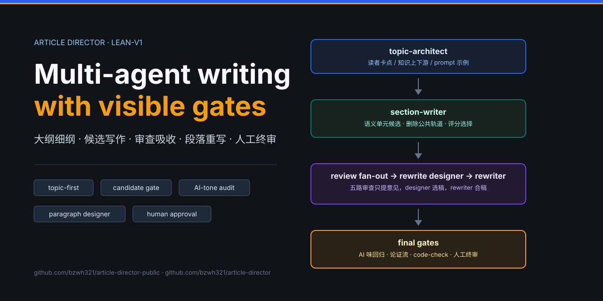
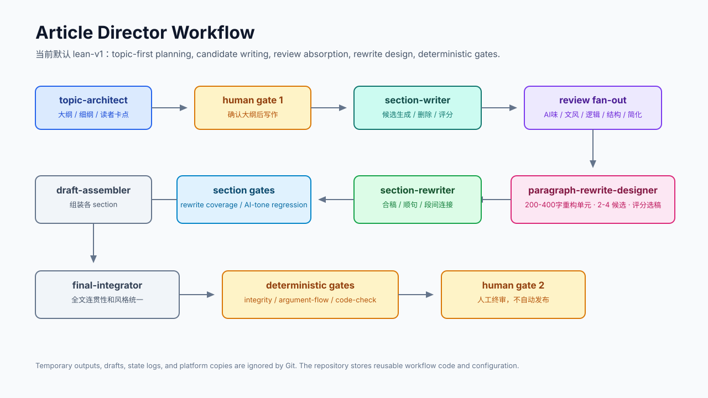
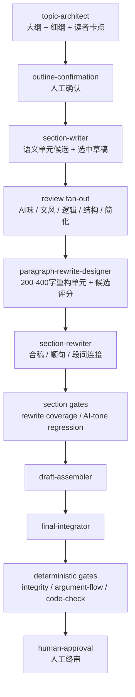

<p align="center">
  
</p>

<h1 align="center">Article Director</h1>

<p align="center">
  面向中文知识科普文章的多 Agent 写作工作流。当前版本把“大纲/细纲、候选写作、审查吸收、段落重写、终稿门禁”拆成可观察的链路，重点解决同质化表达、AI 味、读者卡点和下游可执行性。
</p>

<p align="center">
  
  
  
  
</p>

---

## 这一版解决什么

当前系统不只描述“几个 Agent”，而是把写作生产拆成三层：

| 层级 | 做什么 | 关键变化 |
| --- | --- | --- |
| 上游规划 | 先写大纲和细纲 | `topic-architect` 成为第一 agent；`article-architect` 暂时只是兼容 alias |
| 单节生产 | 每个二级章节独立写作和审查 | `section-writer` 先做语义单元候选；审查 fan-out 只提意见；`paragraph-rewrite-designer` 评分选方案；`section-rewriter` 合稿微调 |
| 全文收口 | 组装、统一、门禁、人工终审 | `final-integrator` 后接确定性检查：AI 味回归、论证流、结构完整性、code-check 和人工终审 |

它不是一次性让模型写完整篇文章，而是把文章拆成一组可审查、可重试、可回放的写作决策。

---

## 工作流图

<p align="center">
  
</p>



---

## 核心 Agent

| Agent | 当前定位 | 产物 |
| --- | --- | --- |
| `topic-architect` | 第一大纲/细纲 agent。负责读者卡点、知识上下游、逻辑顺序、prompt 示例、before/after 和展示方式 | `tmp/{topic_id}-detailed-outline.md`、`section-manifest.json` |
| `section-writer` | 单节写作。先锁定内容骨架，再按语义单元生成候选，删除公共轨道表达，评分选择一个草稿 | `sections/{section_id}/draft.md` |
| `section-reviewer` | 五路审查，只提意见，不改正文 | `review-ai-tone-findings.json`、`review-style.json`、`review-logic.json`、`review-structure.json`、`review-simplify.json` |
| `paragraph-rewrite-designer` | 把审查意见转成段落整改方案。对需要重构的 200-400 字单元生成 2-4 个候选并评分 | `paragraph-rewrite-design.json` |
| `section-rewriter` | 不重新评选候选，只按 designer 选中稿合稿、顺句、消残留 AI 味 | `section-editor-output.json`、`final.md` |
| `final-integrator` | 全文连贯性、风格统一、终稿收口 | `final-integrator-01/output.md`、最终草稿 |

可选支撑：

| Agent | 何时使用 |
| --- | --- |
| `deep-dive-researcher` | 需要论文、机制、开源实现或外部证据时 |
| `image-ui` | 文章需要配图、流程图或图片链时 |

---

## 候选写作机制

同质化表达不再只靠后期润色修。当前版本把“生成阶段允许多样，选择阶段变严格”放进 `section-writer` 内部：

1. 按细纲里的语义单元切分，不按单句切分，减少上下文割裂。
2. 每个单元先锁定事实、例子、字段、边界和上下文连接。
3. 生成 3 个表达候选。
4. 先删除公共轨道表达，例如空泛总结、讲台腔、固定对比壳、缺少工作对象。
5. 对剩余候选打分，低于阈值就删。
6. 如果可用候选少于 2 个，带着失败原因继续生成，最多 3 轮。
7. 下游只收到一个选中的 section 草稿，不改变原有 workflow 图。

这样候选差异主要发生在表达颗粒度、工作现场感、作者判断和自然语气上，不让候选变成“换一个格式写同一件事”。

---

## 审查到改写

审查链路分两步，避免 reviewer 直接改正文导致风格漂移：

| 步骤 | 责任 | 约束 |
| --- | --- | --- |
| `review fan-out` | 分别审 AI 味、文风、逻辑、结构、简化 | 只提问题，不代写 |
| `merge-edit-brief` | 确定性合并审查意见 | 保留来源和维度 |
| `paragraph-rewrite-designer` | 综合判断每个重构单元该怎么改 | 候选评分，选出近成稿 |
| `section-rewriter` | 做最后合稿和微调 | 不重新 judge，不新增事实 |

designer 的评分权重在当前版本里更偏向“吸收审查意见”和“读者易读”，同时保留轻量作者判断：

| 指标 | 权重 |
| --- | ---: |
| meaning_and_fact_preservation | 20 |
| review_absorption | 20 |
| de_ai_tone | 15 |
| reader_readability | 15 |
| workflow_scene | 10 |
| author_judgment_and_light_soul | 10 |
| section_connection | 10 |

---

## 大纲/细纲契约

`topic-architect` 不再用旧 strategy layer 硬套文章结构。策略现在更像可插拔的前置提示词包，细纲契约服务于写作可执行性：

| 检查项 | 目的 |
| --- | --- |
| 读者卡点 | 读者为什么会卡在这里 |
| 上下游承接 | 本段依赖前面什么，又把什么交给后面 |
| prompt 示例 | 需要例子时提前规划，不把责任完全丢给 writer |
| before/after | 需要对照时提前指定展示方式 |
| 逻辑难点 | 标出最容易跳步的位置 |
| writer 可执行信息 | 让 writer 知道该写任务、字段、表格、代码、案例还是边界 |

---

## 门禁

当前默认链路会在 section 和全文两个层面做确定性检查：

| 门禁 | 作用 |
| --- | --- |
| `section-rewrite-gate` | 检查重写是否消费 designer 方案、保留审查信息、没有漏改正文段 |
| `validate-ai-tone-audit` | 检查 AI 味审查上下文、source hash 和幂等键 |
| `ai-tone-regression` | 对 final.md 做确定性去 AI 味回归 |
| `final-draft-integrity` | 检查终稿结构和章节完整性 |
| `argument-flow-check` | 检查短气口堆叠、长推理段和章节顺序 |
| `code-check` | 运行发布前文章检查 |
| `human-approval` | 人工终审，Agent 不自动发布 |

最近一次完整测试使用题目《从提示词到 Schema：规范数据分析结论的输出》，已通过 AI 味扫描、论证流检查和 `code-check`，停在人工终审点。

---

## 快速开始

```powershell
# 1. 初始化 topic，并生成大纲/细纲
python skills/article-director/scripts/init_workflow.py `
  --topic-id "schema-data-analysis-conclusion" `
  --title "从提示词到 Schema：规范数据分析结论的输出" `
  --strategy knowledge-explainer `
  --workflow-mode lean-v1

# 2. 跑 workflow。Codex 模式下，agent 节点会生成 task packet，需要主会话写入并 submit。
python skills/article-director/scripts/workflow_runner.py `
  --script "skills/article-director/outputs/schema-data-analysis-conclusion/run_schema-data-analysis-conclusion.py" `
  --autonomous

# 3. 查看状态
python skills/article-director/scripts/workflow_runner.py `
  --script "skills/article-director/outputs/schema-data-analysis-conclusion/run_schema-data-analysis-conclusion.py" `
  --status
```

正式运行入口保持不变：

```text
init_workflow.py -> workflow_runner.py -> compile_expanded_workflow.py
```

---

## 目录结构

```text
内容生产/
├── AGENTS.md
├── README.md
├── docs/
│   ├── cover.svg
│   └── workflow.svg
├── agents/
│   ├── article-writer.md
│   ├── researcher.md
│   └── reviewer.md
└── skills/article-director/
    ├── SKILL.md
    ├── prompts.yaml
    ├── workflows/topology.yaml
    ├── file-conventions.yaml
    ├── agents/_index.yaml
    ├── agents/topic-architect/
    ├── agents/section-writer/
    ├── agents/paragraph-rewrite-designer/
    ├── agents/section-rewriter/
    ├── style-profiles/
    │   ├── author-soul.md
    │   └── author-soul-writer-contract.md
    ├── references/versions/
    └── scripts/
```

---

## 配置入口

| 文件 | 用途 |
| --- | --- |
| `skills/article-director/agents/_index.yaml` | agent 注册表，区分 active、alias、legacy 和 optional support |
| `skills/article-director/workflows/topology.yaml` | 人类可读 workflow 拓扑和 section loop |
| `skills/article-director/prompts.yaml` | agent 前置提示词与策略提示词包 |
| `skills/article-director/file-conventions.yaml` | 输出路径、生命周期和可见性 |
| `skills/article-director/style-profiles/author-soul.md` | 作者站位与判断风格 |
| `skills/article-director/style-profiles/author-soul-writer-contract.md` | writer 轻量 soul 契约 |
| `skills/article-director/references/versions/` | 关键流程变更记录 |

---

## 仓库说明

本项目会同步到两个 GitHub 仓库，名称刻意不同：

| 仓库 | 可见性 | 用途 |
| --- | --- | --- |
| `bzwh321/article-director` | private | 完整开发主库 |
| `bzwh321/article-director-public` | public | 对外可见镜像 |

`tmp/`、`state/`、`outputs/`、`platforms/` 和真实文章草稿默认不入 Git；仓库只保存 workflow、agent、提示词、脚本、文档和可复用配置。
