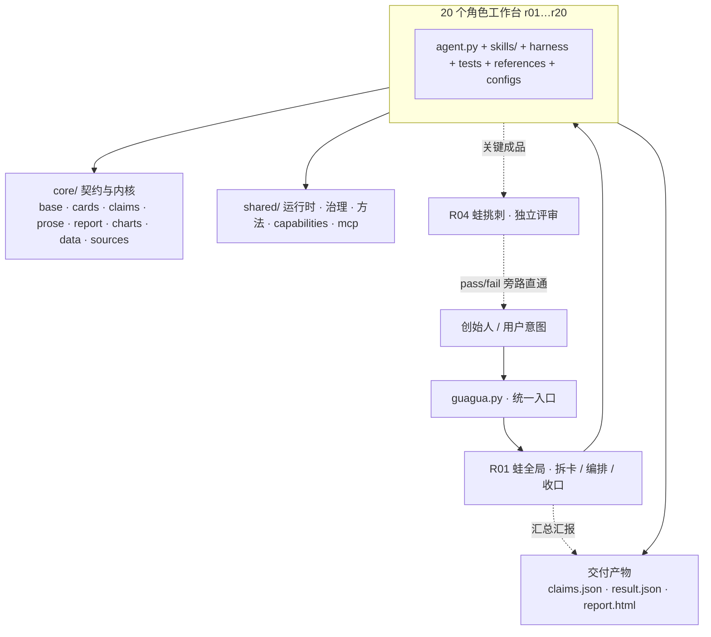
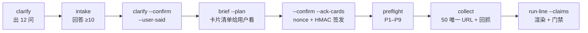

# 蛙蛙呱呱agents团 · 包内导航

> **完整手册在仓根**：[`../README.md`](../README.md)（20 角色详解、协作流水线、版本记录）。
> 本文件是包内 **60 秒导航 + 架构速览**，只做入口，**不重复角色正文**——双写必漂移（2026-11-17 体检结论）。

**一句话**：一个可本地运行、可审计、可编排的「一人公司 OS」——20 个角色，每个角色都有确定性 `agent.py` 与门禁；执行角色只交 `claims.json` / `result.json`，报告由 R01 统一出具，R04 独立验收。

---

## 架构速览



## 60 秒上手

```bash
cd 蛙蛙呱呱agents团

python guagua.py doctor                  # 环境 + 20 角色体检
python guagua.py roles                   # 花名册
python guagua.py info r06                # 某个角色的契约
python guagua.py call r06 --help         # 它的全部子命令
python guagua.py prompt --role r06 --intent "分析留存"   # 唯一提示词入口（chat 已废弃）

python guagua.py plan "停车场一年营收最大化"   # R01 拆任务卡
python guagua.py status
python guagua.py dispatch --all
```

---

## 报告产线 v14（拆卡线唯一默认 + 两段发卡）

分析不是写观点，是**先查源、再按卡取数、按格交付、最后合并成判断**。2026-11-23 起，拆卡线是唯一默认路线。



```bash
report clarify --intent "…" --out <项目>          # 出 12 问
report intake --dir <项目> --answer I1=…          # 记录回答（≥10 条才可签 brief）
report clarify --dir <项目> --confirm --user-said "用户原话"
report brief --dir <项目> --plan                  # 出映射表 + 卡片清单（不发卡）
report brief --dir <项目> --plan --confirm --ack-cards --user-said "用户原话"

report probe --dir <项目> --issue                 # ① 探源卡 → cards/r18/TASK.md
report probe --dir <项目>                         # ② 供给方案 → plan/supply.json
report preflight --dir <项目>                     # ③ 九项预检 P1–P9
report collect --dir <项目> --out <项目>/out       # 收卡 → claims_merged.json
report run-line --intent "…" --claims <项目>/out/claims_merged.json --out <项目>/out/report --pdf
```

**两段发卡**：第一次给 **r18 蛙数仓**查源（探源卡），第二次给执行层采数（采集卡）。少了探源那一步，采集卡只能写"去采品牌价格"，执行层要么采不到、要么自己编。

**人必须在环里**：12 问必须问给用户（`user_answers<10` 签不了 brief）；澄清确认必须带 `--user-said`；发卡前必须 `--plan` 把卡片清单给用户过目，确认带 `--ack-cards`。没有 `coverage/issued.json` 的项目，`collect` 直接拒收（老卡只有 `--allow-legacy` 且标降级）。

| 层 | 模块 | 产物 |
|---|---|---|
| 接活 12 问 + brief 签字 | `core/intake.py` | `intake.json` / `brief.json` |
| 拆卡格网（六维 MECE） | `core/cards/card_upgrade.py` | `plan/grid.json` |
| 探源卡（给 r18） | `core/cards/pipeline.py` | `cards/r18/TASK.md` → `data_catalog.json` |
| 可行性探测 + 供给方案 | `core/cards/pipeline.py` + `core/sources/supply_plan.py` | `plan/supply.json` |
| 卡就绪（DoR） | `core/cards/dor.py` | `plan/dor.json` |
| 派活校验（nonce + 签名 + 执行者） | `core/cards/pipeline.py` | `coverage/issued.json` |
| 预检九项（P1–P9） | `scripts/preflight.py` | 退出码 / PASS-FAIL |
| 收卡整备（归一/去重/冲突/覆盖） | `core/cards/pipeline.py` | `claims_merged.json` |
| 章节校验 + 渲染 | `core/report/report_flow.py` + `core/report/report_renderer.py` | `report.html` |

硬规则：**未注册 metric 拒收**；**图只许 query(raw)**；DoR 未过不发卡；brief 未签不拆卡；**没有 nonce 的卡不收**；**降级必须带 `degraded_from` + `L2_condition`**。

## 包内结构

```text
蛙蛙呱呱agents团/
├─ guagua.py              统一入口（project / prompt / plan / report / run / call / dispatch）
├─ chat.py                [已废弃] 兼容壳；提示词入口是 guagua.py prompt
├─ SKILL.md               Trae 技能入口（拆卡线默认 + 人环门禁）
├─ REPORT-STANDARD.md     汇报标准（唯一产线：R01 出具）
├─ 使用指南.md / AGENTS.md 使用手册 / 提交前自检清单
├─ core/                  机器契约与内核：base / cards / claims / prose / report / charts / data / sources…
├─ shared/                跨角色共享（role_runtime / methods / capabilities / mcp）
├─ r01-… r20-…            20 个角色（agent.py + skills/ + harness + tests + references + configs）
├─ configs/               rXX.yaml + report_card_spec / report_flow / report_coverage
├─ agent-packs/           宿主可直接加载的 20 份角色卡 + plugin.json
├─ avatars/               21 张角色头像（唯一源）
├─ docs/                  产线地图、门禁、导航（现行/历史见 docs/README.md）
│  └─ _entry/             ORG / PROTOCOL / CHANGELOG / TEAM / REPORT-BRIDGE-GUIDE / 人设
├─ 交付/                  仅 generic_semantics_v1.yaml 是代码依赖（勿删）
├─ tests/                 pytest 单测 + 回归 + prompt 回归 + evals 夹具
└─ scripts/               CI 门禁、preflight、生成器、镜像同步
```

> 头像只有 `avatars/` 一份源；`agent-packs/avatars/` 由 `scripts/gen_agent_packs.py` 生成。

---

## 20 个角色 → 去哪读

每个角色目录都是**完整工作台**（`SKILL.md` / `agent.py` / `skills/` / `engines/` / `references/` / `configs/` / `harness.py` / `tests/`）。工程细节看各角色的 `references/engineering-notes.md` 与 `agent.py --help`。

| ID | 花名 | 职位 | 技能卡 |
|---|---|---|---|
| r01-waquanju-ceo | 蛙全局 | CEO 主理人 / 编排器 | [`r01-waquanju-ceo/SKILL.md`](r01-waquanju-ceo/SKILL.md) |
| r02-wapaibu-coo | 蛙排布 | COO 首席运营官 | [`r02-wapaibu-coo/SKILL.md`](r02-wapaibu-coo/SKILL.md) |
| r03-washouxian-cfo | 蛙守线 | 财务合规官 / 红线负责人 | [`r03-washouxian-cfo/SKILL.md`](r03-washouxian-cfo/SKILL.md) |
| r04-watiaoci-reviewer | 蛙挑刺 | 独立评审官 | [`r04-watiaoci-reviewer/SKILL.md`](r04-watiaoci-reviewer/SKILL.md) |
| r05-washenyuan-research | 蛙深远 | 战略研究官 | [`r05-washenyuan-research/SKILL.md`](r05-washenyuan-research/SKILL.md) |
| r06-wadeqing-analyst | 蛙得清 | 数据分析师 | [`r06-wadeqing-analyst/SKILL.md`](r06-wadeqing-analyst/SKILL.md) |
| r07-wademing-pm | 蛙得明 | 产品经理 | [`r07-wademing-pm/SKILL.md`](r07-wademing-pm/SKILL.md) |
| r08-wajiancheng-mvp | 蛙建成 | 产品实现官（MVP） | [`r08-wajiancheng-mvp/SKILL.md`](r08-wajiancheng-mvp/SKILL.md) |
| r09-wawenma-engineer | 蛙稳码 | 代码工程官 | [`r09-wawenma-engineer/SKILL.md`](r09-wawenma-engineer/SKILL.md) |
| r10-wachengmei-design | 蛙成美 | 视觉设计官 | [`r10-wachengmei-design/SKILL.md`](r10-wachengmei-design/SKILL.md) |
| r11-wadianti-copy | 蛙点题 | 内容主笔 | [`r11-wadianti-copy/SKILL.md`](r11-wadianti-copy/SKILL.md) |
| r12-wayingliu-growth | 蛙引流 | 增长运营官 | [`r12-wayingliu-growth/SKILL.md`](r12-wayingliu-growth/SKILL.md) |
| r13-wakecheng-csm | 蛙客成 | 客户成功与销售运营官 | [`r13-wakecheng-csm/SKILL.md`](r13-wakecheng-csm/SKILL.md) |
| r14-wajiaoyi-commerce | 蛙交易 | 交易与收入履约官 | [`r14-wajiaoyi-commerce/SKILL.md`](r14-wajiaoyi-commerce/SKILL.md) |
| r15-wagongying-erp | 蛙供应 | ERP 与供应链运营官 | [`r15-wagongying-erp/SKILL.md`](r15-wagongying-erp/SKILL.md) |
| r16-warenshi-hr | 蛙人事 | 人员与组织运营官 | [`r16-warenshi-hr/SKILL.md`](r16-warenshi-hr/SKILL.md) |
| r17-wazhiwang-automation | 蛙织网 | 自动化与集成工程师 | [`r17-wazhiwang-automation/SKILL.md`](r17-wazhiwang-automation/SKILL.md) |
| r18-washucang-dataeng | 蛙数仓 | 数据工程与管道官 | [`r18-washucang-dataeng/SKILL.md`](r18-washucang-dataeng/SKILL.md) |
| r19-wazhimo-ml | 蛙智模 | 模型工程与 AI 评估官 | [`r19-wazhimo-ml/SKILL.md`](r19-wazhimo-ml/SKILL.md) |
| r20-washouzhi-sre | 蛙值守 | 可靠性与恢复官 | [`r20-washouzhi-sre/SKILL.md`](r20-washouzhi-sre/SKILL.md) |

## 关键文档

| 想知道 | 读 |
|---|---|
| 谁负责什么、向谁汇报、边界 | [`docs/_entry/ORG.md`](docs/_entry/ORG.md) |
| 任务怎么展开、移交、编排 | [`docs/_entry/PROTOCOL.md`](docs/_entry/PROTOCOL.md) |
| 报告写什么、怎么判合格 | [`REPORT-STANDARD.md`](REPORT-STANDARD.md) |
| 报告产线地图（拆卡默认 / A 数据 / B 应急） | [`docs/REPORT-LINES.md`](docs/REPORT-LINES.md) |
| 拆卡与防代写（nonce / 签名 / 收卡校验） | [`docs/archive/REPORT-DISPATCH.md`](docs/archive/REPORT-DISPATCH.md) |
| 新角色怎么接入报告产线 | [`docs/_entry/REPORT-BRIDGE-GUIDE.md`](docs/_entry/REPORT-BRIDGE-GUIDE.md) |
| 术语 / 入口 / 门禁 / 模块耦合 | [`docs/GLOSSARY.md`](docs/GLOSSARY.md) · [`docs/ENTRYPOINTS.md`](docs/ENTRYPOINTS.md) · [`docs/GATES.md`](docs/GATES.md) · [`docs/CORE-MAP.md`](docs/CORE-MAP.md) |
| 跨宿主入口（agents.md 标准） | [`AGENTS.md`](AGENTS.md) |
| 技能层规格 / 升级路线 | [`docs/SKILL-LAYER-SPEC.md`](docs/SKILL-LAYER-SPEC.md) · [`docs/archive/SKILL-MD-UPGRADE-PLAN.md`](docs/archive/SKILL-MD-UPGRADE-PLAN.md) |
| 文档现行/历史索引 | [`docs/README.md`](docs/README.md) |
| 更新日志（按日期记能力与迁移） | [`docs/_entry/CHANGELOG.md`](docs/_entry/CHANGELOG.md) |

## 四条铁律

1. 一个任务一个 owner——「共同负责」等于没人负责。
2. 生成与校验分离——谁生产谁不验收，验收归 `r04-watiaoci-reviewer`。
3. 不可逆动作必须创始人签字——裁员/关停/签合同/动资金不接受口头豁免。
4. 报告只有一个作者（R01）且只加方法不加章节——执行角色只交 `claims.json`；新增章节先扩契约。

## 提交前自检

见 [`AGENTS.md`](AGENTS.md) 的「提交前自检（全绿才算完）」。最少这三条：

```bash
python -m pytest tests -q -p no:cacheprovider
python scripts/preflight.py --dir <项目>
python scripts/sync_trae_skill.py --check
```
