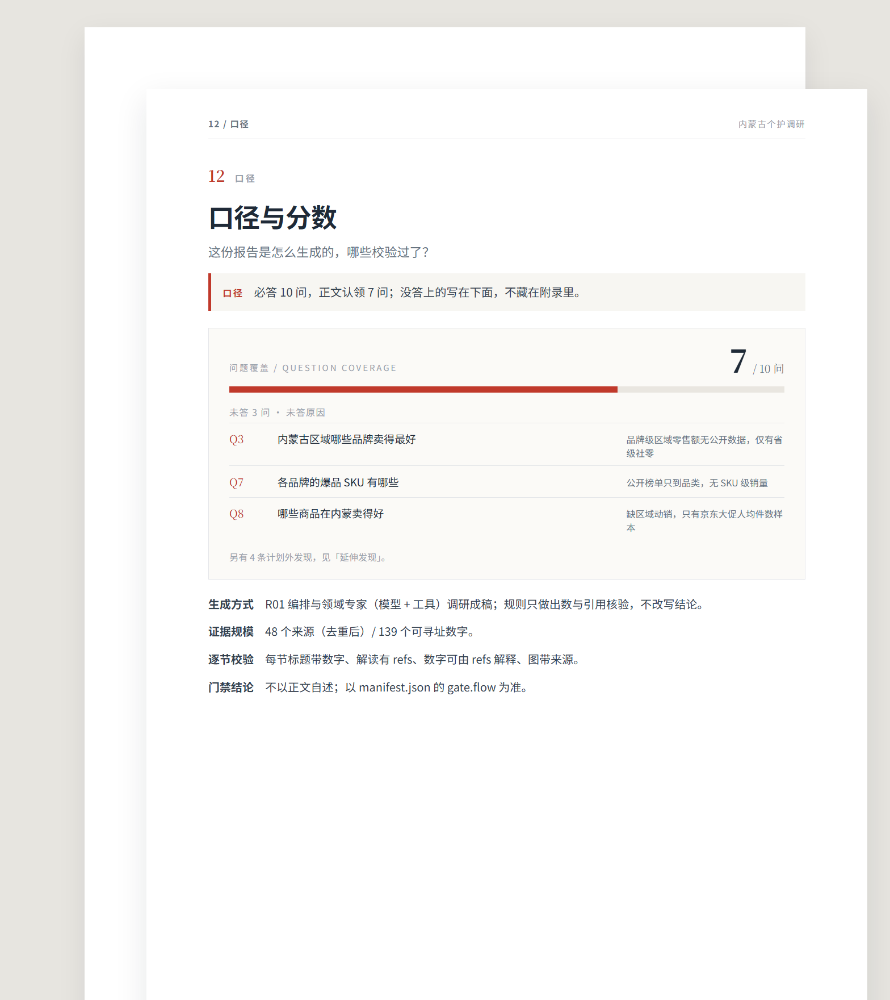
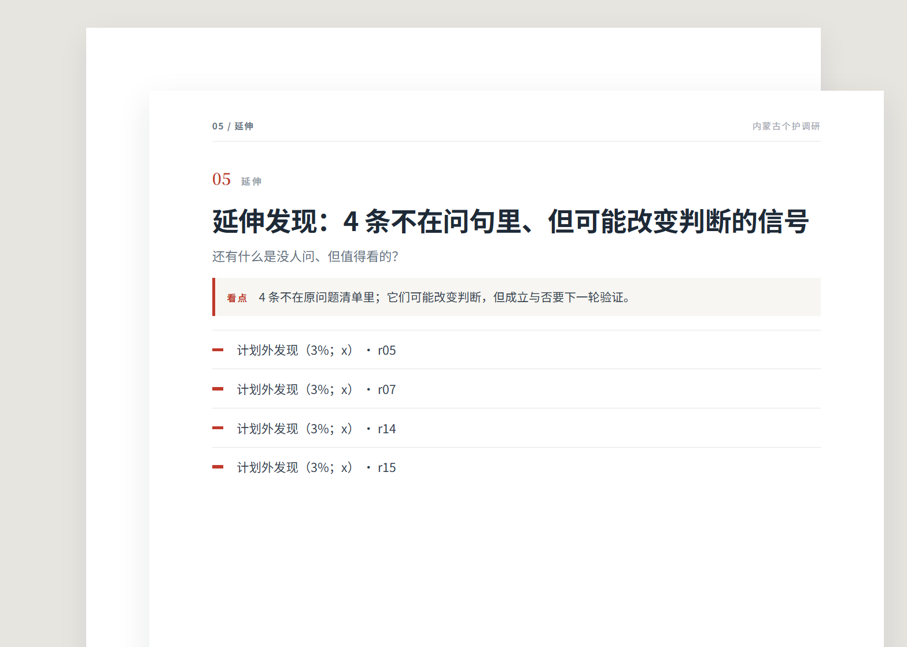

# 接任务 → 澄清 → 拆卡 → 派活 → 收卡校验（REPORT-DISPATCH.md）

> 一句话：**R01 不许"接了就干"。先和你对齐意图，再把问题拆到人头上，
> 每张卡带 nonce 发出去，收卡时验执行者；自己代写的卡直接拒收。**

## 1. 为什么加这三道

2026-11-20 的个护测试里，同一个 R01 干了四件事：拆题、写 6 张卡、把 6 张卡的
`claims.json` 全写了、再自称"4 个角色只交 claims.json"。产线上没有任何一处
能反驳这句话。根因有两条，都在代码里：

1. `TASK.md` 写着「**你要判断什么（自己定，不要等我给）**」，
   `brief.json` 的 `what_to_research` = 「系统不预设问题清单」——**拆卡被设计成不拆**；
2. `report brief` 只写文件，没有分发通道、没有执行者记录——**派活被设计成不发**。

结果：6 张卡内容重叠、用户真正问的"品牌清单/爆品清单"没人认领，
R01 只好自己写。

## 2. 四段流程

```bash
# 1) 出澄清卡：我理解成什么 + 我准备答哪几问 + 默认假设 + 需要你拍的 3–5 件事
python guagua.py report clarify --intent "<你的一句话>" --out <项目>
#    看 <项目>/clarify.md；不同意就改 clarify.json 里的 asks / assumptions / confirm
python guagua.py report clarify --dir <项目> --confirm

# 2) 出「问题 → 角色」映射表（只出表，不发卡）
python guagua.py report brief --dir <项目> --plan
#    看 <项目>/plan.md；不同意就改 plan.json 里的 mapping[].primary
python guagua.py report brief --dir <项目> --plan --confirm   # 确认即发卡

# 3) 执行者按卡交 <项目>/cards/<role>/claims.json（必须回填 dispatch 块）

# 4) 收卡：nonce/role/by 校验不过 → 整卡拒收
python guagua.py report collect --dir <项目> --out <项目>/out --intent "…" \
       --min-sources 50 --allow-degraded
```

四段各留一个文件，谁改了什么都能回看：

| 文件 | 作用 | 谁写 |
|---|---|---|
| `clarify.json` / `clarify.md` | 意图、问句清单、默认假设、待你拍的事项 | 产线出，人改 |
| `plan.json` / `plan.md` | 问题→角色映射（主责/协办/不归谁） | 产线出，人改 |
| `cards/<role>/TASK.md` | 这张卡**只**答 Qx/Qy，并列出"不归你" | 产线发 |
| `coverage/issued.json` | 每张卡的 nonce + 签名 + 问句 | 产线发，**执行者不可改** |

## 3. 拆卡规则（确定性，不靠模型拍脑袋）

- 问句：按中文标点把意图拆成 Q1..Qn（最多 10 条），标注类型
  （清单/量化/排序/价格/机制/时间/增长/归因/判断）与"必须答"；
- 路由：`类型首选 + 关键词命中 + 角色能力`三项加权，选分最高者；
  **r01（作者）与 r04（验收）不下场执行**；
- 负载：一个角色最多 3 问，超出的只改派给"**真有分数**"的角色——
  没人能答的问题宁可留在研究官，也不丢给 SRE（2026-11-20 踩过）；
- 兜底：所有角色都 0 分时落到 r05，不允许"没人负责"。

## 4. nonce 与"代写"判定

`coverage/issued.json` 每张卡：

```json
{"r15": {"nonce": "5a26a0eb45433c9f", "sig": "hmac-sha256(role|nonce|qids)",
          "questions": ["Q5"]}}
```

执行者的 `claims.json` 必须回填：

```json
{"dispatch": {"nonce": "5a26a0eb45433c9f", "role": "r15",
               "by": "<执行者 id>", "questions": ["Q5"]}}
```

`collect` 逐卡校验，任一条不过就拒收整卡：

| 检查 | 不过的后果 |
|---|---|
| `issued.json` 里有没有这个角色 | 拒收："没有发过卡" |
| `nonce` / `role` 与卡一致 | 拒收："串卡或事后补写" |
| `sig` 用本机密钥重算一致 | 拒收："卡被动过" |
| `questions` 与卡一致 | 拒收："回填问句与卡不一致" |
| `by` 非空，且不是 `r01/solo/orchestrator/auto` | 拒收："执行者填的是 r01，视为代写" |

签名密钥在 `~/.guagua/dispatch_key`（首次自动生成，0600）。
它不是密码学护城河——R01 理论上能读；但它把"代写"从**默认动作**变成
**一次显式伪造**，并且会在 `issued.json` 与 claims 之间留下对不上的痕迹。

## 5. 老项目怎么办

没有 `coverage/issued.json` 的项目按**老卡**处理：

- 不拒收，但 `merged.dispatch.mode = "legacy"`；
- `merged.degraded` 会加上 `legacy_dispatch`，一路带到 `manifest.degraded`；
- `report attest` 会把降级打出来。

也就是说：老项目还能出报告，但产物上会明写"这次没有走 nonce 派活"。
要升级，就在项目里补跑第 1、2 步（clarify → plan → issue），再让角色按新卡交。

## 6. 验收看什么

```bash
python guagua.py report attest --out <out>     # 门禁/来源/核验/降级（含 legacy_dispatch）
python -c "import json;print(json.load(open(r'<out>/manifest.json'))['dispatch'])"
```

`manifest.dispatch` 长这样：

```json
{"mode": "nonce", "issued": 5, "verified": 5, "rejected": []}
```

`mode=legacy` 或 `rejected` 非空，就说明这一轮的"专家团"没有真的被派活。

---

# 第二部分：卡片 v2（2026-11-20 晚，回应"卡片写得不够好"）
## 7. 旧卡的四个病，和新卡的对应

| 旧卡 | 新卡 |
|---|---|
| 「你要判断什么（自己定）」 | 写死 Qx/Qy，并列出"不归你" |
| 只写交什么格式 | 写「什么算答好」五条判据（可比点/三层/证伪/发散/协商） |
| 互相不知道对方存在 | `needs.json` 声明依赖，`report exchange` 路由，`collect` 查闭环 |
| 只有"交上来"，没有"交不了" | `unanswered` 结构化：试过哪些 url、为什么答不了 |

## 8. 工单五段

```
1. 你负责回答什么   —— 每问三段：事实 / 机理 / 反例（缺反例=没深入）
2. 什么算答好       —— 5 条判据，缺一条这一问不算过
3. 你可以向谁要什么 —— needs.json + INBOX
4. 发散槽           —— 2 条"没人问但关键"的发现，必须带数字与来源
5. 交不了怎么办     —— unanswered：tried[] + why
```

**发散不能靠鼓励，得靠格子。** 第 4 段是硬性交付：不给这个槽，角色只会回答被问的；
给了，它才可能挖出"包头是唯一正号"这种不在问句里的关键原因。

## 9. 卡间协商（一批发卡也能交互）

```bash
report brief --dir <项目> --plan --confirm    # 一次发完，每卡带 needs.json
# 角色 A 写 needs.json → to=B, what=…
report exchange --dir <项目>                  # 投到 cards/B/INBOX.md，出 exchange.md 台账
# B 写 answers.json（value + source_file，或 declined + 原因）
report collect --dir <项目> --out <项目>/out   # open 的 need → 拒收（--allow-open-needs 放行）
```

规则：**空壳回答不算回答**（必须有 value/quote，或明确 declined + 原因）。
所以"我给你了"这句话，在产物上必须有一条带来源的记录。

## 10. 问题对账（Q → section）

每个 section 加 `"answers": ["Q3"]` 声明它回答哪一问。`collect` 汇总：

```json
"questions": {"must": ["Q1","Q2","Q3","Q4","Q5"],
              "claimed": ["Q1","Q4","Q5"],
              "unanswered": ["Q2","Q3"],
              "coverage": 0.6, "explore": 4}
```

- 只有 **must** 参与覆盖率；support 是给正文补口径的，不单独成节；
- `unanswered` 会写进报告「口径与分数」节，并进 `manifest.questions`；
- `report attest` 会打一行：`问题对账：必答 5 问 / 正文认领 3 问；未答 Q2、Q3`。

### 10.1 这块放在口径页，不放第一屏（2026-11-20 定）

把"必答 10 问 / 答了 7 问"做成正文第一屏，读者会觉得拿到的是审计日志。
所以做成口径页上的**一块**：大数字 + 进度条 + 未答清单（带原因），正文不打扰。



渲染约定：
- 数据在 `contract.sections[口径].coverage`（must / claimed / items[] / explore）；
- `core/report_theme/pages.py::_coverage_panel` 出 HTML，flow 与 consulting 共用；
- 面板出现时，正文自动去掉重复的「问题对账」段落（避免同一件事说两遍）；
- 口径页的"结论"改成覆盖结论（"必答 10 问，正文认领 7 问；没答上的写在下面"），
  不再是"生成方式"的复述。

## 11. 状态：两块已做，一块仍留

1. **延伸发现已经成节**（2026-11-20 晚修）：
   角色在 `explore` 里交的东西，过去只被 `len()` 数了一下、正文不渲染，
   而口径页却写着「见「延伸发现」」——指向一节不存在的章节。
   现在会在正文末尾（口径页之前）自动生成一节，列表呈现，每条带数字/原因/角色。

   

2. **support 问句仍会单独成节**：渲染层还没把 support 并进它服务的 must 那节。
   影响是"节数偏多"，不是"信息丢失"，所以先留着。
   要做的话得改 `build_sections_contract` 的节合并（正文、refs、图都要重新拼），风险高于收益。


